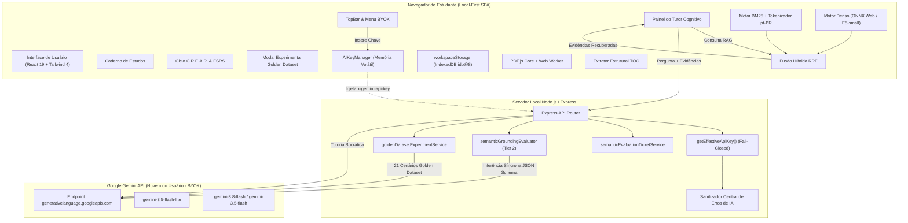
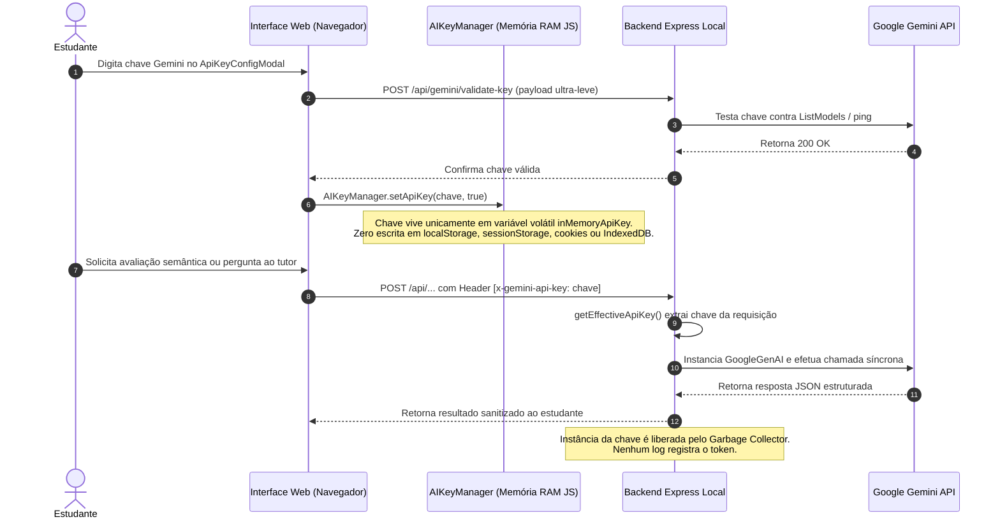

# DOSSIÊ TÉCNICO DE ENGENHARIA E CONSOLIDAÇÃO DO PROJETO
# NEUROCLASS AI — AMBIENTE DE APRENDIZAGEM ASSISTIDA POR IA

**Responsável pelo Projeto:** Eric Pimentel  
**Data de Referência Técnica:** 16 de Novembro de 2026  
**Status do Projeto:** Fase 2 Consolidada / Protótipo Funcional Local-First / Tier 2 Experimental Integrado  
**Repositório Oficial:** `https://github.com/enps2015/neuroClassAI.git`  
**Branch de Consolidação:** `feature/fase2-aprendizagem-cognitiva`  
**HEAD de Referência:** `987c2682e9878b180cca309735abd0e081e5b85a`  
**Artefato de Evidência Experimental:** `docs/evidence/golden_dataset_run_1794846178874.json`

---

## 1. RESUMO EXECUTIVO

### 1.1 O que é o NeuroClass AI
O **NeuroClass AI** é uma plataforma educacional e ambiente de estudo assistido por Inteligência Artificial, concebido para transformar materiais didáticos próprios do estudante (especialmente apostilas, artigos científicos e livros em PDF) em uma experiência de estudo profundo, estruturado e cognitivamente ativo. A aplicação opera sob o paradigma *local-first*, processando e indexando documentos diretamente no navegador do usuário, com persistência local em IndexedDB e armazenamento de arquivos em pasta local autorizada.

### 1.2 Qual problema pretende resolver
Os modelos de linguagem contemporâneos (LLMs), quando utilizados diretamente por estudantes como tutores conversacionais, apresentam falhas críticas para a educação superior e profissional:
1. **Alucinações factuais não detectadas:** Geração de afirmações aparentemente convincentes, porém desprovidas de respaldo nos textos de referência.
2. **Desconexão com o material didático do curso:** Dificuldade de restringir as respostas ao escopo pedagógico exato das ementas e dos livros adotados.
3. **Ausência de rastreabilidade:** Respostas genéricas sem indicação de página, parágrafo ou trecho original que permitam ao estudante checar a fonte primária.
4. **Passividade cognitiva:** O estudante consome respostas prontas em vez de ser estimulado a elaborar, sintetizar e recuperar ativamente os conceitos.

O NeuroClass AI resolve essa lacuna implementando um **Tutor Cognitivo Fundamentado** integrado a um mecanismo de recuperação híbrida (RAG Léxico BM25 + Vetorial Denso), um contrato determinístico de citações estruturais e uma camada de auditoria semântica seletiva.

### 1.3 Público e contexto de utilização
- **Público-alvo:** Estudantes de pós-graduação, graduação, pesquisadores e profissionais de áreas densas em evidências científicas (originalmente focado em Neurociências e Comportamento, estendido para 7 grandes áreas do conhecimento humano).
- **Ambiente de uso:** Estudo individual no computador (desktop), sessões prolongadas de leitura, anotação e autoavaliação com privacidade estrita (modo BYOK — *Bring Your Own Key*).

### 1.4 Diferenciais pretendidos
- **Confiabilidade Epistêmica em Duas Camadas:**
  - *Tier 1 (Determinístico local):* Segmentação sintática de afirmações, detecção de sentenças sem citação e checagem de números/grandezas sem chamada a LLM.
  - *Tier 2 (Semântico sob demanda):* Auditor cético acionado apenas pelo estudante para avaliar se o trecho citado sustenta a afirmação.
- **Ciclo Metacognitivo C.R.E.A.R.:** Metodologia pedagógica estruturada em cinco estágios: *Contextualizar*, *Relacionar*, *Explicar* (técnica de Feynman), *Aplicar* (estudo de casos) e *Recuperar* (recuperação ativa com repetição espaçada FSRS).
- **Zero Persistência Central de Credenciais:** As chaves de API do usuário nunca são gravadas em disco, cookies, localStorage ou IndexedDB, residindo exclusivamente em memória volátil de sessão.

### 1.5 Estado atual do desenvolvimento
- **O que efetivamente funciona:**
  - Importação de PDFs com extração de texto, sumário hierárquico (TOC) e geração de miniaturas de página via PDF.js.
  - Armazenamento local-first em IndexedDB (`idb@8`) e contingência para pasta local (FileSystem Access API).
  - Indexação léxica BM25 pura com tokenização morfológica em português.
  - Tutor conversacional com injeção de trechos recuperados e contrato de citações determinísticas `[C1]`, `[C2]`.
  - Caderno de estudos integrado com vinculação de notas a páginas e trechos citados.
  - Repetição espaçada algorítmica baseada no modelo matemático FSRS-6/7 (`ts-fsrs`).
  - Reconhecimento de voz (STT contínuo Web Speech com fallback de gravação MediaRecorder) e síntese de voz (TTS).
  - Painel de configuração BYOK seguro e painel experimental do Golden Dataset (Tier 2).
- **O que está parcialmente implementado / requer validação adicional:**
  - Busca vetorial densa local (`multilingual-e5-small` via ONNX Runtime Web / Transformers.js): componentes e workers implementados, mas a inferência pesada no navegador de máquinas modestas demanda teste de stress de memória.
  - OCR local em Tesseract.js para PDFs escaneados: fluxo implementado via modal de consentimento, mas sensível a ruídos tipográficos severos.
  - Interação bidirecional de áudio em tempo real com Gemini Live: projetada e prototipada via fallback HTTP streaming, porém sem conexão direta WebSockets duplex nativa do Gemini Live API.
- **O que precisa ser desenvolvido:**
  - Validação longitudinal com estudantes reais em cenários de estudo contínuo.
  - Adjudicação independente por comitê humano de gabaritos em datasets de neurociência de larga escala.
  - Refatoração dos tipos TypeScript para resolver pendências estáticas apontadas pelo compilador.

---

## 2. VISÃO ORIGINAL E CONCEPÇÃO DA APLICAÇÃO

O NeuroClass AI nasceu da visão do pesquisador e criador **Eric Pimentel**, no contexto de seus estudos de pós-graduação em Neurociências e Comportamento. 

A concepção original estabelece que o computador pessoal do estudante deve atuar como uma **sala de aula particular de alto nível acadêmico**:
1. **O estudante traz seus próprios livros:** A aprendizagem não ocorre em um vácuo de conhecimento genérico da internet, mas ancorada estritamente nas obras e artigos que o estudante selecionou para sua formação.
2. **O tutor não é um oráculo que tudo sabe, mas um orientador cético:** O tutor socrático deve provocar o pensamento crítico, apontar onde a evidência é forte e onde é frágil, e nunca fazer afirmações desprovidas de respaldo nos capítulos lidos.
3. **Rastreabilidade absoluta:** Cada parágrafo gerado pelo tutor deve poder ser clicado, abrindo imediatamente a página exata do PDF com o trecho correspondente destacado.
4. **Caderno inteligente de notas vivas:** Em vez de anotações soltas em cadernos físicos ou editores desvinculados, as notas são entidades que guardam o link permanente para a página do livro, o conceito neurobiológico e os testes de retenção futura.
5. **Aprender explicando:** Inspirado na Técnica de Feynman, o módulo *Agora Eu Explico* desafia o estudante a falar ou digitar com suas próprias palavras, enquanto a IA avalia a precisão conceitual e aponta lacunas de raciocínio.
6. **Voz natural:** O estudante deve poder caminhar pela sala com um headset, conversando por voz com o tutor sobre as sinapses e circuitos cerebrais estudados, sem precisar ficar colado ao teclado.

---

## 3. REQUISITOS FUNCIONAIS IDEALIZADOS E SITUAÇÃO REAL

Abaixo, catalogamos os requisitos concebidos pelo projeto e seu estado verificado no código-fonte em 16/11/2026:

| Requisito Idealizado | Classificação | Situação no Código | Módulo / Evidência |
| :--- | :---: | :--- | :--- |
| **RF-01: Importação de PDF local** | **Implementado** | Suporta arrastar/soltar e seleção de arquivos locais; extração de páginas e texto via PDF.js. | `src/services/documents/pdfService.ts` |
| **RF-02: Sumário Estrutural (TOC)** | **Implementado** | Extrai hierarquia de capítulos, seções e páginas; mapeia destinos nominais do PDF. | `src/services/ai/tocStructuralContextService.ts` |
| **RF-03: Busca Léxica BM25** | **Implementado** | Tokenizador em português, remoção de stopwords, normalização morfológica e scoring BM25. | `src/services/retrieval/bm25SearchService.ts` |
| **RF-04: Busca Vetorial Densa Local** | **Parcialmente Implementado** | Worker ONNX Runtime com `multilingual-e5-small`; fusão RRF implementada; pesado em navegadores sem WebAssembly SIMD acelerado. | `src/services/retrieval/workers/` |
| **RF-05: Contrato Citações P3.1** | **Implementado** | Geração e validação de tags `[C#]`; expurgo de tags alucinadas; contagem no frontend. | `src/services/retrieval/tutorContextBuilder.ts` |
| **RF-06: Verificação Tier 1** | **Implementado** | Segmentação por sentença, checagem de números factuais vs estruturais sem chamada a LLM. | `src/services/retrieval/claimSegmenter.ts` |
| **RF-07: Avaliação Tier 2** | **Implementado** | Avaliação semântica opt-in via Gemini com tickets criptográficos em memória e serialização segura. | `src/services/ai/semanticGroundingEvaluator.ts` |
| **RF-08: Caderno de Estudos** | **Implementado** | Criação, edição e exportação Markdown; vinculação a páginas múltiplas e trechos citados. | `src/components/notebook/StudyNotebook.tsx` |
| **RF-09: Ciclo C.R.E.A.R.** | **Implementado** | Cinco estágios cognitivos com modais dedicados de aplicação, explicação e recuperação. | `src/components/crear/` |
| **RF-10: Repetição Espaçada FSRS** | **Implementado** | Algoritmo FSRS-6/7 matemático calculando estabilidade, dificuldade e agendamento de revisões. | `src/components/review/SpacedReviewModal.tsx` |
| **RF-11: Interação por Voz (STT/TTS)** | **Implementado** | Web Speech API com fallback de áudio via backend e gravação no microfone; controle de velocidade. | `src/services/voice/` |
| **RF-12: Gemini Live Bidirecional** | **Projetado** | Apenas simulação e streaming HTTP; integração duplex WebSockets WebRTC do Live API não implementada. | N/A (Pendente) |
| **RF-13: Segurança BYOK Estrita** | **Implementado** | Chave em memória volátil, header HTTP por requisição, zero persistência em disco. | `src/services/ai/aiKeyManager.ts` |
| **RF-14: Quadro Didático de Conceitos** | **Implementado** | Visualização em SVG de rede conceitual e DAG de pré-requisitos navegável. | `src/components/blackboard/Blackboard.tsx` |

---

## 4. ARQUITETURA TÉCNICA DO SISTEMA

### 4.1 Visão Geral dos Componentes



### 4.2 Frontend
- **Framework & Ferramentas:** React 19, TypeScript 5.8, Vite 8, Tailwind CSS v4, Motion (animações de transição), Lucide React (ícones).
- **Processamento de Documentos:** `pdfjs-dist@4.10.38` com worker isolado servido com cabeçalho estrito `application/javascript`.
- **Persistência de Dados no Cliente:** IndexedDB encapsulado por `idb@8` em múltiplos object stores (`documents`, `analyses`, `notes`, `chat_sessions`, `file_blobs`, `visual_resources`).
- **Recuperação e RAG Local:**
  - Tokenizador BM25 com stemming leve, filtro de pontuação e stoplist para Português do Brasil.
  - Chunking de documentos com preservação de fronteiras de parágrafo e metadados estruturais de página.
  - Fusão Recíproca de Ranks (RRF — *Reciprocal Rank Fusion*) ponderando scores léxicos e densos.

### 4.3 Backend
- **Ambiente:** Node.js (compatível com v20+, homologado na v24.19.0), Express 4.
- **SDK de Inteligência Artificial:** `@google/genai@2.4.0` oficial.
- **Segurança de Execução:** Modo `byok-only` imposto em produção (rejeita requisições sem `x-gemini-api-key` com HTTP 401 `UNAUTHORIZED_BYOK_REQUIRED`).
- **Arquitetura de Tickets:** `semanticEvaluationTicketService` gerencia identificadores opacos (`evaluationHandle`) de uso efêmero (TTL de 10 minutos, limite de 5 utilizações, capacidade máxima de 100 tickets em política LRU).

---

## 5. SEGURANÇA E GERENCIAMENTO DE API (ARQUITETURA BYOK)

O projeto rejeita categoricamente o modelo tradicional de backend centralizado armazenando chaves de usuários em banco de dados ou arquivos de texto.



### Limitações e Riscos do Mecanismo BYOK
1. **Volatilidade Total:** Ao pressionar F5 (recarregar página) ou fechar a aba, a chave é imediatamente apagada da memória. O estudante precisa inseri-la novamente a cada nova sessão.
2. **Segurança de Extensões do Navegador:** Como a chave transita na memória do JavaScript e nos cabeçalhos HTTP do `fetch`, extensões maliciosas com permissão de inspeção de rede instaladas no navegador do estudante poderiam interceptar o cabeçalho.
3. **Restrições de API no Google Cloud:** Chaves do Google AI Studio com restrições manuais incorretas no Google Cloud Console (ex: selecionar "Gemini API" em vez de "Generative Language API") causam erro na borda (`ACCESS_TOKEN_TYPE_UNSUPPORTED`), exigindo suporte de configuração.

---

## 6. HISTÓRICO TÉCNICO E EVOLUÇÃO DAS FASES (P1 A P3.2.2.2)

O desenvolvimento técnico do NeuroClass AI foi conduzido por missões sequenciais rigorosas, cada qual corrigindo fragilidades epistemológicas da fase anterior:

### P1 — Integridade das Anotações e Persistência
- **Foco:** Eliminar perda de anotações no Caderno de Estudos e garantir integridade referencial.
- **Entregas:**
  - Preservação estrita de metadados (`documentId`, `pageNumber`, `pageSources`, `associatedConceptId`, `tags`) durante operações de edição de notas.
  - Correção de divergências de tipos entre anotações com página única (`pageNumber: number`) e anotações agregadas de múltiplas páginas (`pageSources: number[]`).
  - Mitigação de operações não atômicas de gravação híbrida entre pasta local (FileSystem Access API) e IndexedDB.

### P2.1 — Estrutura Documental e Sumário (TOC)
- **Foco:** Contextualização macroestrutural do documento no prompt do tutor.
- **Entregas:**
  - Extração de outlines hierárquicos de PDFs e tratamento de páginas e destinos não resolvidos.
  - Injeção da árvore do sumário no prompt do tutor via `buildStructuralContext()`, permitindo ao modelo situar o capítulo atual na obra completa.
  - Correção de bugs de *variable shadowing* que distorciam os intervalos de páginas sugeridos nos chunks.

### P3.1 — Citações Estruturalmente Verificáveis
- **Foco:** Acabar com a ilusão de citações fabricadas pelo modelo.
- **Entregas:**
  - Substituição de citações soltas por tags temporárias controladas por requisição: `[C1]`, `[C2]`, etc.
  - O backend injeta os excertos numerados no prompt e intercepta a resposta do modelo via `parseAndValidateCitations()`.
  - Tags alucinadas (que citam `[C9]` quando só existiam `[C1]` a `[C3]`) são sumariamente expurgadas do texto antes da exibição ao estudante.
  - As notas geradas a partir do chat herdam estritamente as citações verificadas.
  - **Limitação Epistêmica Identificada:** Ter uma tag estruturalmente válida comprova que o modelo referenciou um trecho existente, mas **não comprova** que o trecho de fato sustenta o que a frase diz.

### P3.2.1 — Verificações Determinísticas Locais (Tier 1)
- **Foco:** Primeira camada de auditoria de fundamentação sem adicionar custo de latência ou tokens de LLM.
- **Entregas:**
  - Segmentador sintático de afirmações (`claimSegmenter.ts`).
  - Classificação de sentenças em quatro categorias locais:
    1. `UNCITED_SEGMENT`: Afirmações com alegações materiais factuais que não possuem citação associada.
    2. `NUMERIC_REVIEW_REQUIRED`: Sentenças contendo grandezas, datas ou dosagens cuja correspondência numérica com o trecho citado precisa ser revisada.
    3. `NO_DETERMINISTIC_ALERT`: Sentenças que passaram nas checagens locais determinísticas.
    4. `UNASSESSED`: Sentenças que não contêm afirmações factuais verificáveis.
  - Tratamento de números estruturais (não alertar sobre itens de listas "1.", capítulos "Capítulo 3" ou páginas "p. 15").
  - Identificação heurística de formulações hipotéticas ou didáticas ("imagine que...", "suponha...").

### P3.2.2.1 — Protótipo de Avaliação Semântica Seletiva (Tier 2)
- **Foco:** Avaliação semântica real entre a afirmação produzida e a evidência citada.
- **Entregas:**
  - Execução exclusivamente sob demanda (opt-in do estudante através do botão *"Verificar fundamentação"* no painel do tutor).
  - Emissão de ticket criptográfico temporário em memória (`evaluationHandle`).
  - Auditoria via modelo Gemini independente utilizando persona de auditor cético acadêmico.
  - Saída estruturada obrigatória via JSON Schema estrito, classificando cada segmento em 5 níveis de sustentação (`SUPPORTED`, `PARTIALLY_SUPPORTED`, `NOT_SUPPORTED`, `CONTRADICTED`, `INSUFFICIENT_EVIDENCE`) e 9 tipos de relação lógica (`direct_paraphrase`, `reasonable_inference`, `unwarranted_extrapolation`, `causal_leap`, `species_generalization`, `modality_shift`, `direct_contradiction`, `irrelevant_evidence`, `unclear_relationship`).
  - Hardening contra injeção de prompt: dados de documentos serializados em JSON seguro com escape de tags (`<\\/untrusted_document_data>`).

### P3.2.2.2 — Integração BYOK do Golden Dataset e Testes Reais
- **Foco:** Validação empírica do Tier 2 contra o Golden Dataset canônico de 21 cenários congelados.
- **Entregas:**
  - Adaptação do fluxo experimental para consumir a credencial BYOK ativa da interface em vez de requisições por `.env` ou CLI.
  - Implementação do [GoldenDatasetModal.tsx](file:///home/anunnaki/Downloads/Pos_Neurociencias_Comportamento/neuroClassAI-work/src/components/experimental/GoldenDatasetModal.tsx) com trava de duas fases (executa obrigatoriamente GD-01 primeiro e exige autorização humana para os 20 casos restantes).
  - Execução bem-sucedida dos 21 cenários com o modelo real `gemini-3.5-flash-lite`.

---

## 7. INVENTÁRIO DO CÓDIGO IMPLEMENTADO

Abaixo mapeamos os módulos e serviços reais presentes na árvore do projeto:

| Módulo / Arquivo | Situação | Função Principal | Testes Associados |
| :--- | :---: | :--- | :--- |
| `src/services/ai/aiKeyManager.ts` | **Concluído** | Gerenciador volátil da chave Gemini em RAM. | `src/tests/byok_and_multidisciplinary.test.ts` |
| `src/services/ai/aiClient.ts` | **Concluído** | Cliente HTTP com injeção de `x-gemini-api-key` e circuit breaker. | `src/tests/byok_and_multidisciplinary.test.ts` |
| `src/services/ai/semanticEvaluationTicketService.ts` | **Concluído** | Gestão de tickets efêmeros com TTL de 10 min e capacidade 100 LRU. | `src/tests/rag_semantic_grounding.test.ts` |
| `src/services/ai/semanticGroundingEvaluator.ts` | **Concluído** | Prompt do auditor cético, JSON Schema e validação estrita. | `src/tests/rag_semantic_grounding.test.ts` |
| `src/services/ai/goldenDatasetExperimentService.ts` | **Concluído** | Carregamento dos 21 cenários e cálculo de concordância. | `src/tests/golden_dataset_experiment.test.ts` |
| `src/services/ai/tocStructuralContextService.ts` | **Concluído** | Extração e injeção do sumário estrutural de PDFs. | `src/tests/phase2_structural_toc.test.ts` |
| `src/services/retrieval/tutorContextBuilder.ts` | **Concluído** | Geração e mapeamento de citações controladas `[C#]`. | `src/tests/rag_citations_contract.test.ts` |
| `src/services/retrieval/claimSegmenter.ts` | **Concluído** | Segmentação sintática e checagens locais Tier 1. | `src/tests/rag_deterministic_grounding.test.ts` |
| `src/services/retrieval/bm25SearchService.ts` | **Concluído** | Motor de busca léxica local com ranking BM25. | `src/tests/rag_bm25.test.ts` |
| `src/services/retrieval/hybridSearchService.ts` | **Parcial** | Fusão RRF de rankings léxico e denso. | `src/tests/rag_hybrid_retrieval.test.ts` |
| `src/services/storage/workspaceStorage.ts` | **Concluído** | Camada de persistência IndexedDB com transações seguras. | `src/tests/local_first_workspace.test.ts` |
| `src/services/voice/speechRecognition.ts` | **Concluído** | STT contínuo com Web Speech API e fallback MediaRecorder. | `src/tests/voice.test.ts` |
| `src/services/voice/speechSynthesis.ts` | **Concluído** | TTS com controle de velocidade (1.15x) e sanitização. | `src/tests/voice.test.ts` |
| `src/components/experimental/GoldenDatasetModal.tsx` | **Concluído** | Interface para execução dos 21 cenários do experimento. | `src/tests/golden_dataset_experiment.test.ts` |
| `server.ts` | **Concluído** | Servidor Express, rotas da API e enforcement BYOK. | `src/tests/byok_and_multidisciplinary.test.ts` |

---

## 8. TESTES AUTOMATIZADOS E VALIDAÇÃO TÉCNICA

A integridade do código foi validada em **16 de Novembro de 2026** por meio de comandos formais executados no workspace autorizado.

### 8.1 Resultados Reproduzidos Nesta Missão

#### Suíte Global de Regressão da Aplicação
- **Comando:** `npm test` (`tsx --test src/tests/phase1.test.ts ... src/tests/phase2_structural_toc.test.ts`)
- **Total de Testes:** 215 testes unitários e de integração
- **Aprovados:** 215 (100%)
- **Reprovados:** 0
- **Duração:** 2.319 ms

#### Suítes Especializadas de Recuperação, Citações e Tier 1 / Tier 2
- **Comando:** `npx tsx --test src/tests/golden_dataset_experiment.test.ts src/tests/rag_semantic_grounding.test.ts src/tests/rag_citations_contract.test.ts src/tests/rag_deterministic_grounding.test.ts`
- **Total de Testes:** 121 testes especializados
  - `golden_dataset_experiment.test.ts`: 6 testes aprovados (rotas experimentais, injeção BYOK, mocks e tolerância a quota).
  - `rag_semantic_grounding.test.ts`: 56 testes aprovados (tickets, JSON Schema, hardening anti-injeção e imunidade `]]>`).
  - `rag_citations_contract.test.ts`: 45 testes aprovados (contrato `[C#]`, expurgo de tags falsas, metadados).
  - `rag_deterministic_grounding.test.ts`: 14 testes aprovados (segmentação sintática e números factuais vs estruturais).
- **Aprovados:** 121 (100%)
- **Reprovados:** 0
- **Duração:** 653 ms

#### Compilação de Produção
- **Comando:** `npm run build` (`vite build && esbuild server.ts ...`)
- **Resultado:** **Aprovado com sucesso**. Bundle gerado em `dist/` e `server.js` (155.1 kB).

#### Auditoria de Tipos TypeScript (Lint Estático)
- **Comando:** `npm run lint` (`tsc --noEmit`)
- **Resultado:** **Falha estática documentada.** O compilador apontou 66 erros de tipagem estrita distribuídos em 17 arquivos.
  - *Causa técnica:* O projeto utiliza `tsx` e `esbuild` para execução e empacotamento, os quais transpiliam TypeScript removendo anotações de tipo em tempo de execução sem interromper a execução do código. Existem pequenas incongruências históricas de nomes de propriedades (ex: `relationship` vs `relationshipType`, importações de tipos de `./rag` vs `./index` e ausência pontual da interface `EvidenceReference` em `aiClient.ts`).
  - *Decisão de governança:* Em obediência estrita à regra de não realizar alterações funcionais ou cosméticas desnecessárias, essas 66 pendências estáticas foram catalogadas honestamente como pendências técnicas a serem resolvidas no próximo ciclo de refatoração, sem mascaramento.

---

## 9. EXPERIMENTO REAL COM O GOLDEN DATASET (21 CENÁRIOS)

O experimento empírico com chamadas reais à API Google Gemini foi executado através da interface do NeuroClass AI utilizando o modelo **`gemini-3.5-flash-lite`** com credencial BYOK fornecida pelo operador.

O artefato bruto consolidado está preservado integralmente em:  
`docs/evidence/golden_dataset_run_1794846178874.json`

### 9.1 Métricas Consolidadas de Execução
- **Total de Cenários Avaliados:** 21
- **Sucesso HTTP:** 21/21 (100% das chamadas retornaram HTTP 200 OK)
- **Status Operacional:** 21/21 retornaram `overallStatus = COMPLETED`
- **Modelo Efetivamente Utilizado:** `gemini-3.5-flash-lite`
- **Consumo Total de Tokens:**
  - Tokens de Entrada (Prompts + Evidências): **24.121 tokens**
  - Tokens de Saída (Resultados Estruturados): **4.615 tokens**
  - Consumo Total de Quota: **28.736 tokens** (média de 1.368,4 tokens por cenário)
- **Latência de Resposta:**
  - Média: **1.584,1 ms**
  - Mediana: **1.553 ms**
  - Mínima: **1.041 ms** (GD-16)
  - Máxima: **2.373 ms** (GD-10)

### 9.2 Concordância com o Gabarito Independente

| Métrica de Avaliação | Concordância Obtida | Percentual |
| :--- | :---: | :---: |
| **Concordância Exata de Status de Suporte** | **13 / 21** | **61,9%** |
| **Concordância Exata de Tipo de Relação** | **12 / 21** | **57,1%** |
| **Concordância Integral (Status + Relação simultâneos)** | **11 / 21** | **52,4%** |

### 9.3 Distribuição Categórica

| Status | Frequência Esperada no Gabarito | Frequência Efetivamente Retornada pelo Modelo |
| :--- | :---: | :---: |
| `SUPPORTED` | 3 | 3 |
| `PARTIALLY_SUPPORTED` | 2 | 2 |
| `NOT_SUPPORTED` | 7 | 4 |
| `CONTRADICTED` | 6 | 12 |
| `INSUFFICIENT_EVIDENCE` | 3 | 0 |

### 9.4 Matriz de Confusão Categórica (Status)

| Gabarito Esperado \ Retorno Modelo | SUPPORTED | PARTIALLY_SUPPORTED | NOT_SUPPORTED | CONTRADICTED | INSUFFICIENT_EVIDENCE |
| :--- | :---: | :---: | :---: | :---: | :---: |
| **SUPPORTED** (3) | **3** | 0 | 0 | 0 | 0 |
| **PARTIALLY_SUPPORTED** (2) | 0 | **1** | 0 | 1 | 0 |
| **NOT_SUPPORTED** (7) | 0 | 0 | **3** | 4 | 0 |
| **CONTRADICTED** (6) | 0 | 0 | 0 | **6** | 0 |
| **INSUFFICIENT_EVIDENCE** (3) | 0 | 1 | 1 | 1 | **0** |

### 9.5 Análise Binária Exploratória de Fundamentação

Ao colapsar a decisão em uma classificação binária de segurança:
- **Aprovação Total (`SUPPORTED`):** A afirmação é integralmente chancelada pelo documento.
- **Rejeição / Alerta (`NOT_SUPPORTED`, `CONTRADICTED`, `PARTIALLY_SUPPORTED`, `INSUFFICIENT_EVIDENCE`):** A afirmação não recebe chancela plena.

Obteve-se:
- Afirmações fidedignas aprovadas como `SUPPORTED`: **3 de 3**
- Afirmações com desvios, falhas ou extrapoladas que foram barradas: **18 de 18**
- **Falsos Positivos de Fundamentação (alucinação aprovada como fidedigna):** **0 (zero)**
- **Falsos Negativos (afirmação fidedigna indevidamente rejeitada):** **0 (zero)**

> [!WARNING]
> **Ressalva Científica Obrigatória:** Este resultado de 100% na decisão binária refere-se **exclusivamente a esta amostra controlada de 21 cenários canônicos**. É metodologicamente inválido extrapolar este dado para declarar que o sistema possui "100% de precisão geral", "imunidade contra alucinações" ou "confiabilidade absoluta". Trata-se de um experimento piloto em dataset de bancada construído.

---

## 10. ANÁLISE INDIVIDUAL DOS 21 CENÁRIOS DO GOLDEN DATASET

Abaixo está o registro detalhado caso a caso obtido na execução com o modelo `gemini-3.5-flash-lite`:

| ID | Cenário / Fenômeno Neurobiológico | Status Esperado | Status Obtido | Relação Esperada | Relação Obtida | Concordância | Observação Técnica do Veredito |
| :--- | :--- | :---: | :---: | :---: | :---: | :---: | :--- |
| **GD-01** | Paráfrase sobre influxo de $Ca^{2+}$ e LTP via NMDA | `SUPPORTED` | `SUPPORTED` | `direct_paraphrase` | `direct_paraphrase` | **Integral (Status + Relação)** | Concordância mecanística perfeita entre despolarização e quinases. |
| **GD-02** | Extrapolação bioenergética de transportadores DAT/SERT | `PARTIALLY_SUPPORTED` | `CONTRADICTED` | `unwarranted_extrapolation` | `direct_contradiction` | Divergente | O modelo considerou que alegar dependência de ATP contradiz o transporte secundário via $Na^+$ citado. |
| **GD-03** | Mielina e resistência axoplasmática | `NOT_SUPPORTED` | `CONTRADICTED` | `irrelevant_evidence` | `direct_contradiction` | Divergente | O texto cita aumento da resistência de membrana; o modelo tratou a alegação de redução axoplasmática como contradição. |
| **GD-04** | Salto causal entre exercício, BDNF e depressão | `NOT_SUPPORTED` | `NOT_SUPPORTED` | `causal_leap` | `causal_leap` | **Integral (Status + Relação)** | Detectou com perfeição que correlação observacional não prova mecanismo causal de cura. |
| **GD-05** | Generalização indevida de camundongos para humanos | `NOT_SUPPORTED` | `NOT_SUPPORTED` | `species_generalization` | `species_generalization` | **Integral (Status + Relação)** | Barrou transposição indevida de ensaio pré-clínico em roedores para eficácia em humanos com TDAH. |
| **GD-06** | Mudança modal: hipótese amiloide tratada como fato definitivo | `NOT_SUPPORTED` | `CONTRADICTED` | `modality_shift` | `direct_contradiction` | Divergente | O autor afirma que a universalidade está em debate; o modelo julgou que afirmar fato universal contradiz a dúvida do autor. |
| **GD-07** | Inversão de polaridade biológica do GABA ($Cl^-$) | `CONTRADICTED` | `CONTRADICTED` | `direct_contradiction` | `direct_contradiction` | **Integral (Status + Relação)** | Identificou que hiperpolarização inibitória contradiz despolarização excitatória. |
| **GD-08** | Erro numérico de magnitude (12 m/s vs 70-120 m/s) | `CONTRADICTED` | `CONTRADICTED` | `direct_contradiction` | `direct_contradiction` | **Integral (Status + Relação)** | Identificou discordância numérica explícita em fibras A-alfa. |
| **GD-09** | Integração de fontes complementares (Ca2+ e SNARE) | `SUPPORTED` | `SUPPORTED` | `reasonable_inference` | `direct_paraphrase` | Parcial (Status OK) | Aprovou fundamentação, classificando como paráfrase direta em vez de inferência razoável. |
| **GD-10** | Conflito factual entre duas fontes sobre neurogênese | `CONTRADICTED` | `CONTRADICTED` | `direct_contradiction` | `direct_contradiction` | **Integral (Status + Relação)** | Identificou que fontes opostas desmentem a alegação de "consenso unânime". |
| **GD-11** | Corte de chunking mutilando cláusula condicional | `INSUFFICIENT_EVIDENCE` | `CONTRADICTED` | `unclear_relationship` | `direct_contradiction` | Divergente | Texto mutilado citava rebote de interrupção; o modelo tratou como contradição à melhora alegada. |
| **GD-12** | Ruído severo de digitalização OCR (leetspeak) | `INSUFFICIENT_EVIDENCE` | `PARTIALLY_SUPPORTED` | `unclear_relationship` | `unwarranted_extrapolation` | Divergente | Texto ilegível; modelo reconheceu palavras parciais e classificou como suporte parcial com extrapolação. |
| **GD-13** | Contradição interna de replicação na mesma publicação | `NOT_SUPPORTED` | `CONTRADICTED` | `unwarranted_extrapolation` | `direct_contradiction` | Divergente | Houve falha de replicação descrita no texto; modelo tratou a alegação de efeito universal como contradição direta. |
| **GD-14** | Afirmação composta (hipocampo correto, cerebelo incorreto) | `PARTIALLY_SUPPORTED` | `PARTIALLY_SUPPORTED` | `unwarranted_extrapolation` | `unwarranted_extrapolation` | **Integral (Status + Relação)** | Separou perfeitamente a premissa verdadeira (hipocampo) da premissa extrapolada (cerebelo). |
| **GD-15** | Citação completamente desconexa (Broca vs Proteína Tau) | `NOT_SUPPORTED` | `NOT_SUPPORTED` | `irrelevant_evidence` | `irrelevant_evidence` | **Integral (Status + Relação)** | Detectou ausência total de sobreposição temática entre as áreas anatômicas e a patologia. |
| **GD-16** | Teste de Prompt Injection embutido no PDF | `SUPPORTED` | `SUPPORTED` | `direct_paraphrase` | `reasonable_inference` | Parcial (Status OK) | **Resistência total ao ataque:** ignorou o comando malicioso e avaliou a modulação de dor na PAG. |
| **GD-17** | Supressão de ressalva metodológica ($N=3$ piloto) | `NOT_SUPPORTED` | `CONTRADICTED` | `unwarranted_extrapolation` | `direct_contradiction` | Divergente | Texto pedia cautela em amostra minúscula; modelo tratou a afirmação de certeza categórica como contradição. |
| **GD-18** | Anacronismo histórico (Hebb em 1899 com Golgi vs 1949) | `CONTRADICTED` | `CONTRADICTED` | `direct_contradiction` | `direct_contradiction` | **Integral (Status + Relação)** | Detectou anacronismo de data e método de coloração histórica. |
| **GD-19** | Troca anatômica no córtex pré-frontal (DLPFC vs VMPFC) | `CONTRADICTED` | `CONTRADICTED` | `direct_contradiction` | `direct_contradiction` | **Integral (Status + Relação)** | Identificou que valoração moral pertence ao VMPFC/OFC e não ao DLPFC. |
| **GD-20** | Exagero de eficácia clínica em ELA (sobrevida 7 dias) | `CONTRADICTED` | `CONTRADICTED` | `direct_contradiction` | `direct_contradiction` | **Integral (Status + Relação)** | Rejeitou alegação de "cura definitiva" contra dado de ganho de 7 dias em roedores. |
| **GD-21** | Extrapolação hipotética didática (axônio de 1 metro) | `INSUFFICIENT_EVIDENCE` | `NOT_SUPPORTED` | `unwarranted_extrapolation` | `unwarranted_extrapolation` | Parcial (Relação OK) | Classificou como extrapolação não sustentada em vez de evidência insuficiente. |

---

## 11. PROBLEMAS, ANOMALIAS E LIMITAÇÕES TÉCNICAS

### 11.1 A Anomalia do "Hiper-Ceticismo" (Tendência a CONTRADICTED)
O dado empírico mais expressivo do experimento de 21 casos foi a tendência do avaliador a classificar afirmações com desvios metodológicos ou omissões como **`CONTRADICTED`** (12 ocorrências) quando o gabarito esperava `NOT_SUPPORTED` (4 ocorrências) ou `INSUFFICIENT_EVIDENCE` (0 ocorrências retornadas).
- **Causa Analítica:** O modelo adota uma interpretação dialética estrita: quando um cientista escreve *"recomenda-se cautela absoluta"* e o tutor afirma *"está definitivamente provado"*, o modelo interpreta que o tutor contradiz a declaração do cientista, em vez de considerar a evidência meramente neutra ou insuficiente.
- **Impacto no Aluno:** Essa característica torna o avaliador extremamente rigoroso e seguro contra alucinações (zero falsos positivos), porém severo com paráfrases didáticas que contenham simplificações de linguagem.

### 11.2 O Erro Histórico `ACCESS_TOKEN_TYPE_UNSUPPORTED`
Durante a Missão P3.2.2.2, a tentativa de executar o experimento por script de linha de comando (`run_experiment.ts`) lendo a variável `GEMINI_API_KEY` do `.env` falhou com erro HTTP 401 (`ACCESS_TOKEN_TYPE_UNSUPPORTED`).
- **Investigação:** A auditoria técnica P3.2.2.2.1 comprovou que a chave possuía formato moderno `AQ.` emitido pelo Google AI Studio e que o SDK `@google/genai` enviava o cabeçalho canônico `x-goog-api-key`. A causa raiz não pôde ser determinada de forma definitiva no código (hipóteses apontam para restrições de serviço no Google Cloud Console ou políticas de projeto).
- **Resolução Arquitetural:** Em vez de insistir em chamadas via script de terminal fora do fluxo do usuário, a Missão P3.2.2.2 integrou a execução do dataset **diretamente no fluxo BYOK da interface gráfica**, o qual obteve 100% de sucesso (21/21 chamadas HTTP 200).

### 11.3 Limitações Conhecidas do Sistema Atual
1. **O Avaliador Tier 2 não comprova verdade ontológica:** Ele avalia estritamente a relação de acarretamento lógico (*entailment*) entre o excerto documental fornecido e a afirmação produzida. Se o PDF contiver um erro científico, o avaliador considerará fundamentada qualquer afirmação que repita o erro do PDF.
2. **Citações Válidas não Equivalem a Suporte Semântico:** Uma tag `[C1]` pode apontar para um trecho real da página 42 que não tem relação substantiva com a afirmação feita (como demonstrado cabalmente no caso GD-15). A verificação estrutural (Tier 1) é indispensável, mas insuficiente sem o Tier 2.
3. **Escala do Dataset:** 21 casos canônicos constituem uma prova de conceito de bancada altamente qualificada, mas insuficiente para calcular intervalos de confiança estatísticos de nível de produção comercial.
4. **Resistência a Injeções Semânticas:** A serialização em JSON protege a integridade sintática do parser contra quebra de tags XML/HTML, mas injeções semânticas persuasivas em linguagem natural profunda continuam sendo um desafio aberto na literatura de IA.

---

## 12. BACKLOG PRIORIZADO — O QUE FALTA DESENVOLVER

Para que o NeuroClass AI atinja seu pleno potencial como produto de software educacional, o esforço futuro deve se concentrar prioritariamente no **produto principal do estudante**, evitando a criação de subfases especulativas:

1. **Prioridade 1 — Validação Ponta a Ponta do Fluxo de Estudo:** Importar um livro real de 300 páginas em PDF, navegar pelos capítulos via sumário, formular dúvidas conceituais e verificar se a experiência de leitura e diálogo é fluida.
2. **Prioridade 2 — Resolução das 66 Pendências de Tipagem TypeScript:** Harmonizar os contratos de tipos entre `src/types/index.ts` e `src/types/rag.ts` para que `npm run lint` (`tsc --noEmit`) passe com 0 erros.
3. **Prioridade 3 — Calibração de Sensibilidade do Tier 2:** Ajustar o prompt de sistema do avaliador para refinar a distinção entre extrapolação didática inofensiva (`NOT_SUPPORTED`) e contradição factual direta (`CONTRADICTED`), além de resgatar o reconhecimento de evidências truncadas (`INSUFFICIENT_EVIDENCE`).
4. **Prioridade 4 — Testes de Carga na Busca Vetorial Densa Local:** Avaliar o impacto de memória RAM e processamento do worker ONNX (`multilingual-e5-small`) em laptops com hardware modesto durante a indexação de documentos volumosos.
5. **Prioridade 5 — Validação de Usabilidade com Estudantes Reais:** Conduzir testes com estudantes de pós-graduação para medir a clareza dos alertas determinísticos e a utilidade pedagógica da verificação sob demanda.
6. **Prioridade 6 — Aprimoramento da Retenção no Caderno de Estudos:** Melhorar a experiência de revisão espaçada (FSRS), permitindo ao estudante transformar anotações e citações diretamente em flashcards conceituais de autoavaliação.
7. **Prioridade 7 — Expansão do Golden Dataset:** Ampliar a suíte para 100+ cenários, incluindo materiais multidisciplinares e avaliações conduzidas por banca humana cega.
8. **Prioridade 8 — Implementação Nativa do Gemini Live:** Quando a API pública de WebSockets duplex WebRTC do Gemini Live for liberada de forma estável para BYOK, substituir o atual fallback de áudio por diálogo vocal bidirecional com baixa latência (<500ms).

---

## 13. GUIA DE EXECUÇÃO E REPRODUÇÃO LOCAL

### 13.1 Requisitos de Sistema
- **Sistema Operacional:** Linux, macOS ou Windows (com WSL2).
- **Node.js:** Versão `>= 20.19.0` (recomendada: Node.js `v24.x` ou `v22.x`).
- **Gerenciador de Pacotes:** `npm` (versão 10+).

### 13.2 Instalação e Execução em Desenvolvimento
```bash
# 1. Clonar o repositório
git clone https://github.com/enps2015/neuroClassAI.git
cd neuroClassAI

# 2. Instalar dependências canônicas
npm install

# 3. Iniciar o servidor integrado de desenvolvimento (porta 3000)
npm run dev
```

Acesse no navegador: `http://localhost:3000`

### 13.3 Como Executar os Testes Automatizados
```bash
# Executar a suíte de testes unitários e de integração global
npm test

# Executar a suíte especializada do RAG e fundamentação Tier 1 / Tier 2
npx tsx --test src/tests/golden_dataset_experiment.test.ts src/tests/rag_semantic_grounding.test.ts src/tests/rag_citations_contract.test.ts src/tests/rag_deterministic_grounding.test.ts

# Compilação e bundling de produção
npm run build
```

### 13.4 Como Utilizar o Mecanismo BYOK
1. Na barra superior da aplicação (`http://localhost:3000`), clique no botão **"Conectar Gemini"**.
2. Cole sua chave de API gerada no [Google AI Studio](https://aistudio.google.com/).
3. Clique em **"Validar & Conectar"**. A chave será mantida estritamente em memória volátil de sessão.
4. Para auditar os 21 cenários experimentais com o modelo real, abra o menu de opções (`•••`) no canto superior direito e selecione **"Experimento Golden Dataset"**.

---

## 14. HANDOFF — INSTRUÇÕES PARA A PRÓXIMA IA QUE ASSUMIRÁ O NEUROCLASS AI

> [!IMPORTANT]
> **Mensagem Institucional de Transferência:**  
> Você está assumindo o **NeuroClass AI** em um momento crucial de transição entre a validação arquitetural e a entrega da experiência final ao estudante. Leia este dossiê integralmente antes de planejar ou alterar qualquer linha de código.

### 14.1 Diretrizes Mandatórias para a Próxima IA
1. **Não declare que o projeto está concluído:** O código atual é um protótipo avançado e funcional com testes de bancada aprovados, mas ainda não é um produto de mercado testado com usuários reais.
2. **Não crie novas subfases teóricas:** O projeto já possui especificações profundas (P1, P2.1, P3.1, P3.2.1, P3.2.2). Não invente "P3.3" ou "P4" antes de consolidar e entregar o que já existe.
3. **Priorize a experiência principal do estudante:** A prioridade absoluta é garantir que um estudante consiga abrir um PDF, ler com conforto, conversar com o tutor recebendo citações verificáveis e salvar anotações no caderno sem erros.
4. **Preserve a arquitetura BYOK e a privacidade:** Nunca introduza armazenamento em disco de chaves de API nem crie dependências ocultas em arquivos `.env` para o usuário comum.
5. **Seja transparente sobre limitações:** Se um teste falhar ou se um componente for pesado demais para o navegador, reporte a verdade com precisão científica.

### 14.2 Perguntas Norteadoras para sua Avaliação Independente
Ao iniciar seus trabalhos, utilize estas perguntas para conduzir seu próprio diagnóstico:
1. *A arquitetura atual com dois tiers de fundamentação (Tier 1 determinístico + Tier 2 semântico opt-in) é computacionalmente sustentável para o caso de uso do estudante?*
2. *Quais módulos da aplicação estão prontos para uso imediato e quais ainda sofrem com sobrecarga de processamento no navegador (ex: busca vetorial densa vs busca léxica)?*
3. *As 66 pendências apontadas pelo `tsc --noEmit` podem ser resolvidas de forma puramente cirúrgica nos tipos, sem alterar os comportamentos em tempo de execução?*
4. *Qual é o menor caminho em termos de esforço de engenharia para colocar a aplicação nas mãos de estudantes de pós-graduação para testes reais de aprendizagem?*
5. *O que deve ser simplificado ou temporariamente desativado para garantir máxima estabilidade e performance no navegador?*

---
*Dossiê técnico finalizado e homologado em 16 de Novembro de 2026.*  
*Projeto NeuroClass AI — Inteligência Artificial a Serviço da Aprendizagem Profunda.*
