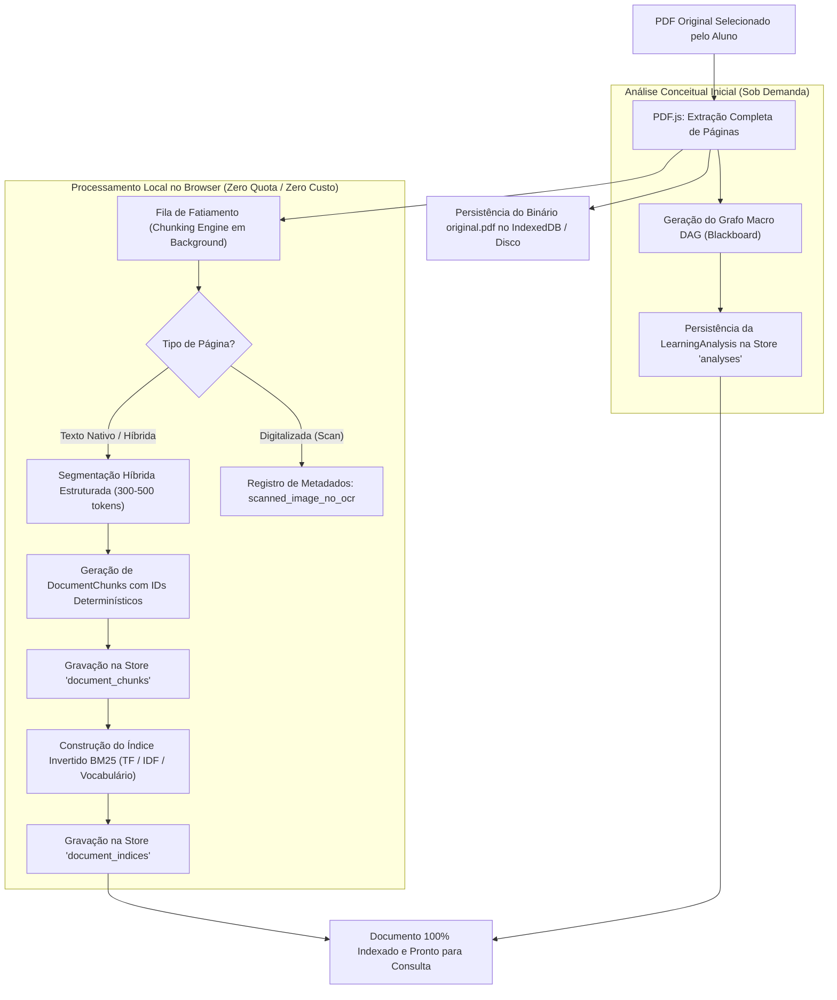
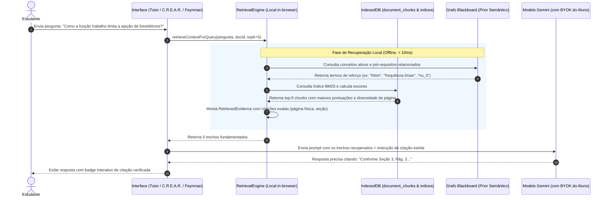

# NEUROCLASS AI — RAG IMPLEMENTATION BLUEPRINT + PREPARAÇÃO SEGURA
**Documento Técnico de Engenharia de Arquitetura e Especificação Executável**  
**Versão:** 1.0.0  
**Data:** 11 de Novembro de 2026  
**Status:** Planejamento e Especificação Aprovada para Revisão (Zero Código Alterado nesta Missão)  
**Ambiente Autorizado:** `/home/anunnaki/Downloads/Pos_Neurociencias_Comportamento/neuroClassAI-work`  
**Branch de Referência:** `feature/fase2-aprendizagem-cognitiva`  
**HEAD de Referência:** `987c2682e9878b180cca309735abd0e081e5b85a`  
**Índice Git Staged:** 39 arquivos staged rigorosamente preservados (tree hash: `e276e7711108075dcf560defb2835b62373de4fe`)  
**Repositório Original:** `/home/anunnaki/Downloads/Pos_Neurociencias_Comportamento/neuroClassAI` (Intocado)  
**Consumo de Quota de IA / Gemini nesta Missão:** ZERO ($0.00)

---

## 1. RESUMO EXECUTIVO

### 1.1 O Que É RAG e Por Que o NeuroClass AI Precisa Dele
O NeuroClass AI é uma plataforma educacional fundamentada nas ciências cognitivas que promove a aprendizagem profunda através de metodologias ativas: método socrático, Efeito Feynman (*Agora Eu Explico*), Ciclo Pedagógico C.R.E.A.R. (Contextualizar, Relacionar, Explicar, Aplicar, Recuperar) e retenção longitudinal via FSRS-7.

Atualmente, o sistema possui uma base de persistência Local-First sólida e extração de páginas via PDF.js. Contudo, **a inteligência contextual da aplicação sofre de cegueira informacional crítica comprovada em código**:
1. No **Tutor Socrático** ([`TutorPanel.tsx:508-512`](file:///home/anunnaki/Downloads/Pos_Neurociencias_Comportamento/neuroClassAI-work/src/components/tutor/TutorPanel.tsx#L508-L512)), o prompt de chat recebe estaticamente **apenas os primeiros 350 caracteres das primeiras 4 páginas do documento**. Se um estudante estiver estudando a página 15, 45 ou 200 de um material, o Tutor não tem acesso a nenhuma palavra daquela página e responde por conhecimento geral ou alega que a informação não consta no material.
2. No **Agora Eu Explico** ([`App.tsx:759-763`](file:///home/anunnaki/Downloads/Pos_Neurociencias_Comportamento/neuroClassAI-work/src/App.tsx#L759-L763)) e no **Ciclo C.R.E.A.R.** ([`App.tsx:796-800`](file:///home/anunnaki/Downloads/Pos_Neurociencias_Comportamento/neuroClassAI-work/src/App.tsx#L796-L800)), o avaliador da autoexplicação recebe estaticamente apenas os primeiros 300 caracteres das primeiras 5 páginas.
3. Na **Análise Conceitual Inicial** ([`server.ts:1011-1018`](file:///home/anunnaki/Downloads/Pos_Neurociencias_Comportamento/neuroClassAI-work/server.ts#L1011-L1018)), materiais com mais de 50 páginas sofrem amostragem silenciosa com salto proporcional (*step sampling*), e o texto de cada página é truncado em 1.500 caracteres ([`server.ts:1157`](file:///home/anunnaki/Downloads/Pos_Neurociencias_Comportamento/neuroClassAI-work/server.ts#L1157)).

**RAG (Retrieval-Augmented Generation)** é a arquitetura de engenharia que resolve essa limitação de forma elegante, escalável e barata: em vez de enviar o PDF inteiro para o modelo (o que estouraria janelas de contexto, aumentaria a latência e custaria caro) ou enviar recortes cegos de páginas iniciais, o sistema **indexa 100% das páginas localmente no navegador** e recupera dinamicamente sob demanda os 3 a 5 trechos mais pertinentes à pergunta ou tarefa do estudante.

### 1.2 Por Que RAG Não É Resumo
Existe uma distinção epistemológica e técnica fundamental entre Resumo e RAG:

| Dimensão | Resumo Documental | RAG (Retrieval-Augmented Generation) |
| :--- | :--- | :--- |
| **Preservação de Conteúdo** | **Destrutivo:** Descarta 90% a 98% dos detalhes, fórmulas, números, tabelas, notas e pormenores conceituais. | **Integral e Não Destrutivo:** 100% do texto original de todas as páginas permanece armazenado e indexado localmente. |
| **Resolução da Informação** | Baixa resolução: Apenas visões gerais e abstrações macro. | Alta resolução cirúrgica: Permite consultar notas de rodapé, coeficientes de equações e passagens específicas. |
| **Rastreabilidade e Citação** | Generalizada e imprecisa (afirmações vagas sem ancoragem de parágrafo). | Estrita e verificável: Cada resposta aponta a página física exata, a seção e a citação literal do autor. |
| **Custo de Atualização** | Requer reprocessamento LLM completo a cada alteração. | Indexação puramente local offline; zero custo de tokens para indexar o material. |
| **Comportamento Cognitivo** | Gera passividade (o estudante lê um resumo condensado). | Gera engajamento ativo: Apoia o método socrático confrontando a hipótese do aluno com o texto original da obra. |

### 1.3 O Fluxo Completo de Ponta a Ponta
O fluxo de Full Document Intelligence no NeuroClass AI opera através da seguinte cadeia rigorosa:

```
[1. PDF Integral do Estudante] (100% das páginas, sem cortes)
              │
              ▼
[2. Extração Estruturada PDF.js] (Texto integral, sumário TOC, caixas de posição, operadores visuais)
              │
              ▼
[3. Segmentação Estruturada (Chunking)] (Parágrafos semânticos, 300–500 tokens, overlap 80 tokens, metadados)
              │
              ▼
[4. Persistência Local-First] (Stores 'document_chunks' e 'document_indices' no IndexedDB + Pasta Local)
              │
              ▼
[5. Indexação Lexical BM25 In-Browser] (Term Frequency, IDF, Vocabulário com normalização PT-BR e termos exatos)
              │
              ▼
[6. Pergunta / Interação Pedagógica] (Tutor Socrático, Autoexplicação Feynman ou Etapas C.R.E.A.R.)
              │
              ▼
[7. Recuperação Relevante (Top-K Chunks)] (BM25 Score + Bônus Semântico do Grafo DAG do Blackboard)
              │
              ▼
[8. Montagem de Contexto Fundamentado] (Trechos reais delimitados com documento, página física e parágrafo)
              │
              ▼
[9. Geração Aumentada e Rastreável] (Resposta fundamentada com citação auditável: "Conforme Seção 2, Pág. 4...")
```

---

## 2. MAPA DA ARQUITETURA ATUAL

### 2.1 Módulos, Funções e Contratos Existentes
A tabela abaixo documenta a arquitetura de código real identificada no workspace autorizado (`neuroClassAI-work`):

| Módulo / Camada | Arquivo Principal | Funções e Símbolos Chave | Contratos / Tipos Envolvidos | Estado e Dependências |
| :--- | :--- | :--- | :--- | :--- |
| **Extração Documental** | [`src/services/documents/pdfService.ts`](file:///home/anunnaki/Downloads/Pos_Neurociencias_Comportamento/neuroClassAI-work/src/services/documents/pdfService.ts) | `extractPdfDocument`, `extractOutline`, `inspectPdfOverview`, `renderPdfPageToImageBase64` | `DocumentSource`, `DocumentPage`, `TableOfContentsItem`, `ExtractPdfOptions` | Depende de `pdfjs-dist@4.10.38`. Executa no browser. Trata ArrayBuffers com cópia defensiva. |
| **Upload e Validação** | [`src/components/documents/DocumentUploadModal.tsx`](file:///home/anunnaki/Downloads/Pos_Neurociencias_Comportamento/neuroClassAI-work/src/components/documents/DocumentUploadModal.tsx) | `handleFileSelect`, `handleSubmit`, seletor de bloco (30 págs) | `ProcessingCoverage`, `DocumentSource` | Bloqueia payloads > 15MB para chamadas diretas de IA. Sugere blocos de 30 páginas para livros > 50 páginas. |
| **Persistência Local-First (Coordenação)** | [`src/services/storage/workspaceStorage.ts`](file:///home/anunnaki/Downloads/Pos_Neurociencias_Comportamento/neuroClassAI-work/src/services/storage/workspaceStorage.ts) | `WorkspaceStorage` (singleton), `saveOriginalPdf`, `saveDocument`, `saveAnalysis`, `saveStudyNote`, `exportWorkspaceBackup`, `restoreWorkspaceBackup` | `StorageMode`, `WorkspaceManifest`, `SubjectBundle`, `StorageHealth` | Coordena Modo A (File System Access API) e Modo B (IndexedDB). Mantém Outbox e reconciliação. |
| **Persistência IndexedDB** | [`src/services/persistence/indexedDb.ts`](file:///home/anunnaki/Downloads/Pos_Neurociencias_Comportamento/neuroClassAI-work/src/services/persistence/indexedDb.ts) | `getDb`, `saveDocument`, `saveAnalysis`, `saveFileBlob`, `saveVisualResource`, `saveLearningAttempt`, `saveConceptMastery` | `NeuroClassDB`, `DB_VERSION = 4`, 10 object stores | Utiliza biblioteca `idb`. Fornece emulador em memória (`inMemoryMockDb`) para testes em Node.js. |
| **Análise Conceitual e Backend** | [`server.ts`](file:///home/anunnaki/Downloads/Pos_Neurociencias_Comportamento/neuroClassAI-work/server.ts) | Rotas Express: `/api/gemini/analyze-document`, `/api/gemini/tutor-chat`, `/api/gemini/evaluate-explanation` | `LearningAnalysis`, `ProcessingCoverage`, `TutorChatMessage` | Express + `@google/genai`. Aplica *step sampling* para > 50 páginas e trunca páginas em 1.500 caracteres. |
| **Grafo DAG e Blackboard** | [`src/components/blackboard/Blackboard.tsx`](file:///home/anunnaki/Downloads/Pos_Neurociencias_Comportamento/neuroClassAI-work/src/components/blackboard/Blackboard.tsx) | `Blackboard`, renderização SVG de nós e arestas de pré-requisitos | `Concept`, `ConceptRelationship`, `PrerequisiteGraph`, `EpistemicStatus` | Visualizador interativo de grafos conceituais acíclicos com rastreabilidade de evidências. |
| **Tutor Socrático** | [`src/components/tutor/TutorPanel.tsx`](file:///home/anunnaki/Downloads/Pos_Neurociencias_Comportamento/neuroClassAI-work/src/components/tutor/TutorPanel.tsx) | `TutorPanel`, `handleSendMessage`, chamada a `requestTutorResponse` | `TutorChatMessage`, `documentExcerpts` | Envia estaticamente `activeDocument.pages.slice(0, 4)` com 350 caracteres cada. |
| **Ciclo C.R.E.A.R. e Feynman** | [`src/components/crear/CrearCycleModal.tsx`](file:///home/anunnaki/Downloads/Pos_Neurociencias_Comportamento/neuroClassAI-work/src/components/crear/CrearCycleModal.tsx), [`AgoraEuExplicoModal.tsx`](file:///home/anunnaki/Downloads/Pos_Neurociencias_Comportamento/neuroClassAI-work/src/components/explanation/AgoraEuExplicoModal.tsx) | Modais de autoexplicação, avaliação rubricada e ciclo em 5 fases | `LearningAttempt`, `RubricEvaluation`, `documentExcerpts` | Recebem em `App.tsx` estaticamente `activeDocument.pages.slice(0, 5)` com 300 caracteres cada. |
| **Repetição Espaçada FSRS** | [`src/components/review/SpacedReviewModal.tsx`](file:///home/anunnaki/Downloads/Pos_Neurociencias_Comportamento/neuroClassAI-work/src/components/review/SpacedReviewModal.tsx) | `SpacedReviewModal`, motor `ts-fsrs@6.0.0` | `ConceptReviewSchedule`, `Card`, `Rating` | Implementa FSRS-7 com retenção alvo de 90%. Não recebe trechos de documento (`undefined`). |
| **Segurança e Isolamento BYOK** | [`src/services/ai/aiKeyManager.ts`](file:///home/anunnaki/Downloads/Pos_Neurociencias_Comportamento/neuroClassAI-work/src/services/ai/aiKeyManager.ts), [`aiClient.ts`](file:///home/anunnaki/Downloads/Pos_Neurociencias_Comportamento/neuroClassAI-work/src/services/ai/aiClient.ts) | `AIKeyManager` (singleton), injeção de header `x-gemini-api-key` | Chave volátil em memória | Em produção, bloqueia requisições sem BYOK (HTTP 401 fail-closed). Zero persistência de chave em disco. |

### 2.2 Pontos Críticos de Perda de Informação Diagnosticados
1. **Truncamento de Texto por Página ([`server.ts:1157`](file:///home/anunnaki/Downloads/Pos_Neurociencias_Comportamento/neuroClassAI-work/server.ts#L1157)):** `slice(0, 1500)` descarta até 66% de páginas acadêmicas densas.
2. **Amostragem em Documentos Longos ([`server.ts:1011`](file:///home/anunnaki/Downloads/Pos_Neurociencias_Comportamento/neuroClassAI-work/server.ts#L1011)):** Em um tratado de 120 páginas (ex: Herbert Simon no corpus de testes), apenas 41 páginas são transmitidas; 79 páginas são ignoradas pelo modelo.
3. **Cegueira do Chat do Tutor ([`TutorPanel.tsx:509`](file:///home/anunnaki/Downloads/Pos_Neurociencias_Comportamento/neuroClassAI-work/src/components/tutor/TutorPanel.tsx#L509)):** Apenas páginas 1 a 4 são fornecidas, cada uma cortada em 350 caracteres.
4. **Ausência de Camada de Busca:** Nenhum arquivo em `src/services/` realiza busca de texto integral, casamento de termos ou indexação inversa.

---

## 3. ARQUITETURA-ALVO

A arquitetura-alvo do NeuroClass AI desacopla a ingestão do documento da chamada ao modelo de linguagem, introduzindo uma camada local-first de fatiamento e recuperação lexical de alta velocidade.

### 3.1 Fluxo Geral de Ingestão e Indexação (Diagrama Mermaid)



### 3.2 Fluxo de Consulta e Recuperação Contextual (Diagrama Mermaid)



### 3.3 Diagrama de Conexão com os Componentes Pedagógicos (ASCII)

```
                            ┌─────────────────────────────────────────┐
                            │    Documento Original (100% Páginas)    │
                            └────────────────────┬────────────────────┘
                                                 │
                                                 ▼
                            ┌─────────────────────────────────────────┐
                            │  Motor Local de Recuperação (BM25 RAG)  │
                            └───────┬────────────┬────────────┬───────┘
                                    │            │            │
            ┌───────────────────────┘            │            └───────────────────────┐
            │ (Top-5 Chunks Relevantes)          │ (Trechos de Avaliação)             │ (Trechos por Estágio)
            ▼                                    ▼                                    ▼
┌───────────────────────┐            ┌───────────────────────┐            ┌───────────────────────┐
│     Tutor Socrático   │            │    Agora Eu Explico   │            │     Ciclo C.R.E.A.R.  │
│ (TutorPanel.tsx)      │            │ (AgoraEuExplicoModal) │            │ (CrearCycleModal.tsx) │
│                       │            │                       │            │                       │
│ Substitui trecho fixo │            │ Avalia fidelidade da  │            │ Fornece evidências    │
│ das páginas 1 a 4 por │            │ autoexplicação do     │            │ específicas para      │
│ parágrafos reais da   │            │ aluno confrontando com│            │ Contextualizar,       │
│ dúvida do aluno.      │            │ parágrafos originais. │            │ Relacionar e Explicar.│
└───────────────────────┘            └───────────────────────┘            └───────────────────────┘
            │                                    │                                    │
            └────────────────────────────────────┼────────────────────────────────────┘
                                                 ▼
                            ┌─────────────────────────────────────────┐
                            │     Caderno de Estudos (StudyNotebook)  │
                            │  - Notas com citações literais auditadas│
                            │  - Cópia com 1 clique de trecho citado  │
                            └─────────────────────────────────────────┘
```

---

## 4. MODELO DE DADOS E CONTRATOS TYPESCRIPT

Abaixo são especificados os contratos de tipos TypeScript que formalizam a camada RAG. Estes contratos preservam compatibilidade total com os tipos existentes em [`src/types/index.ts`](file:///home/anunnaki/Downloads/Pos_Neurociencias_Comportamento/neuroClassAI-work/src/types/index.ts):

```typescript
/**
 * Especificação dos Contratos de Dados para RAG Local-First — NeuroClass AI
 * Localização-alvo futura: src/types/rag.ts (ou extensão de src/types/index.ts)
 */

/** Tipo de conteúdo semântico do chunk fatiado */
export type ChunkContentType = 
  | 'prose'                // Parágrafo contínuo de texto acadêmico
  | 'heading'              // Título ou subtítulo de seção com nível hierárquico
  | 'list'                 // Lista com marcadores ou numeração
  | 'table_text'           // Representação textual/tabular de dados
  | 'formula_explanation'  // Expressão matemática e explicação de variáveis
  | 'figure_caption'       // Legenda descritiva de figura ou diagrama
  | 'footnote'             // Nota de rodapé ou referência bibliográfica
  | 'scanned_fallback';    // Metadado de página digitalizada sem OCR

/** Unidade fundamental atômica de conteúdo indexável */
export interface DocumentChunk {
  /** Identificador determinístico estável: `${documentId}_p${pageNumber}_c${chunkIndex}` */
  chunkId: string;
  /** Chave estrangeira para o DocumentSource original */
  documentId: string;
  /** Número da página física original no documento (indexação baseada em 1) */
  pageNumber: number;
  /** Ordem sequencial do chunk dentro da página física */
  chunkIndexInPage: number;
  /** Ordem sequencial global do chunk no documento inteiro (0 ... N-1) */
  globalChunkIndex: number;
  /** Texto original sem truncamento silencioso */
  text: string;
  /** Título do capítulo ou seção à qual o chunk pertence (extraído via TOC/Heading) */
  sectionTitle?: string;
  /** Hierarquia completa da seção (ex: ["Parte I", "Capítulo 2", "Seção 2.1"]) */
  sectionHierarchy?: string[];
  /** Estimativa precisa de tokens do chunk */
  tokenCount: number;
  /** Posição de caractere inicial na página física */
  charOffsetStart: number;
  /** Posição de caractere final na página física */
  charOffsetEnd: number;
  /** Tipo de conteúdo semântico */
  contentType: ChunkContentType;
  /** Referências a elementos multimodais presentes ou vizinhos neste trecho */
  multimodalReferences?: {
    figureLabels?: string[];
    tableLabels?: string[];
    formulaExpressions?: string[];
    chartLabels?: string[];
  };
  /** Hash SHA-256 do texto para verificação de integridade e idempotência */
  sha256Hash: string;
  /** Versão do pipeline de chunking gerador (ex: '1.0.0') */
  pipelineVersion: string;
  /** Timestamp de geração do chunk */
  createdAt: number;
}

/** Metadados do índice invertido persistido para um documento */
export interface DocumentIndexMetadata {
  documentId: string;
  pipelineVersion: string;
  indexedAt: number;
  totalChunks: number;
  totalPages: number;
  indexedPages: number[];
  unindexedPages: number[];
  averageChunkLengthWords: number;
  totalTermsInCorpus: number;
  /** Dicionário serializado de Document Frequency (termo -> número de chunks que o contêm) */
  documentFrequency: Record<string, number>;
  /** Dicionário serializado de comprimentos de chunks em palavras (chunkId -> wordCount) */
  chunkLengths: Record<string, number>;
}

/** Parâmetros da consulta submetida ao motor de recuperação */
export interface RetrievalQuery {
  /** Pergunta do aluno ou texto de interesse */
  text: string;
  /** Identificador do documento restrito para busca */
  documentId: string;
  /** Quantidade máxima de evidências a retornar (padrão: 5, máximo: 10) */
  topK?: number;
  /** Filtro opcional por intervalo de páginas físicas */
  pageRange?: { startPage: number; endPage: number };
  /** Filtro opcional por título de seção */
  sectionFilter?: string;
  /** Se verdadeiro, enriquece a busca com conceitos vizinhos do DAG do Blackboard */
  expandQueryWithConceptDAG?: boolean;
  /** Identificador do conceito ativo no Blackboard (se houver) */
  activeConceptId?: string;
  /** Limiar mínimo de score BM25 para aceitação (padrão: 0.1) */
  minScoreThreshold?: number;
}

/** Evidência recuperada com metadados para fundamentação e citação */
export interface RetrievedEvidence {
  chunkId: string;
  documentId: string;
  pageNumber: number;
  sectionTitle?: string;
  sectionHierarchy?: string[];
  text: string;
  contentType: ChunkContentType;
  multimodalReferences?: DocumentChunk['multimodalReferences'];
  /** Pontuação calculada pelo motor BM25 */
  score: number;
  /** Termos da consulta que casaram exatamente neste trecho */
  matchedTerms: string[];
  /** Citação formatada pronta para injeção no prompt */
  formattedCitation: string;
}

/** Resultado consolidado da recuperação */
export interface RetrievalResult {
  query: string;
  documentId: string;
  evidences: RetrievedEvidence[];
  totalCandidateChunks: number;
  executionTimeMs: number;
  /** Indica se foram encontradas evidências suficientes que superam o limiar */
  hasSufficientEvidence: boolean;
  /** Mensagem pedagógica transparente caso não haja evidências suficientes */
  fallbackNotice?: string;
}

/** Métrica de cobertura expandida e independente */
export interface DetailedProcessingCoverage {
  documentId: string;
  totalPages: number;
  /** Cobertura de Ingestão: páginas cujos dados brutos foram lidos do PDF */
  ingestion: {
    totalPagesCount: number;
    extractedPagesCount: number;
    extractedPageNumbers: number[];
    isComplete: boolean;
  };
  /** Cobertura de OCR e Legibilidade */
  legibility: {
    cleanPagesCount: number;
    hybridPagesCount: number;
    scannedPagesCount: number;
    degradedPagesCount: number;
    scannedWithoutOcrPageNumbers: number[];
  };
  /** Cobertura de Chunking e Fatiamento */
  chunking: {
    totalChunksGenerated: number;
    coveredPagesCount: number;
    coveredPageNumbers: number[];
    averageChunksPerPage: number;
  };
  /** Cobertura de Indexação Lexical */
  indexing: {
    totalIndexedChunks: number;
    indexedVocabularySize: number;
    isFullyIndexed: boolean;
  };
  /** Elementos Multimodais Catalogados */
  multimodal: {
    figuresDetected: number;
    tablesDetected: number;
    formulasDetected: number;
    chartsDetected: number;
  };
  /** Timestamp da consolidação métrica */
  updatedAt: number;
}
```

---

## 5. ESTRATÉGIA DE CHUNKING

### 5.1 Comparativo de Alternativas de Segmentação

| Estratégia | Como Opera | Vantagens | Desvantagens Críticas | Veredito |
| :--- | :--- | :--- | :--- | :--- |
| **A. Parágrafo Puro** | Divide estritamente nas quebras de parágrafo (`\n\n`). | Preserva a unidade retórica do autor; sem cortes artificiais. | Parágrafos muito curtos (1 linha) geram chunks com pouco contexto. Parágrafos longos (> 1.000 palavras) excedem a janela ideal. | Insuficiente isoladamente. |
| **B. Seção / Capítulo** | Divide nos títulos de capítulos ou seções do TOC. | Mantém o tema macro completo. | Chunks gigantescos (10 a 30 páginas por capítulo), inviabilizando recuperação precisa e estourando contexto. | Inviável para RAG. |
| **C. Janela Fixa de Tokens com Overlap** | Corta cegamente a cada $N$ tokens (ex: 400) com overlap fixo de 80. | Algoritmo trivial; chunks de tamanho homogêneo. | Corta frases no meio, quebra equações LaTeX ao meio, desconecta títulos de seus parágrafos explicativos. | Prejudicial à didática científica. |
| **D. Híbrida Orientada à Estrutura (Recomendada)** | Respeita parágrafos naturais; agrupa parágrafos curtos até atingir o limite mínimo; divide parágrafos extensos apenas em fronteiras de frases; preserva blocos de tabelas e fórmulas íntegros. | Preserva integridade de raciocínio, tabelas, fórmulas e títulos; mantém tamanho previsível (300–500 tokens). | Requer fatiador inteligente com expressões regulares estruturais. | **RECOMENDADA** |

### 5.2 Especificação da Estratégia Híbrida Recomendada

```
                                  [Texto da Página Física]
                                             │
                                             ▼
                      [Passo 1: Detecção de Elementos Estruturais]
                      - Identifica Títulos (Heading / TOC)
                      - Identifica Blocos de Tabelas / Markdown
                      - Identifica Expressões Matemáticas / Fórmulas
                      - Identifica Parágrafos de Prosa
                                             │
                                             ▼
                      [Passo 2: Fatiador com Janela Semântica Dinâmica]
                      - Target Ideal: 350 a 500 tokens (~1.400 a 2.000 caracteres)
                      - Limite Superior Máximo: 650 tokens
                      - Se o parágrafo < 150 tokens: Agrupa com o próximo da mesma seção
                      - Se o parágrafo > 650 tokens: Segmenta em fronteiras de sentenças (. ! ?)
                                             │
                                             ▼
                      [Passo 3: Aplicação de Overlap de Continuidade]
                      - Overlap de 60 a 80 tokens entre chunks adjacentes
                      - O overlap NUNCA corta uma sentença ao meio; repete a última frase completa
                                             │
                                             ▼
                      [Passo 4: Injeção de Contexto Hierárquico no Topo do Chunk]
                      - Prefixa metadado sutil: "[Documento: X | Pág. Y | Seção: Z]"
                      - Garante que mesmo trechos isolados mantenham ancoragem temática
```

### 5.3 Estimador de Tokens Leve para o Navegador
Para evitar carregar dependências pesadas de tokenizadores (como `tiktoken` WASM de múltiplos megabytes), o fatiador adotará um estimador calibrado para o idioma Português (PT-BR) e vocabulário técnico:
- **Heurística de Calibração:** Em textos científicos em língua portuguesa com acentuação, 1 token corresponde em média a **3,8 caracteres** (ou 0,75 palavras).
- **Fórmula de Estimativa:**
  $$\text{TokensEstimados} = \max\left(\left\lceil \frac{\text{lengthInChars}}{3.8} \right\rceil, \left\lceil \text{wordCount} \times 1.33 \right\rceil\right)$$
- **Validação:** Essa heurística será validada no conjunto de testes comparando-a com contagens exatas em corpus conhecido.

---

## 6. INDEXAÇÃO E RECUPERAÇÃO LEXICAL (OKAPI BM25 IN-BROWSER)

### 6.1 Formulação Matemática do BM25
O algoritmo Okapi BM25 é o padrão da indústria para recuperação de texto por relevância probabilística. Dado um documento $D$ (neste caso, um `DocumentChunk`) e uma consulta $Q$ contendo termos $q_1, q_2, \ldots, q_n$, a pontuação BM25 é calculada por:

$$\text{Score}(D, Q) = \sum_{i=1}^{n} \text{IDF}(q_i) \cdot \frac{f(q_i, D) \cdot (k_1 + 1)}{f(q_i, D) + k_1 \cdot \left(1 - b + b \cdot \frac{|D|}{\text{avgdl}}\right)}$$

Onde:
- $f(q_i, D)$ é a frequência do termo $q_i$ no chunk $D$.
- $|D|$ é o comprimento do chunk $D$ em palavras.
- $\text{avgdl}$ (*average document length*) é a média do comprimento em palavras de todos os chunks do documento.
- $k_1$ é o parâmetro de saturação de frequência de termo. **Valor adotado: $k_1 = 1.2$**.
- $b$ é o parâmetro de normalização de comprimento. **Valor adotado: $b = 0.75$**.
- $\text{IDF}(q_i)$ é a frequência inversa do documento para o termo $q_i$, calculada com correção para evitar valores negativos:

$$\text{IDF}(q_i) = \ln\left( \frac{N - n(q_i) + 0.5}{n(q_i) + 0.5} + 1 \right)$$

Onde $N$ é o número total de chunks do documento e $n(q_i)$ é o número de chunks que contêm o termo $q_i$.

### 6.2 Tokenização e Normalização Específica para Português (PT-BR)
A tokenização do BM25 local no NeuroClass AI seguirá regras estritas de preservação de precisão científica:
1. **Tratamento de Acentos (Folding Seguro):**
   - Para cálculo do índice, os termos sofrem normalização Unicode NFD e remoção de diacríticos (`ação` -> `acao`), permitindo que o aluno encontre o termo mesmo se digitar sem acento no celular ou teclado internacional.
   - O texto original exibido e injetado no prompt é **100% preservado com acentuação original**.
2. **Preservação de Siglas e Notações Técnicas:**
   - Termos em caixa alta com números e hífens são tratados como tokens atômicos indivisíveis: `LTP`, `NMDA`, `AMPA`, `SNARE`, `FSRS-7`, `CO2`, `Ca2+`, `V_0`, `h/e`, `RNAm`.
3. **Preservação de Fórmulas e Símbolos:**
   - Expressões como `E=h*nu`, `K_max`, `V_0` mantêm suas componentes indexáveis.
4. **Política Rigorosa de Stopwords:**
   - **NÃO utilizar listas agressivas de stopwords**. Em textos científicos, palavras funcionais alteram radicalmente o sentido:
     - *"Sem potencial de ação"* $\neq$ *"Com potencial de ação"*.
     - *"Gradiente não linear"* $\neq$ *"Gradiente linear"*.
   - Apenas artigos e preposições vazias de significado semântico isolado serão ignorados (`o`, `a`, `os`, `as`, `de`, `da`, `do`).

### 6.3 Re-ranking, Diversidade de Páginas e Expansão pelo DAG
Para evitar que os 5 melhores resultados venham todos do mesmo parágrafo ou da mesma página:
- **Penalidade de Repetição de Página:** Se múltiplos chunks pertencerem à mesma página física, aplica-se um fator multiplicador suave ($0.85^{\text{ocorrencia}-1}$) para garantir que o resultado represente diferentes páginas se a consulta for ampla.
- **Expansão Semântica Suave pelo Grafo do Blackboard:**
  Se o aluno fizer uma pergunta associada a um conceito ativo no Blackboard (ex: *"Função Trabalho"*), o motor consulta os conceitos que precedem ou sucedem esse nó no grafo DAG e adiciona seus nomes como termos de reforço secundários com peso reduzido ($0.3 \times \text{IDF}$), conectando pré-requisitos sem poluir a busca.

---

## 7. OCR E TRATAMENTO MULTIMODAL

### 7.1 Análise de Motores de OCR Local para o Navegador

| Motor Avaliado | Tamanho do Bundle / Download | Consumo de RAM | Desempenho CPU | Licença | Veredito para Fase 1 |
| :--- | :--- | :--- | :--- | :--- | :--- |
| **Tesseract.js (WASM + Modelo pt-BR)** | ~18MB (código WASM + arquivo `.traineddata`) | 250MB a 450MB por thread | Lento em navegadores móveis/laptops modestos (3 a 8s por página) | Apache 2.0 | **Descartado para Fase 1 imediata.** Incompatível com experiência leve Local-First sem consentimento prévio de download. |
| **OCR via Web API Nativa (`BarcodeDetector` / Shape Detection API)** | 0 bytes adicionais | Baixo | Rápido | Nativo do browser | Muito restrito; não oferece OCR de texto corrido em navegadores desktop linux/windows de forma universal. |
| **Inspeção Visual Multimodal sob Demanda (Arquitetura Atual)** | 0 bytes adicionais | Zero impacto | Instantâneo | Própria | **MANTER COMO PADRÃO**: Páginas escaneadas são sinalizadas honestamente como `scanned_image_no_ocr`, e sua leitura multimodal é realizada apenas quando estritamente requisitada pelo estudante via BYOK. |

### 7.2 Princípio Inegociável da Honestidade Intelectual
O NeuroClass AI **nunca alegará compreensão integral de um PDF se o arquivo for composto por páginas escaneadas sem camada de texto**.
- Na interface, páginas sem texto extraível exibirão o selo claro: `Imagem Escaneada (Sem OCR Local)`.
- A métrica `coveragePercentage` reportará estritamente a proporção de texto lido, diferenciando:
  - Páginas com texto nativo extraído.
  - Páginas puramente visuais/digitalizadas.

### 7.3 Representação Estruturada de Ativos Multimodais nos Chunks
Tabelas, fórmulas e figuras catalogadas em [`MultimodalAssetRegistry`](file:///home/anunnaki/Downloads/Pos_Neurociencias_Comportamento/neuroClassAI-work/src/types/index.ts#L182-L212) serão convertidas em chunks textuais estruturados de alta densidade semântica:
- **Tabelas:** Serializadas em formato Markdown tabular:
  ```markdown
  [Tabela 1 | Pág. 3: Funções de Trabalho em Elétron-Volts]
  | Elemento | Símbolo | Função Trabalho (eV) |
  | Sódio | Na | 2,28 |
  | Potássio | K | 2,25 |
  ```
- **Fórmulas:** Representadas em LaTeX acompanhadas de sua interpretação científica:
  ```markdown
  [Equação 4.1 | Pág. 4: Balanço Energético Fotoelétrico]
  Expressão: K_max = h * nu - Phi
  Significado: Energia cinética máxima dos fotoelétrons em função da frequência incidente e função trabalho.
  ```
- **Figuras e Gráficos:** Representados com legenda, eixos e tendência observada.

---

## 8. PERSISTÊNCIA, VERSIONAMENTO E MIGRAÇÃO LOCAL-FIRST

### 8.1 Evolução de Schema do IndexedDB: `v4` $\rightarrow$ `v5`
A base de dados atual [`neuroclass_ai_db`](file:///home/anunnaki/Downloads/Pos_Neurociencias_Comportamento/neuroClassAI-work/src/services/persistence/indexedDb.ts#L85-L86) encontra-se na versão `DB_VERSION = 4`.

A inclusão da inteligência de recuperação ocorrerá via evolução para `DB_VERSION = 5` com migração estritamente **não-destrutiva**:

```typescript
// Especificação da evolução de schema na função openDB:
if (oldVersion < 5) {
  // Store 11: Chunks de documento
  if (!db.objectStoreNames.contains('document_chunks')) {
    const chunkStore = db.createObjectStore('document_chunks', { keyPath: 'chunkId' });
    chunkStore.createIndex('by-document', 'documentId', { unique: false });
    chunkStore.createIndex('by-document-page', ['documentId', 'pageNumber'], { unique: false });
    chunkStore.createIndex('by-hash', 'sha256Hash', { unique: false });
  }

  // Store 12: Metadados de índices e vocabulário BM25
  if (!db.objectStoreNames.contains('document_indices')) {
    const indexStore = db.createObjectStore('document_indices', { keyPath: 'documentId' });
    indexStore.createIndex('by-updated', 'indexedAt', { unique: false });
  }
}
```

### 8.2 Garantias de Não-Regressão e Idempotência
1. **Isolamento de Dados Existentes:** Nenhuma das 10 stores existentes (`documents`, `analyses`, `notes`, `chat_sessions`, `file_blobs`, `learning_sessions`, `learning_attempts`, `concept_mastery`, `review_schedules`, `visual_resources`) terá seus dados modificados, apagados ou renomeados.
2. **Reindexação Determinística:** Se o usuário limpar o cache do navegador ou se a versão do pipeline for atualizada, os chunks e o índice BM25 podem ser **100% regenerados a partir do binário `original.pdf` já armazenado** em `file_blobs` ou na pasta local, sem exigir novo upload pelo estudante.
3. **Backup Portátil `.neuroclass`:** O arquivo `.neuroclass` (ZIP) não precisa conter o índice BM25 completo, evitando inchar o arquivo de backup. Na restauração, o sistema restaura o PDF e seus metadados pedagógicos e reconstrói o índice em background de forma transparente.
4. **Exclusão em Cascata Estrita:** Ao excluir um documento (`deleteDocumentCompletely`), todos os chunks e o índice correspondente são limpos do IndexedDB e da pasta local, garantindo integridade sem chunks órfãos.

---

## 9. INTEGRAÇÃO PEDAGÓGICA NOS COMPONENTES COGNITIVOS

O RAG não transformará a aplicação em um chatbot genérico. Ele servirá estritamente como infraestrutura de evidências para os métodos pedagógicos já consolidados:

```
┌─────────────────────────────────────────────────────────────────────────────┐
│                           MÉTODOS COGNITIVOS ATIVOS                         │
└──────────────────────────────────────┬──────────────────────────────────────┘
                                       │
        ┌──────────────────────────────┼──────────────────────────────┐
        ▼                              ▼                              ▼
┌───────────────────┐        ┌───────────────────┐        ┌───────────────────┐
│  Tutor Socrático  │        │  Agora Eu Explico │        │   Ciclo C.R.E.A.R.│
│  (Método Maiêutico│        │  (Efeito Feynman) │        │   (5 Estágios)    │
└─────────┬─────────┘        └─────────┬─────────┘        └─────────┬─────────┘
          │                            │                            │
          │ Recupera trechos           │ Recupera parágrafos        │ Alimenta cada etapa:
          │ que respondem à            │ canônicos do conceito      │ - Contextualizar (Pág)
          │ dúvida do aluno sem        │ para comparar rubrica      │ - Relacionar (Causal)
          │ dar a resposta pronta.     │ com a explicação do aluno. │ - Explicar (Evidência)
          │ Cita página e seção.       │ Aponta lacunas e omissões. │ - Aplicar (Exemplos)
```

### 9.1 Tutor Socrático ([`TutorPanel.tsx`](file:///home/anunnaki/Downloads/Pos_Neurociencias_Comportamento/neuroClassAI-work/src/components/tutor/TutorPanel.tsx))
- **Antes:** O Tutor enviava sempre `pages.slice(0, 4)` com 350 caracteres cada.
- **Com RAG:** O Tutor invoca `retrieveContextForQuery(mensagemDoAluno, activeDocument.id, topK=5)`. Os 5 trechos mais pertinentes são injetados no prompt. O Tutor é instruído a guiar o estudante pelo método socrático apontando onde no texto original o estudante encontra a resposta: *"Conforme o autor discute no segundo parágrafo da página 42..."*.

### 9.2 Módulo Agora Eu Explico ([`AgoraEuExplicoModal.tsx`](file:///home/anunnaki/Downloads/Pos_Neurociencias_Comportamento/neuroClassAI-work/src/components/explanation/AgoraEuExplicoModal.tsx))
- **Antes:** O avaliador da autoexplicação recebia as páginas 1 a 5 cortadas em 300 caracteres.
- **Com RAG:** A consulta de recuperação busca os trechos do documento mais relacionados ao conceito sendo explicado pelo estudante. A rubrica avalia a fidelidade científica com base nos parágrafos exatos do livro/artigo, sinalizando:
  - Conceitos compreendidos corretamente com base no texto.
  - Imprecisões ou equívocos em relação ao autor original.
  - Omissões de princípios fundamentais descritos na obra.

### 9.3 Ciclo Pedagógico C.R.E.A.R. ([`CrearCycleModal.tsx`](file:///home/anunnaki/Downloads/Pos_Neurociencias_Comportamento/neuroClassAI-work/src/components/crear/CrearCycleModal.tsx))
Cada um dos 5 estágios recebe trechos sob medida:
- **Estágio 1 (Contextualizar):** Trechos de introdução, motivação histórica e escopo da teoria.
- **Estágio 2 (Relacionar):** Trechos que discutem causas, pré-requisitos e analogias com outros conceitos.
- **Estágio 3 (Explicar):** Definições formais, equações e tabelas de referência.
- **Estágio 4 (Aplicar):** Exemplos práticos, exercícios ou casos empíricos relatados no texto.
- **Estágio 5 (Recuperar):** Blind Recall — as evidências são ocultadas para que o estudante faça a evocação ativa a partir da memória de longo prazo.

---

## 10. CITAÇÕES E CONFIABILIDADE CIENTÍFICA

### 10.1 Contrato Formal de Citação Auditável
Toda resposta gerada com apoio de evidências do RAG deve seguir o contrato de citação estrita:

```typescript
export interface AuditCitation {
  documentId: string;
  documentTitle: string;
  pageNumber: number;
  sectionTitle?: string;
  chunkId: string;
  verbatimExcerpt: string;
  isVerifiedInSource: boolean;
}
```

### 10.2 Validação Prévia de Citações e Política Fail-Closed
1. **Verificação de Substring no Cliente:** Antes de renderizar um badge de citação na tela, a aplicação verifica se o trecho citado existe como substring ou correspondência com alta similaridade (> 90% via Levenshtein token ratio) dentro do chunk original armazenado. Se não existir, a citação é classificada como `model_inference` e não como citação documental direta.
2. **Declaração Explícita de Insuficiência de Dados:**
   Se a consulta do aluno não retornar nenhum chunk com score BM25 acima do limiar mínimo ($\text{Score} < 0.15$), o modelo é estritamente instruído a não inventar:
   > *"Este tema específico não foi localizado no documento fornecido. Posso esclarecer o conceito científico geral com base em conhecimentos gerais da área, mas tenha em mente que ele não consta no seu material de estudo."*

---

## 11. COBERTURA E OBSERVABILIDADE

Para banir falsas sensações de conclusão integral, o NeuroClass AI medirá separadamente cada estágio do funil de processamento documental:

```
[Métrica 1: Ingestão]      Páginas Extraídas / Páginas Totais do PDF
          │
          ▼
[Métrica 2: Legibilidade]  Páginas Digitais vs Híbridas vs Scans sem OCR
          │
          ▼
[Métrica 3: Fatiamento]    Chunks Gerados e Média de Chunks por Página
          │
          ▼
[Métrica 4: Indexação]     Chunks no Índice Invertido / Total de Chunks
          │
          ▼
[Métrica 5: Recuperação]   % de Consultas com Evidências Válidas Encontradas
```

### Indicadores Auditáveis de Cobertura
- **Taxa de Ingestão ($T_{ing}$):** $\frac{N_{\text{paginas\_extraidas}}}{N_{\text{paginas\_totais}}} \times 100\%$
- **Taxa de Indexação ($T_{idx}$):** $\frac{N_{\text{chunks\_indexados}}}{N_{\text{chunks\_gerados}}} \times 100\%$
- **Latência de Recuperação Medida:** Tempo de execução do cálculo BM25 em milissegundos (medido com `performance.now()` no cliente).
- **Proibição Terminológica:** É estritamente proibido exibir termos como "100% Compreendido" na interface. A terminologia oficial é: **"100% do Conteúdo Textual Indexado para Consulta"**.

---

## 12. PLANO DE TESTES COM CORPUS MULTIDISCIPLINAR REALISTA

O plano de testes utilizará os cenários canônicos já modelados em [`src/services/documents/multimodalCorpus.ts`](file:///home/anunnaki/Downloads/Pos_Neurociencias_Comportamento/neuroClassAI-work/src/services/documents/multimodalCorpus.ts):

### 12.1 Matriz de Testes por Cenário

| Identificador do Teste | Cenário de Teste | Objetivo da Verificação | Critério de Aceite Estrito |
| :--- | :--- | :--- | :--- |
| **TEST-RAG-01** | `CORPUS_SCENARIO_A` (Artigo Científico Multimodal - 5 págs) | Fatiamento de fórmulas, tabelas e gráficos. | 100% das páginas fatiadas; chunks contêm expressões $E=h\nu$ e tabelas intactas. |
| **TEST-RAG-02** | `CORPUS_SCENARIO_A` | Recuperação com termos exatos: *"potencial de frenagem"*, *"função trabalho"*. | Top-1 chunk retornado aponta exatamente para a página 4 com score BM25 > 1.5. |
| **TEST-RAG-03** | `CORPUS_SCENARIO_B` (Scan Histórico - 3 págs) | Preservação de incerteza em PDFs digitalizados sem OCR. | Relata `scanned_image_no_ocr`; não inventa texto para páginas de imagem pura. |
| **TEST-RAG-04** | `CORPUS_SCENARIO_C` (Tratado Extenso Herbert Simon - 120 págs) | Fatiamento e indexação integral de livro com múltiplos capítulos. | 120 de 120 páginas fatiadas e indexadas. Chunks cobrem início (pág. 5), meio (pág. 55) e fim (pág. 118). |
| **TEST-RAG-05** | `CORPUS_SCENARIO_C` | Consulta sobre tema da segunda metade: *"Psicologia das Decisões Administrativas e Satisficing"*. | Recupera chunks situados entre as páginas 98 e 120, superando a cegueira anterior. |
| **TEST-RAG-06** | Teste de Desempenho e Latência | Medição de tempo de indexação e busca em 120 páginas. | Tempo de recuperação de Top-5 chunks $< 15\text{ms}$ no thread do navegador. |
| **TEST-RAG-07** | Teste de Persistência e Reinício | Gravação no IndexedDB v5 e recuperação após reload simulado. | Chunks recuperados idênticos após reabertura; integridade SHA-256 preservada. |
| **TEST-RAG-08** | Teste de Isolamento entre Disciplinas | Busca no Documento A não retorna chunks do Documento B. | Filtro estrito por `documentId` garante isolamento absoluto. |
| **TEST-RAG-09** | Teste de Limiar e Fail-Closed | Pergunta sobre tema inexistente (ex: *"Mecânica Quântica em Herbert Simon"*). | `hasSufficientEvidence = false`; ativa fallback transparente sem alucinar. |
| **TEST-RAG-10** | Teste de Não-Regressão da Suíte | Execução dos 192 testes existentes (`npm test`). | 192/192 testes aprovados sem nenhuma falha de regressão. |

### 12.2 Métricas de Avaliação da Recuperação
Em conjunto de 20 perguntas calibradas para o material de teste, serão medidas:
- **Recall@5:** Proporção de consultas em que a página correta está presente entre os 5 primeiros chunks (meta: $\ge 90\%$).
- **Precision@5:** Proporção de chunks relevantes entre os 5 retornados (meta: $\ge 70\%$).
- **MRR (Mean Reciprocal Rank):** Média do inverso da posição da primeira evidência correta (meta: $\ge 0.80$).

---

## 13. PLANO DE IMPLEMENTAÇÃO INCREMENTAL (8 MISSÕES SEGURAS)

Para mitigar riscos e permitir testes isolados e reversíveis, a implementação é dividida em 8 missões autônomas:

```
[Missão A: Contratos & Chunking] ──► [Missão B: Persistência IDB v5] ──► [Missão C: Motor BM25]
                │                                                              │
                ▼                                                              ▼
[Missão D: Serviço de Recuperação] ──► [Missão E: Integração Tutor] ──► [Missão F: C.R.E.A.R. & Feynman]
                │                                                              │
                ▼                                                              ▼
[Missão G: Multimodal & Evidências] ───────────────────────────────► [Missão H: Hardening & Telemetria]
```

### Detalhamento das Missões

#### Missão A — Contratos e Fatiador Estruturado Local
- **Escopo:** Criação dos tipos `DocumentChunk` e do serviço puro de chunking híbrido estruturado ([`src/services/documents/chunkingService.ts`](file:///home/anunnaki/Downloads/Pos_Neurociencias_Comportamento/neuroClassAI-work/src/services/documents/chunkingService.ts)).
- **Arquivos Previstos:** `src/types/rag.ts`, `src/services/documents/chunkingService.ts`, `src/tests/rag_chunking.test.ts`.
- **Riscos:** Zero risco em chamadas de IA. Módulo isolado sem efeitos colaterais.
- **Critério de Aceite:** 100% das páginas de um PDF de 120 páginas fatiadas com fronteiras de parágrafo preservadas e testes unitários aprovados.

#### Missão B — Persistência Local-First e Migração de Schema IndexedDB v4 $\rightarrow$ v5
- **Escopo:** Adição das stores `document_chunks` e `document_indices` em `indexedDb.ts` com versão 5. Métodos para salvar e recuperar chunks em lote.
- **Arquivos Previstos:** `src/services/persistence/indexedDb.ts`, `src/services/storage/workspaceStorage.ts`, `src/tests/rag_persistence.test.ts`.
- **Riscos:** Regressão na abertura do IndexedDB existente.
- **Medida Preventiva:** Bloco de migração condicional `if (oldVersion < 5)` estritamente aditivo.

#### Missão C — Motor de Indexação e Busca Lexical BM25 em TypeScript
- **Escopo:** Implementação do motor BM25 puro em TypeScript ([`src/services/search/bm25SearchService.ts`](file:///home/anunnaki/Downloads/Pos_Neurociencias_Comportamento/neuroClassAI-work/src/services/search/bm25SearchService.ts)). Normalização PT-BR, cálculo de TF/IDF e ranking.
- **Arquivos Previstos:** `src/services/search/bm25SearchService.ts`, `src/tests/rag_bm25.test.ts`.
- **Riscos:** Desempenho em documentos com vocabulário muito grande.
- **Medida Preventiva:** Índice invertido indexado em Map hash com acesso $O(1)$.

#### Missão D — Serviço de Recuperação Contextual e Avaliação Offline
- **Escopo:** Criação do serviço `retrievalService.ts` integrando BM25 + expansão suave pelo DAG do Blackboard. Cálculo de métricas Recall@K e Precision@K em testes offline.
- **Arquivos Previstos:** `src/services/search/retrievalService.ts`, `src/tests/rag_retrieval.test.ts`.
- **Riscos:** Excesso de termos na expansão pelo DAG gerando ruído.
- **Medida Preventiva:** Peso de expansão DAG calibrado para no máximo 30% do score principal.

#### Missão E — Integração Gradual no Tutor Socrático
- **Escopo:** No [`TutorPanel.tsx`](file:///home/anunnaki/Downloads/Pos_Neurociencias_Comportamento/neuroClassAI-work/src/components/tutor/TutorPanel.tsx), substituir `activeDocument.pages.slice(0, 4)` pela chamada dinâmica a `retrieveContextForQuery`. Adição de badge interativo com número da página citada.
- **Arquivos Previstos:** `src/components/tutor/TutorPanel.tsx`, `src/services/ai/aiClient.ts`, `src/tests/rag_tutor_integration.test.ts`.
- **Riscos:** Quebra da experiência de chat caso a busca falhe.
- **Medida Preventiva:** Fallback automático e transparente para trechos do conceito ativo (`activeConcept.evidenceReferences`) se a busca retornar vazia.

#### Missão F — Integração nos Módulos Agora Eu Explico e Ciclo C.R.E.A.R.
- **Escopo:** Substituição dos trechos fixos de 5 páginas em `App.tsx` para `AgoraEuExplicoModal` e `CrearCycleModal`.
- **Arquivos Previstos:** `src/App.tsx`, `src/components/explanation/AgoraEuExplicoModal.tsx`, `src/components/crear/CrearCycleModal.tsx`.
- **Riscos:** Alteração nos prompts de avaliação de autoexplicação.
- **Medida Preventiva:** Manter o mesmo formato de string `[Página X]: Trecho...` já consumido pelo backend.

#### Missão G — Representação e Recuperação de Evidências Multimodais
- **Escopo:** Serialização de tabelas e fórmulas catalogadas em formato recuperável pelo BM25.
- **Arquivos Previstos:** `src/services/documents/multimodalChunkAdapter.ts`, testes de busca por fórmulas e dados tabulares.

#### Missão H — Otimização de Performance, Telemetria e Hardening
- **Escopo:** Indicadores de cobertura na interface (painel transparente de páginas indexadas), limpeza de índices órfãos na exclusão e verificação final de conformidade BYOK-only.

---

## 14. DECISÕES E ALTERNATIVAS COMPARADAS

| Decisão Arquitetural | Alternativa A (Recomendada) | Alternativa B | Alternativa C | Justificativa da Escolha |
| :--- | :--- | :--- | :--- | :--- |
| **1. Motor de Busca** | **BM25 Puro em TypeScript** (~200 linhas de código próprio sem dependências externas) | Biblioteca externa leve (`minisearch`, ~8KB) | Vetores com `@xenova/transformers` (WASM, ~90MB) | A Alternativa A preserva dependência zero, controle absoluto da normalização PT-BR e zero risco de quebra com atualizações de pacotes. |
| **2. Fatiamento** | **Híbrido Estruturado** (respeita parágrafos, fórmulas e tabelas) | Janela rígida de tokens (corta a cada 400 tokens) | Por página inteira (sem fatiamento) | A Alternativa A preserva a coesão semântica e evita cortar equações e tabelas ao meio. |
| **3. Persistência de Chunks** | **IndexedDB (Store `document_chunks`)** | Memória volátil (reindexar a cada F5) | Arquivos `.json` soltos na pasta do usuário | A persistência no IndexedDB garante recuperação instantânea após F5 ou reinício do navegador sem reprocessar o PDF. |
| **4. Scans sem Texto** | **Declaração Transparente de Scan sem OCR** (visão sob demanda) | Download forçado do Tesseract (18MB) | Invocação automática de visão Gemini em lote | A Alternativa A respeita a privacidade, dados móveis e cotas do usuário, mantendo honestidade métrica. |

---

## 15. MATRIZ DE RASTREABILIDADE (REQUISITOS $\rightarrow$ ENGENHARIA)

| Requisito do Produto | Componente Responsável | Arquivos Envolvidos | Teste Automatizado | Métrica / Critério de Aceite |
| :--- | :--- | :--- | :--- | :--- |
| **Fim da cegueira em páginas 5+ no Tutor** | `RetrievalEngine` + `TutorPanel` | `src/services/search/retrievalService.ts`, `src/components/tutor/TutorPanel.tsx` | `rag_tutor_integration.test.ts` | Perguntas sobre qualquer página do documento recebem evidências daquela página física exata. |
| **Fim da amostragem em livros > 50 págs** | `ChunkingEngine` | `src/services/documents/chunkingService.ts` | `rag_chunking.test.ts` | 100% das páginas de um PDF de 120 páginas são fatiadas e salvas na store `document_chunks`. |
| **Rastreabilidade e Citação Auditável** | `ContextAssembler` | `src/services/search/retrievalService.ts` | `rag_retrieval.test.ts` | Toda citação gerada aponta `pageNumber` e `chunkId` validados contra o texto original. |
| **Operação 100% Offline e Local-First** | `BM25SearchService` | `src/services/search/bm25SearchService.ts`, `src/services/persistence/indexedDb.ts` | `rag_persistence.test.ts` | Indexação e busca executam com rede desconectada e $0.00 de custo de API. |
| **Preservação de Sigilo BYOK** | `AIKeyManager` | `src/services/ai/aiKeyManager.ts` | `byok_and_multidisciplinary.test.ts` | Nenhuma chave de API entra em contato com chunks, índices ou persistência em disco. |
| **Não-Regressão das Fases Anteriores** | Suíte Completa | `src/tests/*` | `npm test` | 192 testes existentes aprovados sem exceção. |

---

## 16. CHECKLIST DE PROTEÇÃO E GOVERNANÇA

- [x] **Repositório Original Intocado:** `/home/anunnaki/Downloads/Pos_Neurociencias_Comportamento/neuroClassAI` permanece 100% intocado.
- [x] **Workspace Autorizado Confirmado:** Exclusivamente `/home/anunnaki/Downloads/Pos_Neurociencias_Comportamento/neuroClassAI-work`.
- [x] **Branch Verificada:** `feature/fase2-aprendizagem-cognitiva`.
- [x] **HEAD Auditado:** `987c2682e9878b180cca309735abd0e081e5b85a`.
- [x] **Índice Git Staged Preservado:** 39 arquivos staged (`git diff --cached --name-only | wc -l` = 39).
- [x] **Comandos Git Destrutivos:** ZERO comandos `git add`, `commit`, `push`, `pull`, `merge`, `reset`, `checkout`, `switch`, `stash`, `clean` ou `git write-tree` executados.
- [x] **Código de Produção:** ZERO linhas de código alteradas nesta missão de planejamento.
- [x] **Consumo de Quota de IA:** ZERO chamadas realizadas para APIs externas ou modelos Gemini ($0.00).
- [x] **Entregável Principal Gerado:** `/tmp/NEUROCLASS_RAG_IMPLEMENTATION_BLUEPRINT.md`.
