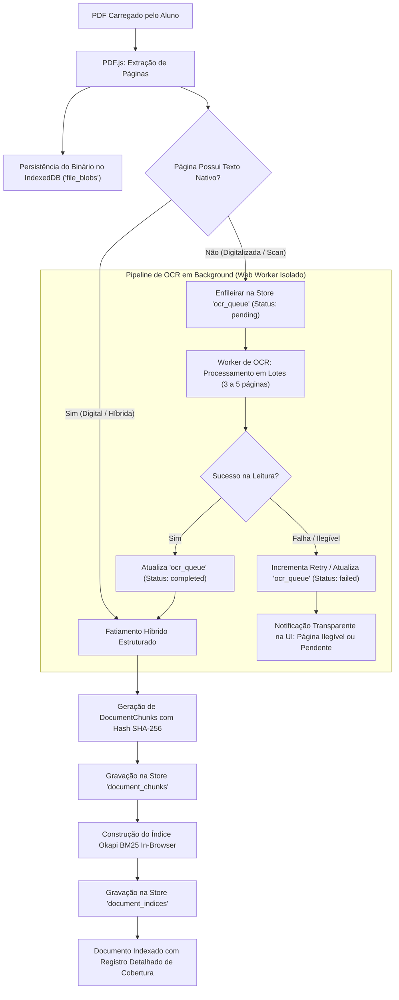
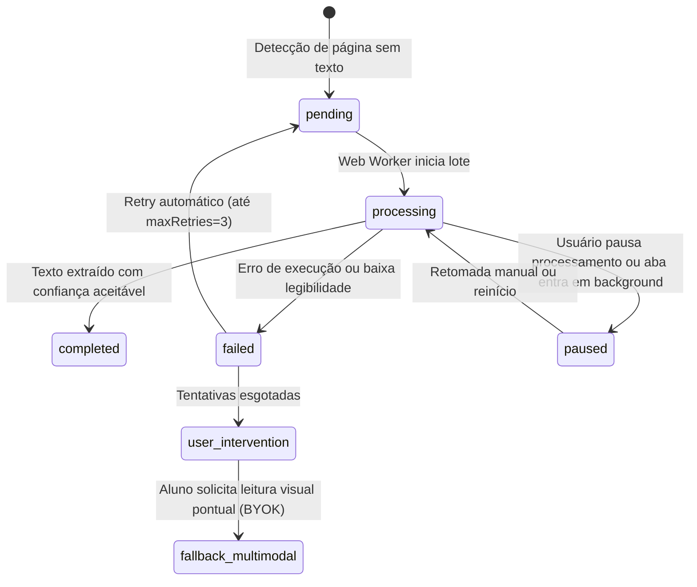
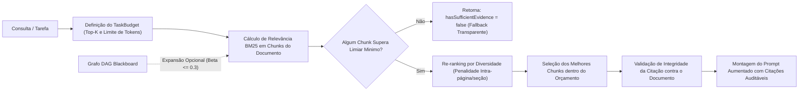

# NEUROCLASS AI — RAG IMPLEMENTATION BLUEPRINT (v1.1 REVISADO)
**Especificação Técnica de Engenharia de Arquitetura, Recuperação Contextual e Pipeline OCR Local**  
**Versão:** 1.1.0 (Revisão Pós-Auditoria de Conformidade)  
**Data:** 11 de Novembro de 2026  
**Status:** Especificação Executável para Revisão e Aprovação (Zero Código Alterado | Zero Consumo de Quotas)  
**Ambiente Autorizado de Trabalho:** `/home/anunnaki/Downloads/Pos_Neurociencias_Comportamento/neuroClassAI-work`  
**Clone Original Intocado:** `/home/anunnaki/Downloads/Pos_Neurociencias_Comportamento/neuroClassAI`  
**Branch de Referência:** `feature/fase2-aprendizagem-cognitiva`  
**HEAD de Referência:** `987c2682e9878b180cca309735abd0e081e5b85a`  
**Índice Git Staged:** 39 arquivos staged rigorosamente preservados  
**Consumo de Quota de IA / Gemini nesta Missão:** ZERO ($0.00)

---

## 1. RESUMO EXECUTIVO (v1.1)

### 1.1 O Que É RAG no NeuroClass AI
O NeuroClass AI é uma plataforma de aprendizagem ativa alicerçada nas neurociências e ciências cognitivas. Seus pilares centrais — o método socrático ([`TutorPanel.tsx`](file:///home/anunnaki/Downloads/Pos_Neurociencias_Comportamento/neuroClassAI-work/src/components/tutor/TutorPanel.tsx)), o Efeito Feynman de autoexplicação ([`AgoraEuExplicoModal.tsx`](file:///home/anunnaki/Downloads/Pos_Neurociencias_Comportamento/neuroClassAI-work/src/components/explanation/AgoraEuExplicoModal.tsx)), o Ciclo Pedagógico C.R.E.A.R. em 5 estágios ([`CrearCycleModal.tsx`](file:///home/anunnaki/Downloads/Pos_Neurociencias_Comportamento/neuroClassAI-work/src/components/crear/CrearCycleModal.tsx)) e a repetição espaçada longitudinal FSRS-7 ([`SpacedReviewModal.tsx`](file:///home/anunnaki/Downloads/Pos_Neurociencias_Comportamento/neuroClassAI-work/src/components/review/SpacedReviewModal.tsx)) — exigem acesso contínuo e preciso às evidências originais fornecidas pelo estudante.

Atualmente, o sistema apresenta **cegueira documental comprovada em código**:
1. O **Tutor Socrático** ([`TutorPanel.tsx:508-512`](file:///home/anunnaki/Downloads/Pos_Neurociencias_Comportamento/neuroClassAI-work/src/components/tutor/TutorPanel.tsx#L508-L512)) recebe estaticamente **apenas os primeiros 350 caracteres das primeiras 4 páginas**. Páginas 5 em diante são 100% invisíveis ao Tutor durante as interações.
2. O **Agora Eu Explico** ([`App.tsx:759-763`](file:///home/anunnaki/Downloads/Pos_Neurociencias_Comportamento/neuroClassAI-work/src/App.tsx#L759-L763)) e o **Ciclo C.R.E.A.R.** ([`App.tsx:796-800`](file:///home/anunnaki/Downloads/Pos_Neurociencias_Comportamento/neuroClassAI-work/src/App.tsx#L796-L800)) recebem apenas os primeiros 300 caracteres das primeiras 5 páginas.
3. A **Análise Inicial** ([`server.ts:1011-1018`](file:///home/anunnaki/Downloads/Pos_Neurociencias_Comportamento/neuroClassAI-work/server.ts#L1011-L1018)) realiza amostragem silenciosa (*step sampling*) em documentos com mais de 50 páginas e trunca o texto de cada página em 1.500 caracteres ([`server.ts:1157`](file:///home/anunnaki/Downloads/Pos_Neurociencias_Comportamento/neuroClassAI-work/server.ts#L1157)).
4. **Documentos digitalizados (scans)** geram imagens de canvas para renderização visual, mas não possuem pipeline de extração de texto local, permanecendo em estado pendente sem indexação pesquisável.

**RAG (Retrieval-Augmented Generation) Local-First** no NeuroClass AI é a solução de engenharia que:
- Fatiará e indexará **100% do conteúdo textual extraível** de todas as páginas locais.
- Submeterá páginas puramente digitalizadas a um **pipeline de OCR local em background** com fila, lotes, pausa, retomada e retry.
- Recuperará os trechos mais pertinentes a cada pergunta ou tarefa com base em orçamentos específicos de contexto, diversidade de páginas e seções, e checagem de suficiência de evidências.
- Fornecerá citações auditáveis com número da página física e verificação contra o texto original.

### 1.2 Por Que RAG Não É Resumo
- **Resumo:** Condensa e comprime o material, descartando 90% a 98% dos detalhes empíricos, fórmulas, coeficientes, tabelas e notas explicativas. Gera generalizações imprecisas.
- **RAG:** Preserva 100% do texto original armazenado em sua resolução máxima. Quando o estudante questiona um parâmetro técnico na página 142 de um tratado de 300 páginas, o motor recupera o parágrafo exato, permitindo que a IA fundamente a resposta com citação verificável.

### 1.3 Fluxo Ponta a Ponta do Pipeline RAG e OCR

```
[PDF do Estudante (100% Páginas)]
            │
            ▼
[Inspeção e Extração PDF.js] ───────────────┐
 (Detecta texto, TOC e operadores visuais)  │
            │                               │
    ┌───────┴───────┐                       │
    ▼               ▼                       ▼
[Páginas com   [Páginas Escaneadas    [Binário original.pdf]
 Texto Nativo]  (Sem texto nativo)]   (Salvo no disco/IDB)
    │               │
    │               ▼
    │          [Fila de OCR em Background (Web Worker)]
    │          - Processamento em lotes (3 a 5 págs)
    │          - Checkpoint no IndexedDB ('ocr_queue')
    │          - Pausa, Retomada, Cancelamento, Retry
    │          - Extração de texto por página digitalizada
    │               │
    └───────┬───────┘
            ▼
[Fatiamento Híbrido Estruturado]
 (Parágrafos semânticos, 300-500 tokens, overlap 80 tokens, preservação de tabelas e fórmulas)
            │
            ▼
[Persistência Local-First no IndexedDB v5]
 (Stores: 'document_chunks', 'document_indices', 'ocr_queue')
            │
            ▼
[Índice Invertido Okapi BM25 In-Browser]
 (Normalização PT-BR, preservação de siglas técnicas, DF e IDF serializados)
            │
            ▼
[Consulta do Estudante / Tarefa Pedagógica]
 (Tutor Socrático, Autoexplicação Feynman ou Ciclo C.R.E.A.R.)
            │
            ▼
[Motor de Recuperação Contextual]
 - Orçamento de tokens e Top-K por tarefa
 - Re-ranking por diversidade de páginas e seções
 - Expansão controlada pelo Grafo DAG do Blackboard (opcional e ponderada)
 - Corte por limiar: se insuficiente, declaração transparente sem alucinação
            │
            ▼
[Resposta Aumentada com Citação Auditável]
 (Citação verificada contra o texto do documento no cliente)
```

---

## 2. MAPA DA ARQUITETURA ATUAL E PONTOS DE INTEGRAÇÃO

A inspeção detalhada do repositório confirma a seguinte organização de componentes:

| Componente | Arquivo Real | Símbolos e Funções Chave | Contratos Atuais | Ponto de Integração RAG |
| :--- | :--- | :--- | :--- | :--- |
| **Extração PDF** | [`src/services/documents/pdfService.ts`](file:///home/anunnaki/Downloads/Pos_Neurociencias_Comportamento/neuroClassAI-work/src/services/documents/pdfService.ts) | `extractPdfDocument`, `extractOutline`, `inspectPdfOverview`, `renderPdfPageToImageBase64` | `DocumentSource`, `DocumentPage`, `TableOfContentsItem` | Alimentará a fila de OCR para páginas com `isScanned: true` e o fatiador para páginas textuais. |
| **Persistência Local-First** | [`src/services/storage/workspaceStorage.ts`](file:///home/anunnaki/Downloads/Pos_Neurociencias_Comportamento/neuroClassAI-work/src/services/storage/workspaceStorage.ts) | `WorkspaceStorage`, `saveOriginalPdf`, `saveDocument`, `saveAnalysis`, `exportWorkspaceBackup` | `StorageMode`, `WorkspaceManifest`, `SubjectBundle` | Orquestrará a gravação atômica dos chunks e do manifesto de índices. |
| **IndexedDB** | [`src/services/persistence/indexedDb.ts`](file:///home/anunnaki/Downloads/Pos_Neurociencias_Comportamento/neuroClassAI-work/src/services/persistence/indexedDb.ts) | `openDB`, `DB_VERSION = 4`, 10 object stores (`documents`, `analyses`, `file_blobs`, etc.) | `NeuroClassDB` | Receberá evolução de schema para `v5` com as stores `document_chunks`, `document_indices` e `ocr_queue`. |
| **Blackboard / DAG** | [`src/components/blackboard/Blackboard.tsx`](file:///home/anunnaki/Downloads/Pos_Neurociencias_Comportamento/neuroClassAI-work/src/components/blackboard/Blackboard.tsx) | `Blackboard`, renderização SVG de nós e arestas de pré-requisitos | `Concept`, `ConceptRelationship`, `EpistemicStatus` | Fornecerá termos de expansão semântica controlada para consultas conceituais. |
| **Tutor Socrático** | [`src/components/tutor/TutorPanel.tsx`](file:///home/anunnaki/Downloads/Pos_Neurociencias_Comportamento/neuroClassAI-work/src/components/tutor/TutorPanel.tsx) | `TutorPanel`, `handleSendMessage`, chamada a `requestTutorResponse` | `TutorChatMessage`, `documentExcerpts` | Substituirá `activeDocument.pages.slice(0, 4)` por `retrieveContextForQuery` (orçamento: 1.500 tokens). |
| **Agora Eu Explico** | [`src/components/explanation/AgoraEuExplicoModal.tsx`](file:///home/anunnaki/Downloads/Pos_Neurociencias_Comportamento/neuroClassAI-work/src/components/explanation/AgoraEuExplicoModal.tsx) | Modal Feynman, avaliação de rubrica | `LearningAttempt`, `RubricEvaluation` | Receberá evidências canônicas do autor sobre o conceito explicado (orçamento: 2.500 tokens). |
| **Ciclo C.R.E.A.R.** | [`src/components/crear/CrearCycleModal.tsx`](file:///home/anunnaki/Downloads/Pos_Neurociencias_Comportamento/neuroClassAI-work/src/components/crear/CrearCycleModal.tsx) | Modais dos 5 estágios de aprendizagem | `LearningSession`, `LearningAttempt` | Cada estágio receberá trechos com orçamentos específicos; estágio 5 (Recuperar) opera em Blind Recall (zero trechos). |
| **FSRS-7 Longitudinal** | [`src/components/review/SpacedReviewModal.tsx`](file:///home/anunnaki/Downloads/Pos_Neurociencias_Comportamento/neuroClassAI-work/src/components/review/SpacedReviewModal.tsx) | Motor `ts-fsrs@6.0.0`, fila de revisão espaçada | `ConceptReviewSchedule` | Permitirá gerar cartões de recordação ativa ancorados em trechos de qualquer página do documento. |
| **Segurança BYOK** | [`src/services/ai/aiKeyManager.ts`](file:///home/anunnaki/Downloads/Pos_Neurociencias_Comportamento/neuroClassAI-work/src/services/ai/aiKeyManager.ts) | Gerenciador em memória volátil | Chave volátil | Preservação total: nenhuma chave de API trafega nos índices, chunks ou IndexedDB. |

---

## 3. ARQUITETURA-ALVO REVISADA

### 3.1 Diagrama de Ingestão Híbrida e Fila de OCR (Mermaid)



### 3.2 Diagrama de Fila de OCR com Controle de Estado (Mermaid)



### 3.3 Diagrama de Recuperação com Orçamento e Diversidade (Mermaid)



---

## 4. MODELO DE DADOS E CONTRATOS TYPESCRIPT (REVISADO)

Abaixo estão formalizados os novos contratos de dados para a camada RAG e OCR. Nenhum contrato existente em [`src/types/index.ts`](file:///home/anunnaki/Downloads/Pos_Neurociencias_Comportamento/neuroClassAI-work/src/types/index.ts) é quebrado:

```typescript
/**
 * Especificação dos Contratos de Dados para RAG e OCR Local-First
 * Destino futuro: src/types/rag.ts
 */

export type ChunkContentType =
  | 'prose'
  | 'heading'
  | 'list'
  | 'table_text'
  | 'formula_explanation'
  | 'figure_caption'
  | 'chart_analysis'
  | 'ocr_extracted_text';

export interface DocumentChunk {
  chunkId: string; // `${documentId}_p${pageNumber}_c${chunkIndexInPage}`
  documentId: string;
  pageNumber: number;
  chunkIndexInPage: number;
  globalChunkIndex: number;
  text: string;
  sectionTitle?: string;
  sectionHierarchy?: string[];
  tokenCount: number;
  charOffsetStart: number;
  charOffsetEnd: number;
  contentType: ChunkContentType;
  multimodalReferences?: {
    figureLabels?: string[];
    tableLabels?: string[];
    formulaExpressions?: string[];
    chartLabels?: string[];
  };
  sha256Hash: string;
  pipelineVersion: string;
  isOcrDerived?: boolean;
  createdAt: number;
}

export type OcrPageStatus =
  | 'pending'
  | 'processing'
  | 'completed'
  | 'failed'
  | 'paused';

export interface OcrQueueItem {
  id: string; // `${documentId}_p${pageNumber}`
  documentId: string;
  pageNumber: number;
  status: OcrPageStatus;
  retryCount: number;
  maxRetries: number;
  confidenceScore?: number; // 0.0 a 1.0 (retornado pelo motor OCR)
  errorMessage?: string;
  executionTimeMs?: number;
  enqueuedAt: number;
  processedAt?: number;
}

export type RetrievalTaskType =
  | 'tutor_chat'
  | 'agora_eu_explico_eval'
  | 'crear_contextualize'
  | 'crear_relate'
  | 'crear_explain'
  | 'crear_apply'
  | 'fsrs_card_generation'
  | 'general_search';

export interface TaskContextBudget {
  task: RetrievalTaskType;
  maxTokens: number;
  preferredTopK: number;
  maxTopK: number;
  allowDagExpansion: boolean;
  dagExpansionWeight: number; // 0.0 a 0.3
  minScoreThreshold: number;
  enforcePageDiversity: boolean;
}

export interface RetrievalQuery {
  text: string;
  documentId: string;
  taskType: RetrievalTaskType;
  customBudget?: Partial<TaskContextBudget>;
  pageRange?: { startPage: number; endPage: number };
  sectionFilter?: string;
  activeConceptId?: string;
}

export interface RetrievedEvidence {
  chunkId: string;
  documentId: string;
  pageNumber: number;
  sectionTitle?: string;
  text: string;
  contentType: ChunkContentType;
  bm25Score: number;
  dagBonusScore: number;
  finalScore: number;
  matchedTerms: string[];
  formattedCitation: string;
  sourceVerificationHash: string;
}

export interface RetrievalResult {
  query: string;
  documentId: string;
  taskType: RetrievalTaskType;
  evidences: RetrievedEvidence[];
  totalCandidateChunks: number;
  totalTokensUsed: number;
  executionTimeMs: number;
  hasSufficientEvidence: boolean;
  insufficientEvidenceReason?: 'NO_CHUNKS_ABOVE_THRESHOLD' | 'EMPTY_QUERY' | 'DOCUMENT_NOT_INDEXED';
  coverageNotice?: string;
}

export interface DetailedProcessingCoverage {
  documentId: string;
  totalPages: number;
  ingestion: {
    totalPagesCount: number;
    extractedPagesCount: number;
    extractedPageNumbers: number[];
    isComplete: boolean;
  };
  ocr: {
    totalScannedPagesCount: number;
    processedOcrPagesCount: number;
    pendingOcrPagesCount: number;
    failedOcrPagesCount: number;
    failedPageNumbers: number[];
    averageConfidence: number;
  };
  chunking: {
    totalChunksGenerated: number;
    coveredPagesCount: number;
    coveredPageNumbers: number[];
    averageChunksPerPage: number;
  };
  indexing: {
    totalIndexedChunks: number;
    indexedVocabularySize: number;
    isFullyIndexed: boolean;
  };
  multimodal: {
    figuresDetected: number;
    tablesDetected: number;
    formulasDetected: number;
    chartsDetected: number;
  };
  updatedAt: number;
}
```

---

## 5. ESTRATÉGIA DE CHUNKING HÍBRIDA ORIENTADA À ESTRUTURA

### 5.1 Comparativo Rigoroso de Estratégias
- **Parágrafo Puro:** Preserva coesão retórica, mas gera variabilidade extrema (parágrafos de 10 palavras versus parágrafos de 800 palavras).
- **Janela Rígida de Tokens:** Tamanho uniforme, mas fragmenta sentenças e divide fórmulas matemáticas (`E = h \cdot \nu`) e tabelas no meio.
- **Híbrida Estruturada (Adotada):**
  1. Identifica blocos atômicos estruturais: Cabeçalhos (`heading`), Tabelas Markdown (`table_text`), Fórmulas LaTeX (`formula_explanation`), Legendas (`figure_caption`) e Parágrafos normais (`prose`).
  2. Bloco atômico com menos de 150 tokens é fundido ao parágrafo subsequente da mesma seção.
  3. Bloco atômico com mais de 650 tokens é subdividido **estritamente em fronteiras de frases** (pontuação final `. ! ?` seguida de espaço e maiúscula).
  4. Aplicação de overlap contínuo de 60 a 80 tokens, repetindo a última sentença inteira sem quebrar vocábulos.

### 5.2 Parâmetros Iniciais (Hipóteses a Validar em Corpus)
- **Target Ideal:** 350 a 500 tokens por chunk.
- **Limite Inferior:** 150 tokens (evita chunks sem densidade informacional).
- **Limite Superior:** 650 tokens (evita saturação da janela de contexto).
- **Overlap:** 80 tokens nominais (com limite de 1 frase completa).
- **Estimativa de Tokens em PT-BR:** $\text{Tokens} = \max\left(\lceil \text{chars} / 3.8 \rceil, \lceil \text{words} \times 1.33 \rceil\right)$.

---

## 6. INDEXAÇÃO E RECUPERAÇÃO LEXICAL (OKAPI BM25 + DIVERSIDADE + PARÁFRASES)

### 6.1 Algoritmo Okapi BM25 e Calibração
A relevância de um chunk $D$ para a consulta $Q = \{q_1, \ldots, q_n\}$ é dada por:

$$\text{Score}(D, Q) = \sum_{i=1}^{n} \text{IDF}(q_i) \cdot \frac{f(q_i, D) \cdot (k_1 + 1)}{f(q_i, D) + k_1 \cdot \left(1 - b + b \cdot \frac{|D|}{\text{avgdl}}\right)}$$

- **Parâmetros:** $k_1 = 1.2$, $b = 0.75$.
- **IDF Suavizado:** $\text{IDF}(q_i) = \ln\left( \frac{N - n(q_i) + 0.5}{n(q_i) + 0.5} + 1 \right)$.

### 6.2 Normalização PT-BR e Preservação de Termos Críticos
1. **Folding Diacrítico em Consulta:** Termos de busca são normalizados em minúsculas e sem acentos para indexação (`função` $\rightarrow$ `funcao`), mas o chunk armazenado preserva acentuação gráfica original intacta.
2. **Preservação de Siglas e Fórmulas:** Tokens atômicos como `LTP`, `NMDA`, `SNARE`, `FSRS-7`, `CO2`, `Ca2+`, `E=h\nu`, `V_0` não sofrem remoção de pontuação interna.
3. **Stopwords Conservadoras:** Apenas artigos e conjunções puramente vazias são removidas. Palavras de negação ou modificação de sentido científico (*não, sem, com, contra, mais, menos*) são **obrigatoriamente mantidas**.

### 6.3 Controle de Diversidade de Páginas e Seções
Para prevenir que os $K$ chunks retornados venham todos da mesma página:
- Se um candidato pertencer a uma página física já representada no conjunto de resultados atual, seu score sofre penalidade progressiva:
  $$\text{ScoreFinal} = \text{ScoreOriginal} \times (0.80)^{\text{contagem\_da\_pagina}}$$
- Isso garante dispersão controlada de evidências entre seções do documento.

### 6.4 Expansão Opcional e Controlada pelo Grafo DAG
A expansão da consulta a partir dos conceitos do Blackboard:
- É controlada por flag explícito: `allowDagExpansion: boolean`.
- Possui peso regulado: $\text{BonusScore} = \beta \times \text{BM25Score}(\text{TermosDAG})$, onde $\beta \le 0.30$.
- Será submetida a teste comparativo A/B offline: se o ganho de Recall@5 não superar 5% em relação ao BM25 puro, a expansão permanece desativada por padrão.

### 6.5 Declaração de Insuficiência e Política Fail-Closed
- **Limiar de Corte:** $\theta_{min} = 0.20$.
- Se o melhor chunk obtiver score menor que $\theta_{min}$, a recuperação retorna:
  `hasSufficientEvidence = false` e `insufficientEvidenceReason = 'NO_CHUNKS_ABOVE_THRESHOLD'`.
- O prompt é alimentado com a instrução estrita de não alucinar:
  > *"O material fornecido não contém informações suficientes sobre este tópico específico. Informe ao estudante com clareza que o tema não foi localizado no documento de referência."*

---

## 7. ARQUITETURA CONCRETA DE OCR E TRATAMENTO MULTIMODAL

### 7.1 Rejeição de `scanned_image_no_ocr` como Conclusão
O estado `scanned_image_no_ocr` é categorizado formalmente como **pendência de processamento ou falha**, e nunca como estado satisfatório final. Toda página escaneada deve passar pelo pipeline de OCR ou ser explicitamente marcada como falha com justificativa (ex: borrão irrecuperável, documento ilegível).

### 7.2 Alternativas Locais de OCR para Português do Brasil
A arquitetura contempla três alternativas avaliadas tecnicamente:

| Abordagem | Mecanismo | Vantagens | Limitações / Custos | Papel na Arquitetura |
| :--- | :--- | :--- | :--- | :--- |
| **Alternativa 1 (Primária Local): Tesseract.js em Web Worker** | WebAssembly + `por_fast.traineddata` (~1.5MB) ou `por.traineddata` (~15MB) | 100% offline, executa em thread separada sem travar a UI, suporte robusto a pt-BR. | Consumo de 150MB a 300MB de RAM temporária no Worker; requer download inicial do arquivo de idioma. | **Pipeline Padrão de Background.** Executa após consentimento do usuário para download do modelo leve (1.5MB). |
| **Alternativa 2 (Aceleração Nativa): Web Shape Detection API** | Interface `TextDetector` do navegador (quando disponível) | Zero download de biblioteca, velocidade acelerada por hardware do SO. | Disponível apenas em alguns builds Chromium sob flag; não universal. | **Atalho Oportunista:** Se disponível nativamente, o Worker utiliza; caso contrário, usa Alternativa 1. |
| **Alternativa 3 (Sob Demanda com BYOK): Visão Multimodal Gemini** | Envio da imagem da página isolada via endpoint `/api/gemini/analyze-document` com chave do aluno | Precisão superior em caligrafias antigas ou scans oxidados. | Consome quota de API do estudante; requer conexão de rede. | **Recurso de Contingência:** Acionado apenas individualmente pelo estudante para páginas que falharam no OCR local. |

### 7.3 Gerenciador de Fila de OCR: Lotes, Retomada e Resiliência
Para garantir que o OCR não degrade o desempenho da aplicação:
1. **Fila Persistente no IndexedDB (`ocr_queue`):** Cada página escaneada é registrada com status `pending`.
2. **Processamento em Lotes (Batches):** O Web Worker consome lotes pequenos de **3 a 5 páginas por vez**.
3. **Gestão de Memória no Worker:** Após cada lote, o Worker executa limpeza explícita de canvases e referências de memória. Se o uso de memória exceder 250MB, o Worker é reciclado (`worker.terminate()` seguido de recriação limpa).
4. **Checkpoint Atômico:** Ao concluir cada página, o texto é persistido em `document_chunks` e o status na `ocr_queue` é atualizado para `completed`.
5. **Pausa e Retomada:** O estudante pode pausar o OCR a qualquer momento. Se a aba for fechada, o processamento recomeça da primeira página `pending` ao reabrir.
6. **Política de Retry:** Páginas com erro sofrem até 3 tentativas com ajuste de binarização (threshold de contraste). Após 3 falhas, a página entra em `failed` com código de erro detalhado.

### 7.4 Extração e Recuperação de Ativos Multimodais
- **Tabelas:** Extraídas como matriz de texto e serializadas no formato Markdown dentro do chunk:
  `[Tabela 1 | Pág. 3: Funções de Trabalho]` acompanhada dos dados tabulados.
- **Fórmulas:** Expressões LaTeX acompanhadas do significado de variáveis (`K_max = h * nu - Phi`).
- **Gráficos e Figuras:** Legendados com descrição estruturada de eixos e tendências.
- **Associação de Imagem (Snippet de Evidência):** O chunk mantém as coordenadas de corte (`charOffset` ou bounding box visual) permitindo que o estudante abra um pop-over visual do gráfico diretamente ao lado da citação.

---

## 8. PERSISTÊNCIA, VERSIONAMENTO E MIGRAÇÃO LOCAL-FIRST

### 8.1 Evolução de Schema: `DB_VERSION = 5`
A migração no arquivo [`src/services/persistence/indexedDb.ts`](file:///home/anunnaki/Downloads/Pos_Neurociencias_Comportamento/neuroClassAI-work/src/services/persistence/indexedDb.ts) é estritamente aditiva:

```typescript
if (oldVersion < 5) {
  // Store de Chunks
  if (!db.objectStoreNames.contains('document_chunks')) {
    const chunkStore = db.createObjectStore('document_chunks', { keyPath: 'chunkId' });
    chunkStore.createIndex('by-document', 'documentId', { unique: false });
    chunkStore.createIndex('by-document-page', ['documentId', 'pageNumber'], { unique: false });
    chunkStore.createIndex('by-hash', 'sha256Hash', { unique: false });
  }

  // Store de Metadados do Índice BM25
  if (!db.objectStoreNames.contains('document_indices')) {
    const indexStore = db.createObjectStore('document_indices', { keyPath: 'documentId' });
    indexStore.createIndex('by-updated', 'indexedAt', { unique: false });
  }

  // Store de Fila e Estado de OCR
  if (!db.objectStoreNames.contains('ocr_queue')) {
    const ocrStore = db.createObjectStore('ocr_queue', { keyPath: 'id' });
    ocrStore.createIndex('by-document', 'documentId', { unique: false });
    ocrStore.createIndex('by-status', 'status', { unique: false });
  }
}
```

### 8.2 Garantias de Não-Regressão e Backup `.neuroclass`
- **Idempotência:** A reindexação não duplica registros. Os identificadores de chunks são determinísticos: `${docId}_p${pageNum}_c${idx}`.
- **Limpeza em Cascata:** Ao excluir um documento via `deleteDocumentCompletely`, uma transação atômica remove todos os registros em `document_chunks`, `document_indices` e `ocr_queue` associados ao `documentId`.
- **Backup Portátil:** Os backups `.neuroclass` continuam leves. Eles preservam o `original.pdf` e o estado pedagógico. Ao importar um `.neuroclass`, os chunks e índices são reconstituídos localmente sem inflar o arquivo ZIP.

---

## 9. INTEGRAÇÃO PEDAGÓGICA E ORÇAMENTOS DE CONTEXTO

O motor de recuperação atende cada tarefa respeitando um orçamento rigoroso de tokens e critérios pedagógicos:

| Tarefa Pedagógica | Componente | Orçamento Máximo de Tokens | Top-K | Expansão DAG | Regra Pedagógica |
| :--- | :--- | :--- | :--- | :--- | :--- |
| **Tutor Socrático** | [`TutorPanel.tsx`](file:///home/anunnaki/Downloads/Pos_Neurociencias_Comportamento/neuroClassAI-work/src/components/tutor/TutorPanel.tsx) | 1.500 tokens | 3 a 5 | Opcional ($\beta=0.2$) | Guiar o aluno socrático apontando onde ler no texto, sem dar a resposta mastigada. |
| **Agora Eu Explico (Feynman)** | [`AgoraEuExplicoModal.tsx`](file:///home/anunnaki/Downloads/Pos_Neurociencias_Comportamento/neuroClassAI-work/src/components/explanation/AgoraEuExplicoModal.tsx) | 2.500 a 3.000 tokens | 5 a 8 | Ativada ($\beta=0.3$) | Confrontar a autoexplicação do estudante com os parágrafos canônicos do autor para detectar imprecisões e lacunas. |
| **C.R.E.A.R. 1: Contextualizar** | [`CrearCycleModal.tsx`](file:///home/anunnaki/Downloads/Pos_Neurociencias_Comportamento/neuroClassAI-work/src/components/crear/CrearCycleModal.tsx) | 1.200 tokens | 3 a 4 | Desativada | Fornecer trechos de introdução, escopo e problema histórico da teoria. |
| **C.R.E.A.R. 2: Relacionar** | [`CrearCycleModal.tsx`](file:///home/anunnaki/Downloads/Pos_Neurociencias_Comportamento/neuroClassAI-work/src/components/crear/CrearCycleModal.tsx) | 1.500 tokens | 4 a 5 | Ativada ($\beta=0.3$) | Fornecer trechos que abordam pré-requisitos, causas e conexões causais. |
| **C.R.E.A.R. 3: Explicar** | [`CrearCycleModal.tsx`](file:///home/anunnaki/Downloads/Pos_Neurociencias_Comportamento/neuroClassAI-work/src/components/crear/CrearCycleModal.tsx) | 2.000 tokens | 5 a 6 | Opcional ($\beta=0.1$) | Trechos com formulações matemáticas, definições exatas e tabelas de referência. |
| **C.R.E.A.R. 4: Aplicar** | [`CrearCycleModal.tsx`](file:///home/anunnaki/Downloads/Pos_Neurociencias_Comportamento/neuroClassAI-work/src/components/crear/CrearCycleModal.tsx) | 1.500 tokens | 4 a 5 | Desativada | Trechos contendo casos práticos, experimentos empíricos ou exercícios. |
| **C.R.E.A.R. 5: Recuperar** | [`CrearCycleModal.tsx`](file:///home/anunnaki/Downloads/Pos_Neurociencias_Comportamento/neuroClassAI-work/src/components/crear/CrearCycleModal.tsx) | **0 tokens** | **0** | Desativada | **Blind Recall Estrito**: Nenhuma evidência é injetada para forçar evocação da memória de longo prazo. |
| **FSRS-7 Geração de Cartões** | [`SpacedReviewModal.tsx`](file:///home/anunnaki/Downloads/Pos_Neurociencias_Comportamento/neuroClassAI-work/src/components/review/SpacedReviewModal.tsx) | 1.000 tokens | 2 a 3 | Desativada | Gerar perguntas pontuais baseadas em passagens literais de qualquer página. |

---

## 10. CITAÇÕES, CONFIABILIDADE E POLÍTICA FAIL-CLOSED

### 10.1 Verificação de Integridade de Citações no Cliente
Antes de renderizar uma citação na interface, a aplicação executa checagem de integridade:
1. Localiza o chunk apontado pelo `chunkId`.
2. Verifica se o trecho citado corresponde a uma correspondência exata de substring ou similaridade $\ge 90\%$ (token match) dentro do chunk.
3. Se confirmada, exibe o selo **"Citação Verificada: Pág. X"**. Se houver discrepância, classifica como síntese da IA.

### 10.2 Prevenção Rigorosa de Alucinações
- É terminantemente proibido à IA inventar números de páginas ou citar seções inexistentes.
- Se a recuperação não retornar evidências satisfatórias, o sistema exibe:
  > *"O material de estudo selecionado não contém evidências diretas sobre esta questão. Deseja formular uma pergunta mais específica ou consultar outro tópico?"*

---

## 11. COBERTURA E OBSERVABILIDADE (METAS A AFERIR VS MEDIÇÕES REAIS)

> [!IMPORTANT]
> **Distinção Obrigatória de Engenharia:**  
> Valores de latência e consumo de memória apresentados abaixo são **Metas de Projeto a Serem Aferidas em Benchmark Formal**, e NÃO medições concluídas. Nenhuma medição de latência será alegada como fato antes da execução de suíte de testes de estresse reproduzível.

### 11.1 Metas de Desempenho do Motor RAG (A Validar em Testes)
- **Tempo de Recuperação BM25 (Meta):** $\le 20\text{ms}$ para documentos de até 150 páginas no thread do navegador.
- **Consumo de Memória do Índice (Meta):** $\le 25\text{MB}$ de RAM em documentos de até 300 páginas.
- **Velocidade do Worker de OCR (Meta):** $\le 4\text{s}$ por página em CPU desktop padrão utilizando `por_fast`.

### 11.2 Métricas de Cobertura Documental Independente
O painel de diagnóstico documental relatará separadamente:
1. **Cobertura de Ingestão:** $\frac{N_{\text{páginas\_extraídas}}}{N_{\text{páginas\_totais}}}$.
2. **Cobertura de OCR:** $\frac{N_{\text{páginas\_ocr\_concluídas}}}{N_{\text{páginas\_digitalizadas}}}$.
3. **Cobertura de Indexação:** $\frac{N_{\text{chunks\_indexados}}}{N_{\text{chunks\_gerados}}}$.
4. **Taxa de Sucesso em Consultas:** Proporção de consultas que superam o limiar $\theta_{min}$.

---

## 12. PLANO DE TESTES COM CORPUS MULTIDISCIPLINAR E PROTOCOLO DE AVALIAÇÃO

### 12.1 Matriz de Casos de Teste Automatizados

| ID do Teste | Material de Entrada | Tipo de Consulta | Métrica de Avaliação | Critério de Aceite |
| :--- | :--- | :--- | :--- | :--- |
| **TEST-RAG-01** | `CORPUS_SCENARIO_A` (5 págs) | Consulta Literal: *"frequência limiar nu_0"* | Recall@3 e Precision@3 | Chunk da página 3 é o 1º colocado com score $> 1.5$. |
| **TEST-RAG-02** | `CORPUS_SCENARIO_A` | Paráfrase Conceitual: *"como a barreira energética do metal impede a saída de elétrons"* | Recall@5 | Chunks das páginas 3 e 4 recuperados entre os 5 primeiros. |
| **TEST-RAG-03** | `CORPUS_SCENARIO_B` (Scan 3 págs) | Entrada na Fila de OCR | Transição de Estado e Checkpoint | Páginas entram em `pending`, são processadas pelo Worker e atingem `completed` ou `failed` com registro auditável. |
| **TEST-RAG-04** | `CORPUS_SCENARIO_C` (Tratado 120 págs) | Consulta na 2ª Metade: *"Satisficing e racionalidade limitada"* | Recall@5 na Página 98 | Chunks das páginas 98 a 105 retornados, superando o limite anterior de 4 páginas. |
| **TEST-RAG-05** | `CORPUS_SCENARIO_C` | Avaliação de Diversidade | Dispersão de Páginas | Os 5 chunks retornados para consultas amplas abrangem no mínimo 3 páginas distintas. |
| **TEST-RAG-06** | Qualquer Documento | Consulta sem Relação: *"Reações nucleares em Herbert Simon"* | Fail-Closed Check | `hasSufficientEvidence = false`; zero chunks injetados; ativa aviso de ausência. |
| **TEST-RAG-07** | Corpus Geral | Teste A/B com Expansão DAG | $\Delta\text{Recall@5}$ | Mensurar ganho real de Recall com $\beta=0.2$ comparado a BM25 puro. |
| **TEST-RAG-08** | Suíte Existente | Execução de `npm test` | Não-Regressão | 192/192 testes existentes aprovados sem qualquer falha. |

### 12.2 Protocolo de Avaliação de Recuperação (Recall@K, Precision@K, MRR)
Será construído um dataset de avaliação offline contendo **20 consultas balanceadas**:
- **10 Consultas Literais/Técnicas:** Siglas, fórmulas e nomes próprios (ex: *"E = h nu"*, *"Lámina I Ramón y Cajal"*, *"satisficing"*).
- **10 Paráfrases Conceituais:** Perguntas dissertativas sem as palavras-chave exatas do texto.
- **Métricas Alvo:** Recall@5 $\ge 85\%$ e MRR $\ge 0.75$.

---

## 13. PLANO DE IMPLEMENTAÇÃO INCREMENTAL (8 MISSÕES SEGURAS)

A implementação segue 8 missões pequenas, autônomas e reversíveis:

- **Missão A — Contratos TypeScript e Fatiador Estruturado Local:**
  Criação dos tipos em `src/types/rag.ts` e do serviço de chunking híbrido em `src/services/documents/chunkingService.ts`. Testes em `src/tests/rag_chunking.test.ts`. Zero impacto em IA.
- **Missão B — Persistência Local e IndexedDB v5:**
  Adição das stores `document_chunks`, `document_indices` e `ocr_queue` em `indexedDb.ts` com versão 5. Testes em `src/tests/rag_persistence.test.ts`.
- **Missão C — Motor de Indexação e Busca Okapi BM25:**
  Implementação de `src/services/search/bm25SearchService.ts` com normalização PT-BR, ranking e diversidade de páginas. Testes em `src/tests/rag_bm25.test.ts`.
- **Missão D — Serviço de Recuperação Contextual e Avaliação Offline:**
  Implementação de `src/services/search/retrievalService.ts` com suporte a `TaskContextBudget`, expansão opcional pelo DAG e dataset de 20 perguntas para aferir Recall@K e MRR.
- **Missão E — Integração no Tutor Socrático:**
  Substituição de `pages.slice(0, 4)` no `TutorPanel.tsx` por consulta dinâmica dentro do orçamento de 1.500 tokens, com fallback para o conceito ativo.
- **Missão F — Integração no Agora Eu Explico e Ciclo C.R.E.A.R.:**
  Adequação dos modais em `App.tsx` para consumir trechos contextualizados por estágio pedagógico.
- **Missão G — Worker de OCR Local e Tratamento Multimodal:**
  Implementação do Web Worker de OCR em background com fila, processamento em lotes, retomada e retry para páginas digitalizadas.
- **Missão H — Painel de Cobertura, Hardening e Validação Final:**
  Exibição de cobertura independente na UI, exclusão em cascata de índices e validação dos 192 testes preexistentes.

---

## 14. DECISÕES E ALTERNATIVAS COMPARADAS COM TRADE-OFFS

| Tópico de Decisão | Alternativa Recomendada | Alternativa Descartada | Razão Técnica da Escolha |
| :--- | :--- | :--- | :--- |
| **Motor de Busca** | **BM25 Puro em TypeScript** (próprio, sem dependências) | Biblioteca externa (`minisearch`, `flexsearch`) | Elimina dependências externas no `package.json`, permite normalização científica PT-BR customizada e garante reversibilidade total. |
| **Estratégia de OCR** | **Web Worker com Tesseract leve em lotes de 3 a 5 págs** | OCR bloqueante na thread principal ou ignorar scans | O Worker não congela a interface; lotes pequenos evitam estouro de memória; controle de fila com checkpoint garante retomada. |
| **Orçamento de Contexto** | **Orçamento calibrado por tarefa pedagógica** | Top-K fixo genérico para tudo | Cada etapa pedagógica possui demandas cognitivas distintas (o Tutor precisa de 3 a 5 chunks concisos; a avaliação Feynman precisa de até 8 chunks densos). |
| **Expansão de Consulta** | **Expansão opcional e ponderada pelo DAG ($\beta \le 0.3$)** | Expansão obrigatória sem peso | Evita que termos periféricos do grafo contaminem a busca lexical com falsos positivos. |

---

## 15. MATRIZ DE RASTREABILIDADE (REQUISITOS $\rightarrow$ ENGENHARIA)

| Requisito do Produto | Componente Responsável | Contrato / Arquivo | Teste Automatizado | Critério de Aceite |
| :--- | :--- | :--- | :--- | :--- |
| **Fim da cegueira no Tutor** | `RetrievalEngine` + `TutorPanel` | `retrievalService.ts`, `TutorPanel.tsx` | `rag_tutor_integration.test.ts` | Perguntas sobre páginas $> 4$ recebem evidências da página correta. |
| **Processamento de Scans** | `OcrWorkerManager` | `ocrWorker.ts`, `indexedDb.ts` | `rag_ocr_queue.test.ts` | Páginas digitalizadas transitam de `pending` para `completed` com checkpoint. |
| **Diversidade de Evidências** | `BM25SearchService` | `bm25SearchService.ts` | `rag_bm25.test.ts` | Resultados para consultas amplas distribuem-se entre diferentes páginas físicas. |
| **Política Fail-Closed** | `RetrievalEngine` | `retrievalService.ts` | `rag_retrieval.test.ts` | Consultas sem correspondência retornam `hasSufficientEvidence = false` sem alucinar. |
| **Preservação de Sigilo BYOK** | `AIKeyManager` | `aiKeyManager.ts` | `byok_and_multidisciplinary.test.ts` | Chaves de API mantidas exclusivamente em memória volátil. |
| **Não-Regressão Geral** | Suíte de Testes | `src/tests/*` | `npm test` | 192/192 testes existentes aprovados. |

---

## 16. CHECKLIST DE PROTEÇÃO E AUDITORIA DE CONFORMIDADE

- [x] **Auditoria de Integridade Concluída:** Relatório factual da situação de ambos os clones apresentado formalmente.
- [x] **Clone Original Preservado:** Zero novas operações realizadas no clone original nesta missão.
- [x] **Workspace de Trabalho Confirmado:** `/home/anunnaki/Downloads/Pos_Neurociencias_Comportamento/neuroClassAI-work`.
- [x] **Branch Confirmada:** `feature/fase2-aprendizagem-cognitiva`.
- [x] **HEAD Confirmado:** `987c2682e9878b180cca309735abd0e081e5b85a`.
- [x] **Índice Git Staged Preservado:** Exatamente 39 arquivos staged.
- [x] **Operações Git de Escrita:** ZERO operações executadas (`add`, `commit`, `push`, `reset`, `checkout`, `stash`, `write-tree` não foram chamados).
- [x] **Código de Produção em `src/`:** ZERO arquivos modificados ou criados nesta missão.
- [x] **Consumo de APIs e Quota Gemini:** ZERO ($0.00).
- [x] **Blueprint Revisado Salvo Fora dos Repositórios:** `/tmp/NEUROCLASS_RAG_IMPLEMENTATION_BLUEPRINT_v1.1.md`.

