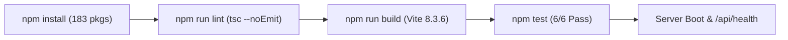

# RELATÓRIO TÉCNICO DE ENTREGA — MISSÃO 00.1
## BOOTSTRAP DO REPOSITÓRIO E PREPARAÇÃO DO AMBIENTE LOCAL

**Data:** 07 de Novembro de 2026
**Engenharia Responsável:** Engenharia de Software Sênior & Arquitetura de Soluções
**Ambiente:** Google Antigravity IDE 2.6.0 | Linux x86_64 | openSUSE Tumbleweed
**Repositório Oficial:** [github.com/enps2015/neuroClassAI](https://github.com/enps2015/neuroClassAI)
**Workspace Original (Intacto):** `/home/anunnaki/Downloads/Pos_Neurociencias_Comportamento/neuroClassAI`
**Clone de Trabalho Independente:** `/home/anunnaki/Downloads/Pos_Neurociencias_Comportamento/neuroClassAI-work`
**Status da Missão:** Concluída com 100% de Sucesso (Zero Commits / Zero Push / Workspace Original Intacto)

---

### 1. LOCALIZAÇÃO DO CLONE

O clone independente foi provisionado no diretório irmão:
`/home/anunnaki/Downloads/Pos_Neurociencias_Comportamento/neuroClassAI-work`

- O workspace original em `/home/anunnaki/Downloads/Pos_Neurociencias_Comportamento/neuroClassAI` permanece **100% intacto**, sem pasta `.git` e sem `node_modules`.

---

### 2. COMMIT DE ORIGEM E BRANCH CRIADA

- **Commit de Origem na `main` Remota:**
  `49569c3dfeeaa6c9c341088c1a5cc9535bffb5b6` (*"feat: initialize NeuroClass AI project structure"*, 06/11/2026 21:16:24 -0300).
- **Branch de Trabalho Criada:**
  `chore/antigravity-bootstrap` (ramificada a partir de `main` em `49569c3`).
- **Governança:** A branch `main` não foi alterada. Nenhum commit e nenhum push foram realizados.

---

### 3. COMPARAÇÃO COMPLETA ENTRE WORKSPACE ORIGINAL E REMOTO

A comparação bidirecional detalhada entre o workspace original e o repositório remoto oficial revelou:

| Categoria | Arquivos / Diretórios | Detalhes |
| :--- | :--- | :--- |
| **Arquivos Idênticos (100% Byte a Byte)** | 30 arquivos: `src/` (todos os componentes, serviços, testes e tipos), `public/pdf.worker.min.mjs`, `server.ts`, `bun.lock`, `package.json`, `tsconfig.json`, `vite.config.ts`, `index.html`, `metadata.json`, `.gitignore`, `.env.example`, `.aistudio/artifacts/...` | Código da Fase 1 homologada coincide estritamente com o commit `49569c3`. |
| **Exclusivos do Workspace Original** | `docs/` (`fase1_implementation_plan.md`, `fase1_implementation_plan_revisado.md`, `fase1_implementation_plan_revisado2.md`, `Relatorio_Fase1_NeuroClass_AI_2026-11-06.md`) e `README.md` | A documentação da Fase 1 e o README genérico não constam no GitHub. |
| **Exclusivos do Repositório Remoto** | `.git/` | Metadados de versionamento existem apenas no repositório. |
| **Arquivos Modificados** | **Nenhum** | Não há divergência de conteúdo em nenhum arquivo comum. |

---

### 4. ARQUIVOS LOCAIS PRESERVADOS E SANITIZAÇÃO

Todos os arquivos da pasta `docs/` foram inspecionados exaustivamente à procura de dados sensíveis antes de qualquer consideração de versionamento:
- **Caminhos absolutos locais (`/home/anunnaki`):** Zero ocorrências.
- **Credenciais ou Segredos:** Zero chaves expostas (apenas a referência ao identificador `GEMINI_API_KEY`).
- **Endereços de E-mail / Dados Pessoais:** Zero ocorrências (apenas `@google/genai`).

---

### 5. DECISÃO SOBRE `README.md` E `docs/`

1. **`README.md`:**
   - O arquivo `README.md` presente no workspace original é o template padrão não-customizado do Google AI Studio (*"Run and deploy your AI Studio app"*), que havia sido intencionalmente excluído no commit `49569c3` do GitHub.
   - **Recomendação:** Não restaurar o template genérico. Criar, mediante autorização, um `README.md` técnico representativo da plataforma NeuroClass AI, documentando a visão pedagógica C.R.E.A.R., a arquitetura da Fase 1 e as instruções de execução local.
2. **Diretório `docs/`:**
   - **Documentos Recomendados para Incorporação:**
     1. `Relatorio_Fase1_NeuroClass_AI_2026-11-06.md`: Homologação formal da Fase 1.
     2. `fase1_implementation_plan_revisado2.md`: Especificação arquitetural ativa (v2.2) do grafo de pré-requisitos e contratos epistemológicos.
     3. Os planos anteriores (`fase1_implementation_plan.md` e `fase1_implementation_plan_revisado.md`) devem ser arquivados em `docs/fase1/historico/` para rastreabilidade completa.

---

### 6. CAUSA-RAIZ E CORREÇÃO DO `ERESOLVE`

#### 6.1 Investigação da Causa-Raiz
- O `package.json` declarava em `devDependencies`: `"esbuild": "^0.25.0"`.
- O `vite@^8.3.0` declarava como *peer dependency opcional*: `esbuild: "^0.27.0 || ^0.28.0"`.
- O runner `tsx@^4.21.0` possui dependência interna em: `esbuild: "~0.27.0"`.
- O plugin `@tailwindcss/vite@4.3.3` exige `vite: "^5.2.0 || ^6 || ^7 || ^8"`.
- No Google AI Studio, o `bun` tolerava o conflito por não aplicar resolução estrita de peer dependencies.
- No npm v11 (padrão em ambientes Node modernos), a presença de `"esbuild": "^0.25.0"` no projeto raiz forçava uma versão incompatível com o intervalo exigido pelo Vite (`^0.27.0 || ^0.28.0`), resultando em falha imediata `ERESOLVE`.

#### 6.2 Avaliação de Uso Direto e Correção Aplicada
- Verificamos que o projeto **não importa nem utiliza `esbuild` diretamente** em nenhum arquivo de `src/`, `server.ts` ou scripts.
- Foi testada a remoção da entrada redundante `"esbuild": "^0.25.0"` de `devDependencies`.
- **Resultado:** A resolução de dependências do npm tornou-se **100% limpa e nativa**, sem necessidade de `--legacy-peer-deps` ou `--force`. O próprio Vite gerenciou a instalação de sua peer dependency compatível (`esbuild@0.28.2`).

---

### 7. GERENCIADOR DE PACOTES ESCOLHIDO

- **Estratégia Adotada:** **`npm` (v11.17.0)**.
  - O `npm` é a ferramenta nativa e oficial instalada no ambiente openSUSE.
  - Foi gerado o arquivo determinístico `package-lock.json` (190 pacotes auditados, 0 vulnerabilidades).
- **Tratamento do `bun.lock`:**
  - O arquivo `bun.lock` foi **preservado** intacto no repositório para manter a compatibilidade caso o projeto venha a ser aberto ou exportado novamente no AI Studio.

---

### 8. ARQUIVOS DE CONFIGURAÇÃO MODIFICADOS (NO CLONE)

Apenas um arquivo foi ajustado na branch de trabalho `chore/antigravity-bootstrap`:
- [package.json](file:///home/anunnaki/Downloads/Pos_Neurociencias_Comportamento/neuroClassAI-work/package.json):
  1. Remoção de `"esbuild": "^0.25.0"` das `devDependencies` (eliminando o conflito com Vite 8.3).
  2. Adição do script oficial de testes: `"test": "tsx --test src/tests/phase1.test.ts"`.

---

### 9. TESTES EXECUTADOS E RESULTADOS

Todas as validações foram executadas no clone `/home/anunnaki/Downloads/Pos_Neurociencias_Comportamento/neuroClassAI-work`:



#### 9.1 Instalação de Dependências
- `npm install`: 183 pacotes adicionados em 34s, auditados 190 pacotes, **0 vulnerabilidades**.

#### 9.2 Checagem de Tipagem TypeScript
- Comando: `npm run lint` (`tsc --noEmit`).
- **Resultado: ZERO ERROS** (código de saída 0).

#### 9.3 Build de Produção do Frontend
- Comando: `npm run build` (`vite build`).
- **Resultado: SUCESSO** em 454ms (`dist/index.html`, `dist/assets/index-DdxzCu0v.css`, `dist/assets/index-BVyxxmIG.js`).

#### 9.4 Suíte de Testes Unitários da Fase 1
- Comando: `npm test` (`tsx --test src/tests/phase1.test.ts`).
- **Resultado: 6/6 APROVADOS (100% de sucesso)** em 394ms:
  - ✔ T01 & T05: Catálogo de demonstração possui evidências estritas e multirrreferências reais (0.97ms)
  - ✔ T06: Relações conceituais mantêm integridade epistemológica sem alucinação de dados (0.18ms)
  - ✔ T07: Grafo de dependências conceituais e pré-requisitos (DAG) (0.14ms)
  - ✔ T08: Isolamento estrito dos materiais de demonstração (0.16ms)
  - ✔ T11: Resiliência passiva e Circuit Breaker do AIServiceHealth (0.77ms)
  - ✔ Regressão P0: Buffer nunca fica destacado após conversão Base64 e cópias defensivas (0.25ms)

#### 9.5 Inicialização do Servidor e Health Check
- Servidor iniciado localmente na porta 3000 em modo de desenvolvimento.
- **Teste de Rota Estática do Worker:**
  - `GET /pdf.worker.min.mjs` retornou `HTTP 200 OK` com `Content-Type: application/javascript; charset=utf-8` (1.375.838 bytes).
- **Teste de Telemetria Passiva:**
  - `GET /api/health` respondeu perfeitamente com o payload JSON esperado:
    ```json
    {
      "status": "online",
      "version": "2.2",
      "timestamp": 1794052870832,
      "primaryModel": "gemini-3.8-flash",
      "fallbackModels": ["gemini-3.5-flash", "gemini-3.1-flash-lite"],
      "hasApiKey": false
    }
    ```
- O servidor foi encerrado de forma limpa e a porta 3000 foi imediatamente liberada.

---

### 10. PENDÊNCIAS PARA CONFIGURAÇÃO DA GEMINI API

- Nenhuma credencial foi criada, simulada ou solicitada no chat.
- O boot passivo confirmou que a ausência de `GEMINI_API_KEY` não impede a subida do servidor nem a operação do catálogo de demonstração (`DEMO_MATERIALS`).
- Para processamento multimodal de novos PDFs pelo usuário, o proprietário deverá criar localmente o arquivo `.env` (baseado em `.env.example`) definindo sua `GEMINI_API_KEY`. O arquivo `.env` já está devidamente protegido pelo `.gitignore`.

---

### 11. PRÓXIMA ETAPA RECOMENDADA

Com o ambiente de desenvolvimento 100% validado, os testes passando e o conflito de dependências resolvido sem artifícios:

1. **Submeter à aprovação do proprietário:**
   - Incorporação formal da documentação da Fase 1 (`docs/`) na branch de bootstrap.
   - Criação de um `README.md` técnico do NeuroClass AI.
   - Realização do primeiro commit na branch `chore/antigravity-bootstrap`.
2. **Após validação do bootstrap:**
   - Criação da branch da Fase 2: `feature/fase2-aprendizagem-cognitiva` para o desenvolvimento do ciclo C.R.E.A.R. e do módulo *Agora Eu Explico*.
