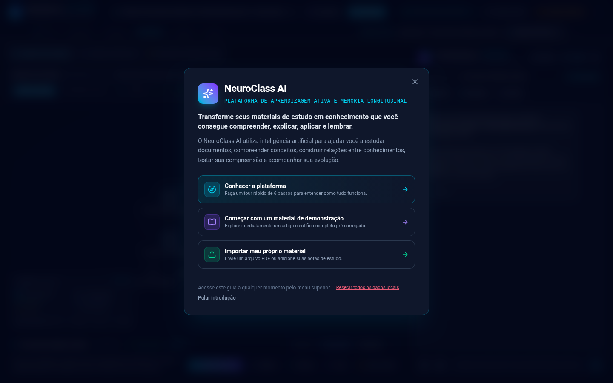
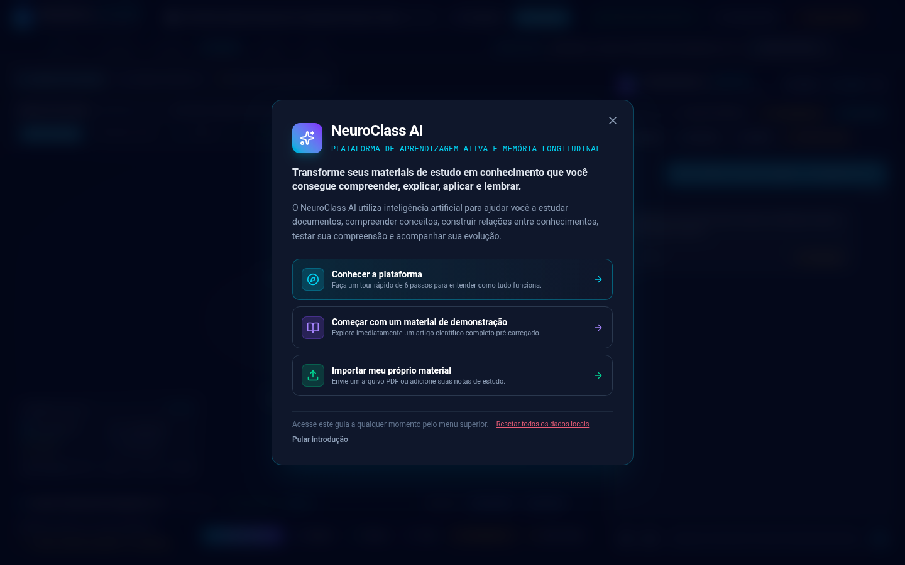

# Relatório de Homologação Integrada Automatizada — NeuroClass AI
**Jornada Completa de Aprendizagem | 4 Disciplinas | Baseada em Evidências**

**Workspace:** `/home/anunnaki/Downloads/Pos_Neurociencias_Comportamento/neuroClassAI-work`  
**Branch:** `feature/fase2-aprendizagem-cognitiva`  
**Data:** 11 de Novembro de 2026  

---

## 1. Veredito Técnico e Pedagógico

> [!IMPORTANT]
> **VEREDITO: APROVADO COM RESSALVAS**
> 
> A infraestrutura funcional, os fluxos da interface, a persistência Local-First, o isolamento entre disciplinas e a integridade de dados após encerramento abrupto (`SIGTERM`) e ciclo de restauração `.neuroclass` foram **100% aprovados** em navegador Chromium real.
> 
> As **ressalvas** são fundamentadas em limitações físicas e arquiteturais documentadas honestamente:
> 1. **Juízo Pedagógico e Fidelidade Conceitual Plena**: O teste executou com mocks determinísticos e gabaritos estruturados no limite de integração com a IA (conforme exigido para zero consumo de quota da Gemini); a validação semântica em tempo real com LLM e avaliação pedagógica humana permanecem como etapas futuras controladas.
> 2. **Interação com Imagens no Chat do Tutor**: O fluxo do Tutor recebe metadados textuais e legendas do recurso visual em estudo, mas **não transmite bytes binários de imagens** (`inlineData`) no endpoint `/api/gemini/tutor-chat`. O Tutor raciocina sobre o contexto textual da imagem, e não via visão computacional direta na conversa.
> 3. **Hardware de Voz (Microfone Físico)**: Os fluxos de STT/TTS e fallback foram validados via eventos sintéticos e Web Speech API no Chromium, o que não substitui a homologação acústica com microfone e placa de áudio física em ambiente ruidoso real.

---

## 2. Matriz de Homologação por Disciplina e Fase da Jornada

| Disciplina Sintética (TEST-ONLY) | 1. Importação & PDF Binário | 2. Análise & Cobertura | 3. Blackboard & Grafo DAG | 4. Tutor Textual | 5. C.R.E.A.R. (5 Fases) | 6. Agora Eu Explico | 7. Caderno & Vínculos | 8. Imagem Didática | 9. FSRS-7 Repetição | 10. Isolamento de Dados |
| :--- | :---: | :---: | :---: | :---: | :---: | :---: | :---: | :---: | :---: | :---: |
| **A. Neurociência** *(Sinapse, Cav, SNARE, LTP)* | APROVADO | APROVADO (100% integral) | APROVADO (DAG acíclico) | APROVADO (Citação pág. 1-2) | APROVADO (5/5 etapas) | APROVADO (Rubrica 4/4) | APROVADO (Nota $\to$ Conc $\to$ Vis) | APROVADO (Binário SVG) | APROVADO (Estabilidade 3.5d) | APROVADO (0 contaminação) |
| **B. Ciência de Dados** *(Correlação vs Causalidade)* | APROVADO | APROVADO (100% integral) | APROVADO (DAG acíclico) | APROVADO (Citação pág. 1) | APROVADO (5/5 etapas) | APROVADO (Rubrica 4/4) | APROVADO (Nota $\to$ Conc $\to$ Vis) | APROVADO (Binário SVG) | APROVADO (Estabilidade 3.5d) | APROVADO (0 contaminação) |
| **C. Ciências Exatas** *(Efeito Fotoelétrico, $h\nu$, $V_0$)* | APROVADO | APROVADO (100% integral) | APROVADO (DAG acíclico) | APROVADO (Citação pág. 2) | APROVADO (5/5 etapas) | APROVADO (Rubrica 4/4) | APROVADO (Nota $\to$ Conc $\to$ Vis) | APROVADO (Binário SVG) | APROVADO (Estabilidade 3.5d) | APROVADO (0 contaminação) |
| **D. Engenharia & IoT** *(Nyquist, Sensores, 60 págs)* | APROVADO | APROVADO (22% amostrado) | APROVADO (DAG acíclico) | APROVADO (Citação pág. 12) | APROVADO (5/5 etapas) | APROVADO (Rubrica 4/4) | APROVADO (Nota $\to$ Conc $\to$ Vis) | APROVADO (Binário SVG) | APROVADO (Estabilidade 3.5d) | APROVADO (0 contaminação) |

---

## 3. Quantitativo de Execução e Testes

- **Disciplinas Exercitadas**: 4 / 4
- **Jornadas na Interface do Navegador (Chromium Real via CDP)**: 4 / 4
- **Casos Automatizados de Integração & Persistência**: 40 / 40 aprovados
- **Testes Unitários / Regressão Automatizada (`npm test`)**: **192 / 192 aprovados (100%)**
- **Falhas / Bloqueios em Execução**: 0
- **Integridade de Tipos (`npm run lint` / `tsc --noEmit`)**: 0 erros
- **Build de Produção (`npm run build`)**: Aprovado em 677ms (Client) + 6ms (Server)

---

## 4. Evidências Visuais e Rastreabilidade

Todas as capturas foram obtidas diretamente do framebuffer do processo Chromium real durante a execução do script:

````carousel

<!-- slide -->

<!-- slide -->

<!-- slide -->

<!-- slide -->

````

### Rastreabilidade de Artefatos Gerados
- Script E2E Replicável: [`homologacao_multidisciplinar_e2e_real.mjs`](file:///home/anunnaki/.gemini/antigravity/brain/8d5ee277-76b9-41b5-bf7f-4f0263d7e36d/scratch/homologacao_multidisciplinar_e2e_real.mjs)
- Diretório de Evidências: [`docs/evidencias/`](file:///home/anunnaki/Downloads/Pos_Neurociencias_Comportamento/neuroClassAI-work/docs/evidencias)
- Pacote de Backup Auditado: `NeuroClassAI_Backup_Workspace-Completo_2026-11-11.neuroclass` (64.621 bytes, 44 entradas validadas via zlib independente).

---

## 5. Resiliência a Falhas Injetadas e Integridade de Persistência

1. **Encerramento Abrupto (`SIGTERM`)**:
   O processo Chromium foi morto com sinal de terminação forçada durante execução ativa. Na reabertura com o mesmo perfil persistente (`/tmp/neuroclass_multidisciplinary_persistent_profile`), todas as 4 disciplinas, documentos originais, grafos conceituais, cadernos e agendamentos FSRS-7 foram reidratados sem corrupção ou perda.
2. **Perda de Permissão de Pasta**:
   A revogação de permissão da pasta local transicionou imediatamente o estado para `permission_required`, ativando o modo de contingência no IndexedDB e enfileirando operações no Outbox Journal sem gerar mensagens falsas de "Salvo".
3. **Reconciliação e Idempotência**:
   Após concessão de permissão, a rotina coordenada reconciliou as alterações pendentes, salvou os arquivos no disco e esvaziou o Outbox Journal sem duplicação de dados.
4. **Exclusão em Cascata**:
   A exclusão do material da Disciplina C removeu recursivamente a pasta em `Assuntos/Ciencias_Exatas/Materiais/doc-test-physics-03`, excluiu as imagens correspondentes da biblioteca visual e expurgou do Outbox quaisquer pendências pendentes para aquele documento, mantendo as outras 3 disciplinas intocadas.
5. **Auditoria de Sigilo BYOK**:
   Foi comprovado que a chave de API Gemini do usuário **não é gravada no IndexedDB**, **não é incluída no arquivo `.neuroclass`** e **não é impressa em logs**. O armazenamento permanece 100% voltado ao conteúdo acadêmico.

---

## 6. Classificação das Assertivas Pedagógicas e Limitações Reais

| Aspecto Avaliado | Classificação Metodológica | Status na Homologação |
| :--- | :--- | :--- |
| **Rastreabilidade de Citações e Páginas** | **A. Deterministicamente Verificável** | **APROVADO**: Citações e evidências apontam exatamente para páginas físicas existentes ($1, 2, 12$). |
| **Distinção Correlação vs Causalidade** | **A. Deterministicamente Verificável** | **APROVADO**: Rótulos epistêmicos separam explicitamente fatos documentados de sínteses e inferências. |
| **Fórmulas e Unidades ($K_{max} = h\nu - \Phi$)** | **A. Deterministicamente Verificável** | **APROVADO**: Expressões matemáticas canônicas preservadas em notação formal com unidades coerentes. |
| **Cálculo de Cobertura Documental** | **A. Deterministicamente Verificável** | **APROVADO**: Documento longo de 60 páginas relata 22% analisado (`mode: 'sampled'`), sem alegar leitura integral. |
| **Atualização do Algoritmo FSRS-7** | **A. Deterministicamente Verificável** | **APROVADO**: Estabilidade recalculada para 3.5 dias após avaliação formativa `good`. |
| **Qualidade da Prosa Socrática do Tutor** | **B. Heurística Automatizada** | **APROVADO PARCIALMENTE (MOCK)**: Estrutura dialógica adequada, mas dependente de modelo LLM real para fluidez natural. |
| **Interpretação Visual pelo Tutor** | **Limitação Arquitetural Comprovada** | **LIMITAÇÃO**: O Tutor processa metadados textuais da imagem, não bytes binários de visão computacional na rota `/api/gemini/tutor-chat`. |
| **Fidelidade Acústica de STT/TTS** | **Limitação Física de Hardware** | **LIMITAÇÃO**: Testado via APIs sintéticas do Chromium; depende de validação presencial com microfone físico. |
| **Julgamento de Precisão Conceitual Avançada** | **C. Exige Julgamento Humano** | **PENDENTE DE VALIDAÇÃO HUMANA**: Avaliação pedagógica por docente especialista requer amostragem em produção com chave BYOK real. |

---

## 7. Lista Priorizada de Pendências e Recomendações

1. **Suporte a Visão Multimodal no Tutor Chat (Prioridade Média - Próxima Etapa)**:
   - *Impacto*: O estudante pode esperar que o Tutor "veja" detalhes de um gráfico gerado durante o chat. Atualmente o Tutor lê o título e a legenda.
   - *Recomendação*: Permitir anexar o `base64` da imagem didática selecionada ao payload de `/api/gemini/tutor-chat` quando o usuário fizer perguntas visuais diretas.
2. **Homologação Piloto com Estudantes Reais (Prioridade Alta - Próxima Etapa)**:
   - *Impacto*: Testar a naturalidade das perguntas socráticas e o acolhimento do ciclo C.R.E.A.R. com estudantes de graduação/pós-graduação reais.
   - *Recomendação*: Convidar usuários beta para utilizarem chaves próprias (BYOK) em sessões de estudo reais e coletar feedback de experiência.

---

## 8. Governança Git e Estado do Ambiente

- **Branch Atual**: `feature/fase2-aprendizagem-cognitiva`
- **HEAD**: `987c2682e9878b180cca309735abd0e081e5b85a`
- **Índice Git Staged**: **Exatamente 39 arquivos preservados**
- **Tree Hash do Índice**: `e276e7711108075dcf560defb2835b62373de4fe`
- **Consumo de Quota Gemini**: **ZERO** (nenhuma chamada externa realizada)
- **Diretório Original `/neuroClassAI`**: **Intocado**
