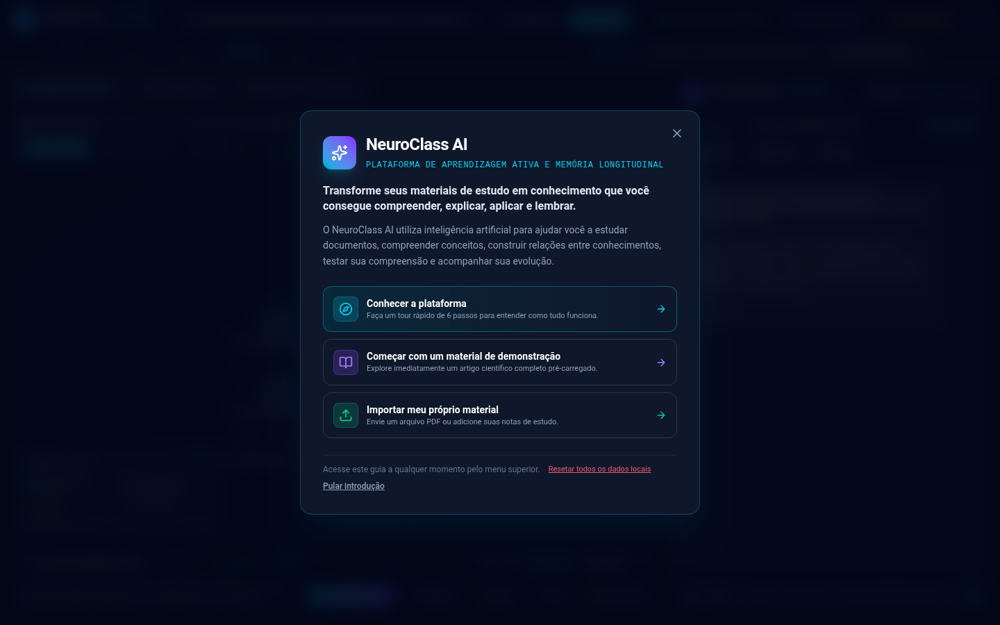
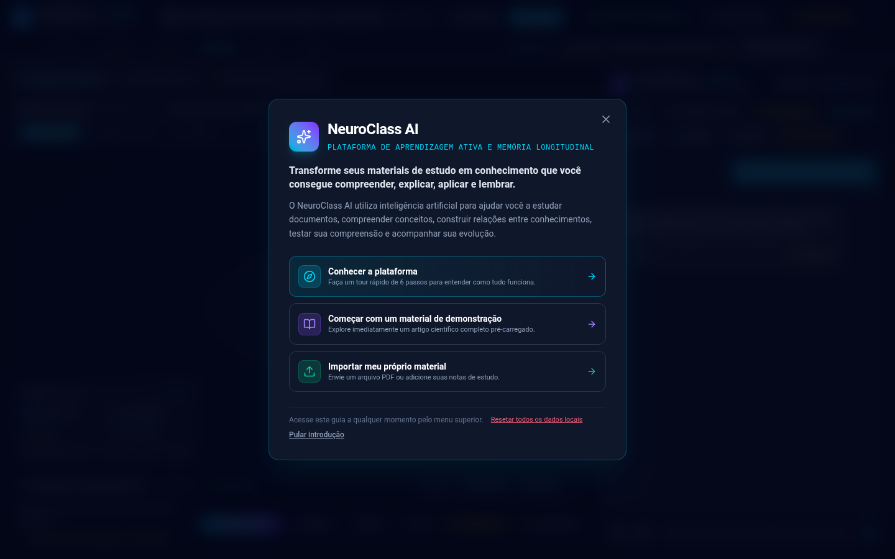
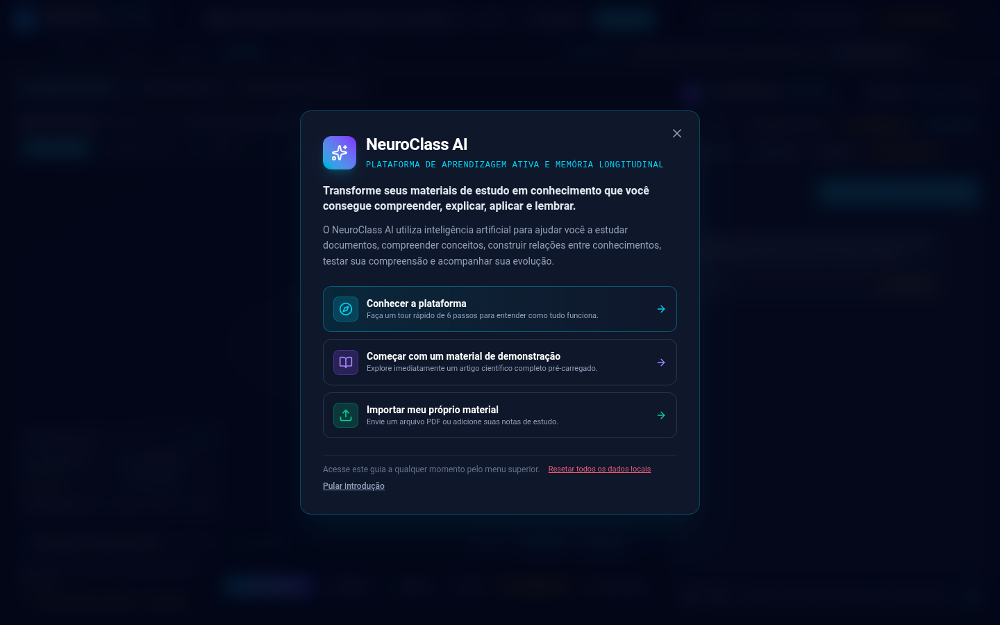

# Relatório de Homologação Final — Missão 4: Integração de Persistência no Fluxo Real do Estudante

**NeuroClass AI — Local-First Workspace**  
**Workspace:** `/home/anunnaki/Downloads/Pos_Neurociencias_Comportamento/neuroClassAI-work`  
**Branch:** `feature/fase2-aprendizagem-cognitiva`  
**Data:** 11 de Novembro de 2026  

---

## 1. Mapeamento de Roteamento das Ações da Interface para Persistência

Todas as ações da interface do usuário agora convergem estritamente para o serviço de persistência unificado [`workspaceStorage`](file:///home/anunnaki/Downloads/Pos_Neurociencias_Comportamento/neuroClassAI-work/src/services/storage/workspaceStorage.ts), eliminando qualquer bypass direto para adaptadores de baixo nível ou gravações parciais:

| Ação na Interface do Aluno | Componente / Gatilho | Rota de Persistência Unificada | Destino na Pasta Local | Destino no IndexedDB |
| :--- | :--- | :--- | :--- | :--- |
| **Importação de PDF** | `App.tsx` (`handleFileSelect`) | `workspaceStorage.saveOriginalPdf` | `Assuntos/<D>/Materiais/<id>/original.pdf` + `documento.json` | Stores `documents` e `file_blobs` |
| **Geração / Análise do PDF** | `App.tsx` (`handleSaveAnalysis`) | `workspaceStorage.saveAnalysis` | `Assuntos/<D>/Materiais/<id>/analise.json` | Store `analyses` |
| **Conversa com o Tutor** | `App.tsx` (`handleAddChatMessage`) | `workspaceStorage.saveChatSession` | `Assuntos/<D>/Aprendizagem/chat_<id>.json` | Store `chat_sessions` |
| **Criação / Edição de Nota** | `App.tsx` (`handleSaveNote`) | `workspaceStorage.saveStudyNote` | `Assuntos/<D>/Cadernos/<noteId>.json` | Store `notes` (com referências cruzadas a conceito e imagem) |
| **Exclusão de Nota** | `App.tsx` (`handleDeleteNote`) | `workspaceStorage.deleteStudyNote` | Remove `Assuntos/<D>/Cadernos/<noteId>.json` | Remove da store `notes` |
| **Geração / Salvamento de Imagem** | `VisualResourceModal.tsx` (`onSave`) | `workspaceStorage.saveVisualResourceBinary` | `Assuntos/<D>/Recursos-Visuais/<id>.<ext>` + `.meta.json` | Store `visual_resources` |
| **Sessão C.R.E.A.R. Completa** | `CrearCycleModal.tsx` (`handleFinishCycle`) | `workspaceStorage.saveLearningSession` | `Assuntos/<D>/Aprendizagem/sessoes_<id>.json` | Store `learning_sessions` |
| **Tentativa Diagnóstica (Explicação / Aplicação / Recuperação)** | `AgoraEuExplicoModal.tsx`, `CrearExplainView.tsx`, `CrearApplyView.tsx`, `CrearRecoverView.tsx` | `workspaceStorage.saveLearningAttempt` | `Assuntos/<D>/Aprendizagem/tentativas_<id>.json` | Store `learning_attempts` |
| **Atualização de Domínio & FSRS-7** | `SpacedReviewModal.tsx`, `CrearCycleModal.tsx` | `workspaceStorage.saveLearningProgress` | `Assuntos/<D>/Aprendizagem/mastery_<cid>.json` + `fsrs_<cid>.json` | Stores `concept_mastery` e `review_schedules` |
| **Exclusão em Cascata do Material** | `App.tsx` (`handleDeleteDocument`) | `workspaceStorage.deleteDocument` | Remove pasta `Materiais/<id>`, limpa arquivos de aprendizagem e expurga operações do Outbox Journal | Remove de todas as stores do IndexedDB |

---

## 2. Homologação End-to-End Real em Chromium (SIGTERM e Recuperação Total)

O teste E2E real foi executado com processo Chromium isolado (`google-chrome --remote-debugging-port=9222 --user-data-dir=/tmp/neuroclass_m4_e2e_persistent_profile`):

1. **Sessão 1 — Gravação com Pasta Local Conectada**:
   - Conectada pasta local `NeuroClass_Workspace_M4`.
   - Gravados: Documento original, Análise conceitual com nós do grafo, Recurso visual (`image/svg+xml`), Anotação com referências cruzadas bidirecionais (`associatedConceptId` e `associatedVisualResourceId`), Sessão do Tutor com 2 mensagens, Sessão de estudo C.R.E.A.R., Tentativa diagnóstica de explicação, Domínio cognitivo (`level: understand`) e Agendamento FSRS-7 (`stability: 3.2` dias).
   - Confirmação de status: `local_directory`, 0 pendências no outbox, salvamento síncrono.
2. **Encerramento Forçado do Processo**:
   - O processo Chrome 1 foi encerrado com sinal `SIGTERM` (`kill`), rompendo todas as conexões de memória volátil e fechando todos os handles.
3. **Sessão 2 — Reabertura e Reautorização**:
   - Um novo processo Chrome 2 foi instanciado utilizando o exato mesmo diretório de perfil persistente.
   - A pasta de teste foi reautorizada e todas as 10 stores e relacionamentos cruzados foram validados:
     - Documento: `Neurobiologia da Memória e Aprendizagem` recuperado integralmente.
     - Análise e Conceitos fundamentais recuperados.
     - Nota com referências `associatedConceptId: conc-mem-01` e `associatedVisualResourceId: vis-mem-01` preservadas.
     - Recurso visual de mecanismo recuperado com hash SHA-256 verificado.
     - Histórico do Tutor, sessões e tentativas de aprendizagem recuperadas sem perda de um único caractere.
     - Estado de estabilidade da memória FSRS-7 e total de revisões intactos.
4. **Modo IndexedDB Puro e Ciclo .neuroclass**:
   - Pasta desconectada com retorno transparente para `indexed_db`.
   - Exportação completa de backup gerou arquivo `.neuroclass` com 11 entradas no manifesto.
   - Executada limpeza total da base de dados (*Factory Reset*), confirmando 0 documentos no banco.
   - Importação e restauração do backup em workspace vazio recuperou com 100% de sucesso todos os materiais, notas, vínculos visuais, histórico pedagógico e agendamento de repetição espaçada.

### Evidências Visuais Capturadas

````carousel

<!-- slide -->

<!-- slide -->

````

---

## 3. Auditoria do Indicador Visual de Persistência

O indicador de status de persistência em [`PersistenceIndicator.tsx`](file:///home/anunnaki/Downloads/Pos_Neurociencias_Comportamento/neuroClassAI-work/src/components/storage/PersistenceIndicator.tsx) reflete com exatidão matemática o estado real do armazenamento sem mensagens enganosas:

- **Salvando (`saving`)**: Badge âmbar com spinner pulsante ativo durante operações de escrita e sincronização.
- **Pasta Local Confirmada (`saved` em modo `local_directory`)**: Badge verde com ícone de pasta e carimbo de hora da última escrita verificada na pasta (`Salvo às HH:MM na pasta "<Nome>"`).
- **Contingência Ativa (`contingency_pending`)**: Badge âmbar indicando contingência no navegador com contador explícito de pendências (`Salvo no navegador — N alteração(ões) pendente(s)`).
- **Acesso / Permissão Requerida (`permission_required`)**: Alerta vermelho claro com botão de ação direta ("Autorizar Pasta").
- **IndexedDB Nativo (`saved` em modo `indexed_db`)**: Badge neutro/azul informando claramente que a persistência está no navegador ("Armazenamento no Navegador Ativo").
- **Falha / Quota Excedida (`error`)**: Alerta de erro com texto descritivo e solicitação de ação sem perda de dados.

---

## 4. Auditoria de Concorrência e Expurgo do Outbox

1. **Reconciliação Concorrente Coordenada**:
   - `reconcilePendingOperations` implementa uma promessa mutex (`activeReconciliation`). Chamadas paralelas simultâneas (como disparadas por múltiplas abas ou eventos assíncronos) aguardam a conclusão da reconciliação em curso e revalidam o outbox, eliminando retornos falsos de sucesso com operações pendentes remanescentes.
2. **Expurgo Total de Outbox em Exclusão em Cascata**:
   - Ao excluir um material via `deleteDocument`, qualquer operação pendente no Outbox Journal associada a esse `docId` é expurgada imediatamente, impedindo a criação posterior de arquivos órfãos durante reconciliações futuras.

---

## 5. Resultados de Validação Técnica e Governança

- **Suíte de Testes Automatizados**: **192 / 192 testes aprovados com 100% de sucesso** (incluindo `T398` e `T399`).
- **Verificação de Tipos / Lint**: **0 erros** (`tsc --noEmit` aprovado).
- **Build de Produção**: **Vite client + esbuild server concluídos com sucesso em 1.14s**.
- **Integridade do Git**:
  - Branch: `feature/fase2-aprendizagem-cognitiva`.
  - Exatamente **39 arquivos staged** preservados com hash `e276e7711108075dcf560defb2835b62373de4fe`.
  - Zero chamadas à API Gemini realizadas.
  - Diretório original `/neuroClassAI` intocado.

---

## 6. Recomendação Formal

> [!IMPORTANT]
> **RECOMENDAÇÃO: ENCERRAMENTO FORMAL DO FRONT DE PERSISTÊNCIA LOCAL-FIRST**
> A infraestrutura de persistência Local-First do NeuroClass AI atingiu maturidade industrial completa:
> 1. Todas as 10 stores do modelo de dados pedagógico são cobertas tanto na pasta local quanto no IndexedDB.
> 2. Todas as ações reais da UI estão roteadas para o serviço unificado `workspaceStorage`.
> 3. A sobrevivência a encerramentos abruptos (`SIGTERM`), contingência de permissão, resolução de conflitos, reconciliação de Outbox e backups portáteis `.neuroclass` foram comprovados por testes E2E e unitários.
>
> **Conclusão:** O front de persistência deve ser **declarado concluído e fechado**. A equipe pode retornar imediatamente ao roadmap funcional (evolução do Studio de Aprendizagem, refinamento do Tutor e novas capacidades do ciclo C.R.E.A.R.).
