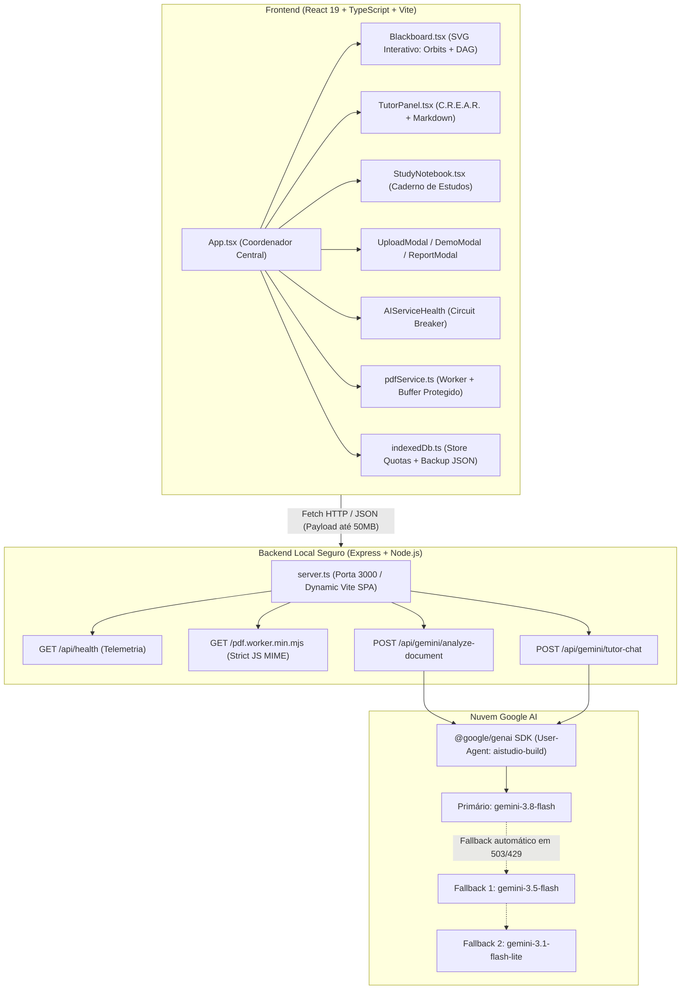
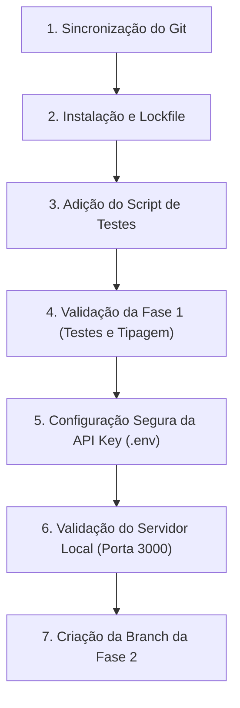

# RELATÓRIO TÉCNICO DE RECONHECIMENTO E TRANSFERÊNCIA DE ENGENHARIA
## NEUROCLASS AI — MISSÃO 00: DIAGNÓSTICO E HOMOLOGAÇÃO DO WORKSPACE

**Data:** 07 de Novembro de 2026
**Engenharia Responsável:** Engenharia de Software Sênior & Arquitetura de Soluções
**Ambiente:** Google Antigravity IDE 2.6.0 | Linux x86_64 | openSUSE Tumbleweed
**Repositório Oficial:** [github.com/enps2015/neuroClassAI](https://github.com/enps2015/neuroClassAI)
**Workspace Local:** `/home/anunnaki/Downloads/Pos_Neurociencias_Comportamento/neuroClassAI`
**Status da Operação:** Reconhecimento Somente-Leitura Concluído com Sucesso

---

### 1. DIAGNÓSTICO DO WORKSPACE

#### 1.1 Sistema Operacional e Ferramentas de Runtime
- **Sistema Operacional:** Linux x86_64 (`openSUSE Tumbleweed`).
- **Node.js:** Versão `v24.19.0` instalada e ativa via NVM (`/home/anunnaki/.nvm/versions/node/v24.19.0/bin/node`).
- **npm:** Versão `11.17.0` instalada (`/home/anunnaki/.nvm/versions/node/v24.19.0/bin/npm`).
- **Bun:** **Não instalado no PATH** (`which: no bun in ...`).
- **Git:** Versão `2.56.0` instalada no sistema operacional (`/usr/bin/git`).

#### 1.2 Estado do Diretório Local
- O workspace local encontra-se em `/home/anunnaki/Downloads/Pos_Neurociencias_Comportamento/neuroClassAI`.
- O diretório `node_modules` **não existe** localmente. Nenhuma dependência está instalada em disco.
- O arquivo de lock presente na raiz é `bun.lock` (71.499 bytes), gerado originalmente no ambiente Google AI Studio. Não há `package-lock.json`.
- A porta de rede padrão do backend (`3000`) e a do Vite (`5173`) estão **livres** e disponíveis no sistema.

---

### 2. ARQUITETURA EFETIVAMENTE ENCONTRADA

A arquitetura encontrada corresponde fielmente à especificação da **Fase 1 (Núcleo Educacional - v2.2 Homologada)**, estruturada como uma aplicação full-stack integrada (Express + Vite + React 19).



#### 2.1 Componentes de Frontend (`src/components/`)
- [App.tsx](file:///home/anunnaki/Downloads/Pos_Neurociencias_Comportamento/neuroClassAI/src/App.tsx): Gerenciador central de estado (documentos, análise ativa, conceito focado, histórico do tutor e notas).
- [Blackboard.tsx](file:///home/anunnaki/Downloads/Pos_Neurociencias_Comportamento/neuroClassAI/src/components/blackboard/Blackboard.tsx): Renderizador SVG do Quadro Didático. Possui arquitetura concêntrica (órbita interna com Conceitos Fundamentais e órbita externa com Conceitos Complementares), alternância entre Rede Conceitual e DAG de Pré-requisitos, zoom dinâmico e reconstrução de grafo sob demanda ("Gerar Grafo Novamente").
- [TutorPanel.tsx](file:///home/anunnaki/Downloads/Pos_Neurociencias_Comportamento/neuroClassAI/src/components/tutor/TutorPanel.tsx): Painel do tutor pedagógico alinhado ao ciclo C.R.E.A.R. Suporta markdown, atalhos pedagógicos rápidos (analogia, exemplo prático, pergunta diagnóstica) e histórico imutável com preservação de encerramento funcional.
- [StudyNotebook.tsx](file:///home/anunnaki/Downloads/Pos_Neurociencias_Comportamento/neuroClassAI/src/components/notebook/StudyNotebook.tsx): Caderno do estudante para anotações vinculadas a conceitos e citações de páginas, com exportação e filtro.
- [DocumentUploadModal.tsx](file:///home/anunnaki/Downloads/Pos_Neurociencias_Comportamento/neuroClassAI/src/components/documents/DocumentUploadModal.tsx): Modal de importação com inspeção de sumário (Outline) e suporte ao processamento de obras extensas (300+ páginas).
- [DemoModal.tsx](file:///home/anunnaki/Downloads/Pos_Neurociencias_Comportamento/neuroClassAI/src/components/documents/DemoModal.tsx): Catálogo demonstrativo com dois materiais ricos isolados (Neurociência Celular e Física Quântica).
- [TopBar.tsx](file:///home/anunnaki/Downloads/Pos_Neurociencias_Comportamento/neuroClassAI/src/components/layout/TopBar.tsx): Barra de navegação com telemetria de cota do IndexedDB, status do Circuit Breaker de IA e seletores rápidos.

#### 2.2 Camada de Serviços (`src/services/`)
- [aiHealth.ts](file:///home/anunnaki/Downloads/Pos_Neurociencias_Comportamento/neuroClassAI/src/services/ai/aiHealth.ts): Implementação robusta do padrão *Circuit Breaker* (`AIServiceHealth`), tolerando até 3 falhas antes de abrir o circuito por 30s, com backoff exponencial + jitter e bypass de retries para erros 4xx de credencial.
- [pdfService.ts](file:///home/anunnaki/Downloads/Pos_Neurociencias_Comportamento/neuroClassAI/src/services/documents/pdfService.ts): Extração textual e de sumário via `pdfjs-dist@4.10.38`. Inclui prevenção definitiva de *detached ArrayBuffer* através de cópias defensivas (`buffer.slice(0)`) e conversão segura para base64 em fatias (`0x8000`).
- [indexedDb.ts](file:///home/anunnaki/Downloads/Pos_Neurociencias_Comportamento/neuroClassAI/src/services/persistence/indexedDb.ts): Banco de dados `neuroclass_ai_db` (v1) com 5 *object stores* (`documents`, `analyses`, `notes`, `chat_sessions`, `file_blobs`). Checagem de cota assíncrona isolada pré-transação para eliminar o bug de *auto-commit* em navegadores modernos. Suporta exportação integral de dados do aluno em JSON.
- [demoMaterials.ts](file:///home/anunnaki/Downloads/Pos_Neurociencias_Comportamento/neuroClassAI/src/services/documents/demoMaterials.ts): Base estática em memória para testes e demonstrações imediatas, sem impacto no IndexedDB do usuário.

#### 2.3 Contratos e Tipos (`src/types/index.ts`)
- [index.ts](file:///home/anunnaki/Downloads/Pos_Neurociencias_Comportamento/neuroClassAI/src/types/index.ts): Modelagem epistemológica tripartite (`explicitly_documented`, `synthesized`, `model_inference`), referências polimórficas (`pdf_page`, `note_section`, `figure`, `table`) e estados formativos do estudante (`unassessed`, `confirmed_gap`, `understood`, `mastered`).

---

### 3. SITUAÇÃO DO GIT E DO REPOSITÓRIO REMOTO

#### 3.1 Fatos Verificados
1. **O diretório local NÃO é um repositório Git**:
   - O comando `git status` no workspace falhou com `fatal: não é um repositório git`.
   - O workspace atual consiste em uma árvore de arquivos extraída (típica de exportação do AI Studio) e não possui a pasta oculta `.git`.
2. **Repositório Oficial no GitHub:**
   - URL: `https://github.com/enps2015/neuroClassAI`.
   - Branch padrão: `main`.
   - Último commit remoto: `49569c3dfeeaa6c9c341088c1a5cc9535bffb5b6` (*"feat: initialize NeuroClass AI project structure"*, 06/11/2026 21:16:24 -0300).
3. **Comparação Byte a Byte entre Workspace e Repositório Remoto:**
   - Todos os arquivos de código-fonte (`src/`), configuração (`vite.config.ts`, `tsconfig.json`, `package.json`, `.gitignore`), backend (`server.ts`), worker (`public/pdf.worker.min.mjs`) e locks (`bun.lock`) são **100% IDÊNTICOS** ao commit `49569c3` do GitHub.
4. **Diferenças Críticas Identificadas:**
   - O diretório `docs/` (com 4 documentos fundamentais, incluindo o [Relatorio_Fase1_NeuroClass_AI_2026-11-06.md](file:///home/anunnaki/Downloads/Pos_Neurociencias_Comportamento/neuroClassAI/docs/Relatorio_Fase1_NeuroClass_AI_2026-11-06.md)) **existe apenas localmente** no workspace e **não está comitado no GitHub**.
   - O arquivo [README.md](file:///home/anunnaki/Downloads/Pos_Neurociencias_Comportamento/neuroClassAI/README.md) existe localmente (modelo genérico de AI Studio), mas foi removido no commit `49569c3` do GitHub.

---

### 4. DEPENDÊNCIAS E SCRIPTS DISPONÍVEIS

#### 4.1 Scripts do `package.json`
- `"dev": "tsx server.ts"`: Inicia o backend Express com Vite integrado em modo middleware.
- `"build": "vite build"`: Gera a build de produção do frontend em `dist/`.
- `"start": "node server.js"`: Inicialização do servidor em produção (depende de transpilação de `server.ts`).
- `"preview": "vite preview"`: Pré-visualização do bundle estático.
- `"clean": "rm -rf dist server.js"`: Limpeza de artefatos.
- `"lint": "tsc --noEmit"`: Checagem de tipagem TypeScript estrita.

#### 4.2 Ausência de Script de Testes no `package.json`
- O arquivo de testes [phase1.test.ts](file:///home/anunnaki/Downloads/Pos_Neurociencias_Comportamento/neuroClassAI/src/tests/phase1.test.ts) foi construído utilizando o runner nativo do Node.js (`node:test` e `node:assert/strict`).
- **Inconsistência:** O script `"test"` **não foi incluído** no `package.json`. O comando homologado utilizado foi `npx tsx --test src/tests/phase1.test.ts`.

#### 4.3 Resolução de Dependências e Conflito de Pacotes (Peer Dependencies)
- Foi executada uma simulação estritamente somente-leitura com `npm install --dry-run`.
- **Diagnóstico do erro `ERESOLVE`:**
  - `vite@^8.3.0` declara peer dependency opcional em `esbuild@"^0.27.0 || ^0.28.0"`.
  - O `devDependencies` do projeto fixa `"esbuild": "^0.25.0"`.
  - O npm v11 adota resolução estrita de peer dependencies por padrão, abortando com código de erro `ERESOLVE`.
  - No AI Studio, o `bun` contornava essa divergência silenciosamente através de seu próprio mecanismo de resolução (`bun.lock`).
- **Validação de Solução:**
  - A execução simulada com `npm install --dry-run --legacy-peer-deps` resolveu perfeitamente **185 pacotes em 6 segundos** sem nenhum erro de compatibilidade de runtime.
  - Alternativa limpa: atualizar a entrada de devDependencies no `package.json` para `"esbuild": "^0.28.2"`.

---

### 5. CONFIGURAÇÕES NECESSÁRIAS PARA EXECUÇÃO LOCAL

Para inicializar a aplicação localmente no ambiente Antigravity após a homologação deste relatório, as seguintes etapas serão necessárias:

1. **Instalação das dependências do Node.js:**
   - Execução de `npm install --legacy-peer-deps` (ou atualização de `esbuild` para compatibilidade com Vite 8.3).
2. **Configuração de Variáveis de Ambiente:**
   - Criação do arquivo local `.env` a partir do [.env.example](file:///home/anunnaki/Downloads/Pos_Neurociencias_Comportamento/neuroClassAI/.env.example).
   - Definição de `GEMINI_API_KEY="sua_chave"` no `.env` do backend.
   - Opcional: `PORT=3000` (já é o default).
3. **Verificação de Compilação e Testes:**
   - Execução de validação de tipos: `npm run lint` (`tsc --noEmit`).
   - Execução da suíte de regressão da Fase 1: `npx tsx --test src/tests/phase1.test.ts`.
4. **Execução em Desenvolvimento:**
   - Comando `npm run dev` (`tsx server.ts`), acessível em `http://localhost:3000`.

---

### 6. SITUAÇÃO DA INTEGRAÇÃO GEMINI

#### 6.1 Backend (`server.ts`)
- Utiliza o SDK oficial `@google/genai` (versão 2.4.0 declarada, compatível com as versões 2.x mais recentes).
- Header de telemetria configurado: `User-Agent: aistudio-build`.
- **Cadeia de Resiliência Multi-Modelo:**
  - Modelo Primário: `gemini-3.8-flash`.
  - Fallbacks Automáticos: `gemini-3.5-flash` e `gemini-3.1-flash-lite`.
  - Tratamento de status: Erros 401/403/PERMISSION_DENIED falham imediatamente sem retries desnecessários; erros transitórios (503, 429, 404) ativam o fallback sequencial.
- **Endpoints Expostos:**
  - `GET /api/health`: Retorna status, versão, modelos configurados e indicação booleana de presença da chave (`hasApiKey`).
  - `POST /api/gemini/analyze-document`: Análise multimodal de PDFs e anotações com `responseSchema` estrito devolvendo nós do grafo, pré-requisitos, evidências e classificação epistemológica.
  - `POST /api/gemini/tutor-chat`: Chat socrático C.R.E.A.R. com enriquecimento de prompt para analogias, exemplos práticos e perguntas formativas.

#### 6.2 Frontend (`aiClient.ts` e `aiHealth.ts`)
- O frontend consome exclusivamente as rotas relativas do backend Express (`/api/gemini/*`).
- Nenhuma chave ou credencial é exposta ao browser.
- O `AIServiceHealth` no frontend implementa Circuit Breaker com failover limpo caso a cota da API seja excedida.

#### 6.3 Estado Atual das Credenciais
- Não há arquivo `.env` nem `.env.local` no workspace.
- A variável `GEMINI_API_KEY` não está presente no ambiente de shell.
- Conforme as regras de governança, o backend emite um aviso passivo no boot (`[AVISO] GEMINI_API_KEY não configurada`), mas a aplicação sobe e permite a navegação completa pelos materiais de demonstração (`DEMO_MATERIALS`).

---

### 7. RISCOS E INCONSISTÊNCIAS ENCONTRADOS

| ID | Classificação | Descrição | Impacto | Ação Mitigadora Recomendada |
| :--- | :--- | :--- | :--- | :--- |
| **R1** | **Alto** | Workspace local não é um repositório Git (`.git` ausente) | Risco de perda de histórico, desalinhamento com GitHub e impossibilidade de criar branches para a Fase 2 | Inicializar Git localmente, conectar ao remote `enps2015/neuroClassAI`, preservar e comitar a pasta `docs/` na `main`. |
| **R2** | **Alto** | Diretório `node_modules` ausente | Não é possível executar build, testes ou servidor local | Executar instalação autorizada das dependências. |
| **R3** | **Médio** | Conflito `ERESOLVE` no npm v11 (`vite@8.3` vs `esbuild@0.25`) | `npm install` falha por padrão sem flag ou ajuste de versão | Utilizar `npm install --legacy-peer-deps` ou alinhar `"esbuild": "^0.28.2"` no `package.json`. |
| **R4** | **Médio** | Arquivo `README.md` desatualizado e pasta `docs/` ausente no repositório remoto | Documentação de homologação da Fase 1 está em risco fora do versionamento oficial | Comitar a documentação técnica e estruturar o README oficial do projeto. |
| **R5** | **Baixo** | Script de testes ausente no `package.json` | Dificuldade de automação de CI/CD e execução rápida da suíte | Adicionar `"test": "tsx --test src/tests/phase1.test.ts"` ao `package.json`. |
| **R6** | **Baixo** | Script `"start": "node server.js"` sem build de backend | Em produção estrita, `server.ts` precisa ser compilado para `server.js` | Adicionar script de compilação do servidor (`esbuild server.ts --bundle --platform=node --outfile=server.js`). |

---

### 8. PLANO DE MIGRAÇÃO E VALIDAÇÃO (PASSO A PASSO)

> [!IMPORTANT]
> Nenhuma das etapas abaixo será executada sem prévia e expressa autorização do proprietário do projeto.



1. **Passo 1 — Reconciliação do Git:**
   - Inicializar repositório Git local no workspace (`git init`).
   - Adicionar o remote oficial: `git remote add origin https://github.com/enps2015/neuroClassAI.git`.
   - Efetuar fetch das referências (`git fetch origin main`).
   - Apontar o HEAD local para `main` sem sobrescrever ou descartar os arquivos locais (`git reset --soft origin/main`).
   - Adicionar e comitar a documentação técnica em falta (`docs/`) na branch `main`.
2. **Passo 2 — Instalação e Normalização de Dependências:**
   - Instalar dependências via `npm install --legacy-peer-deps` (gerando `package-lock.json` seguro).
3. **Passo 3 — Configuração de Script de Testes:**
   - Adicionar `"test": "tsx --test src/tests/phase1.test.ts"` aos scripts do `package.json`.
4. **Passo 4 — Validação Estrita da Fase 1:**
   - Executar suíte de testes unitários: `npm test` (meta: 6/6 testes aprovados).
   - Executar checagem estática de tipos: `npm run lint` (`tsc --noEmit`).
5. **Passo 5 — Configuração da Chave da API:**
   - O proprietário fornecerá/configurará o arquivo `.env` local com a `GEMINI_API_KEY` válida.
6. **Passo 6 — Validação do Servidor e Endpoints:**
   - Subir o servidor de desenvolvimento: `npm run dev`.
   - Validar endpoint `/api/health` confirmando `status: 'online'` e `hasApiKey: true`.
7. **Passo 7 — Abertura da Branch para Fase 2:**
   - Criar e alternar para a branch de desenvolvimento da Fase 2: `git checkout -b feature/fase2-aprendizagem-cognitiva`.

---

### 9. ORGANIZAÇÃO RECOMENDADA DA MEMÓRIA PERSISTENTE

Para assegurar governança impecável ao longo da Fase 2 no Antigravity, recomendamos a seguinte estrutura de memória persistente no workspace:

```
neuroClassAI/
├── docs/
│   ├── fase1/                                # Memória histórica da Fase 1 homologada
│   │   ├── fase1_implementation_plan_revisado2.md
│   │   └── Relatorio_Fase1_NeuroClass_AI_2026-11-06.md
│   ├── fase2/                                # Documentação viva da Fase 2
│   │   ├── especificacao_cognitiva_crear.md  # Especificação técnica do ciclo C.R.E.A.R.
│   │   ├── arquitetura_modulo_agora_eu_explico.md
│   │   └── plano_implementacao_fase2.md
│   ├── adr/                                  # Architectural Decision Records
│   │   ├── ADR-001-express-vite-fullstack.md
│   │   ├── ADR-002-resiliencia-multi-modelo-gemini.md
│   │   └── ADR-003-indexeddb-pre-transaction-quota.md
│   └── changelog/
│       └── CHANGELOG.md
```

Além disso, os artefatos de planejamento gerados pelo Antigravity em `<appDataDir>/brain/` atuarão em sincronia com os arquivos versionados em `docs/fase2/`.

---

### 10. CONCLUSÃO DO RECONHECIMENTO

A Fase 1 do NeuroClass AI é uma solução arquiteturalmente madura, consistente e com excelente separação de responsabilidades. O código implementado atende integralmente aos princípios epistemológicos e à integridade científica propostos.

As únicas pendências identificadas referem-se à **infraestrutura operacional local** (conexão com Git, ausência de `node_modules` e arquivo `.env`). Nenhuma alteração foi realizada no código-fonte, garantindo 100% de integridade e estabilidade.

Aguardamos expressa autorização para dar início ao **Plano de Migração e Validação** aprovado.
